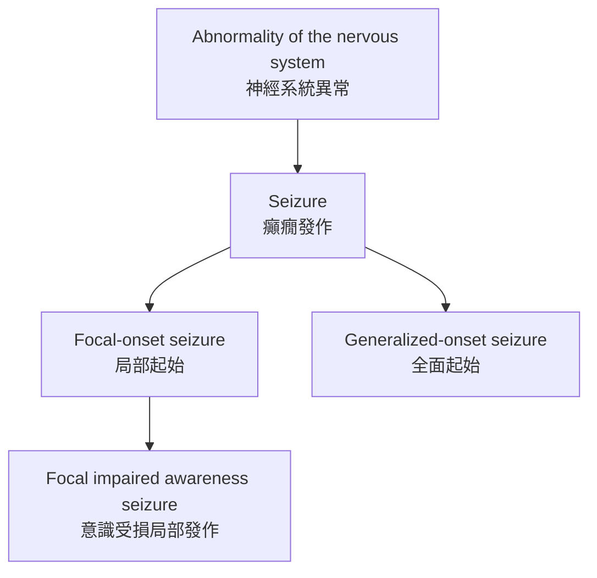
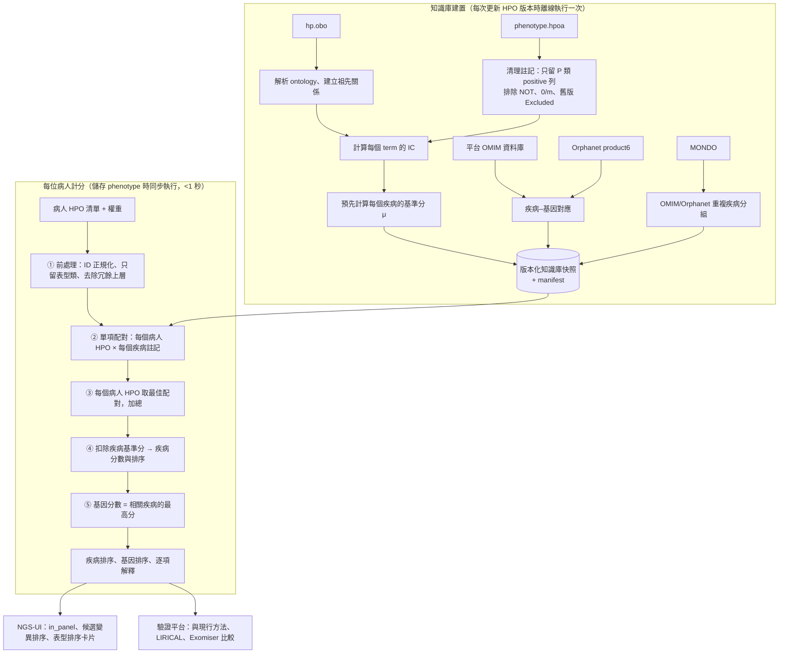

# 從 HPO 到疾病與基因排序：研究與實作計畫（第二版）

| 項目 | 內容 |
|---|---|
| 文件定位 | 給臨床醫師、遺傳諮詢師、生物資訊工程師與研究團隊共同閱讀的完整計畫書：說明要解決的問題、整體架構、每一步的概念與數學、資料處理、驗證方式，以及如何接進 NGS 分析平台 |
| 版本 | 第二版（2026-11-21）。第一版經兩位審查者交叉審查，並用真實資料與 400 例文獻病例實測後全面改寫；與第一版的差異整理在文末附錄 A |
| 研究範圍 | 從已整理好的 positive HPO terms 出發，產生疾病排序，再轉換為基因排序 |
| 暫不處理 | 從病歷自動擷取 HPO、negative HPO（病人明確沒有的表現）、變異致病性分數與表型分數的聯合模型 |
| 重要聲明 | 這是**待開發、待驗證的研究演算法**，輸出的是**排序分數，不是診斷機率**。文中的初步結果來自文獻病例的小規模實測，正式效能須依第 11 章的驗證計畫確認 |

---

## 0. 一頁摘要

**要解決的問題。** 醫師把病人的臨床表現轉成 HPO terms 之後，希望電腦能在一萬多種罕見疾病中，排出最能解釋這些表現的疾病和基因。平台現行的做法是「某基因的疾病是否註記了這個 HPO」的有或無查表：常見表現和罕見表現算同樣分數，病人寫得比資料庫更精確就對不上，每位病人有約 1,900–2,100 個基因得到分數，致病基因常與好幾個基因同分。

**方法（三步）。**

1. **單項配對**：病人的每個 HPO，和疾病的每個註記比較「兩者共同確認的資訊量」。兩者是上下層關係時給足共同部分的分數；不是上下層、只是同屬某個上層類別時給一半。
2. **疾病分數**：每個病人 HPO 只取最好的一項配對，全部加總；再**扣掉這個疾病面對隨便一組症狀時本來就會拿到的「基準分」**，避免註記很多的疾病不分青紅皂白地排在前面。
3. **基因分數**：一個基因取它所有相關疾病中最高的疾病分數，並記下是哪個疾病支持它。

每一個分數都能拆回「哪個病人 HPO 對上了疾病的哪個註記、為什麼給這個分數」。

**資料。** HPO 官方 ontology（`hp.obo`）與疾病表型註記（`phenotype.hpoa`），疾病–基因對應採平台的 OMIM 資料庫與 Orphanet。所有資料都版本化凍結，同樣輸入永遠得到同樣結果。

**驗證。** 主要用「舊版知識庫 + 之後才發表的病例」（time-split）避免「考古題考到原題」，並以院內已簽收的確診個案作為最終測試；對照組包括平台現行方法、LIRICAL 與 Exomiser。

**初步結果。** 400 例文獻病例的 time-split 實測中，致病基因排進前 10 名的比例：平台現行方法 54.5%，本計畫方法約 65%；以「真正答案平均排多前面」衡量（MRR）提升 +0.128（95% CI +0.098 至 +0.160）。

**第一版刻意不納入**疾病內發生率（frequency）與症狀自動分群：實測顯示前者在做完基準分校正後沒有額外幫助，後者在真實資料中幾乎不會觸發。兩者保留為後續研究分支。

---

## 1. 背景與目標

### 1.1 臨床需求

一位疑似罕見遺傳疾病的病人，可能同時有癲癇、發展遲緩、步態不穩等表現。醫師把這些表現轉為 HPO terms 後，希望電腦能：

1. 在上萬種候選疾病中，找出最能解釋病人表現的疾病；
2. 由疾病進一步指出相關基因，協助判讀 WES/WGS 的候選變異；
3. 說明每個排序結果的理由，讓判讀者能檢查、能不同意。

困難在於：

- **用詞層級不同。** 病人可能記錄「局部起始癲癇（Focal-onset seizure）」，疾病只註記「癲癇（Seizure）」；或反過來。兩者 ID 不同，但顯然相關。
- **表現的區辨力不同。** 「全面性發展遲緩」出現在上千種疾病，「嬰兒痙攣」只出現在少數疾病；兩者對縮小診斷範圍的價值差很多。
- **疾病註記的完整度不同。** 有些疾病列了將近 200 個表型，有些只有 3 個。列得多的疾病，比較容易「什麼都對得上」。

### 1.2 平台現況與限制

平台目前的表型分數（`backend/app/services/phenotype_scorer.py`）做法如下：

$$
\text{pheno\_score}(g)=100\times\frac{\sum_{h\in \text{病人 HPO 與 panel}} w_h\cdot \mathbf{1}[g \in \text{Genes}(h)]}{\sum_h w_h}
$$

其中 $\text{Genes}(h)$ 來自 HPO 官方檔 `phenotype_to_genes.txt`（某基因的任一疾病註記了 $h$ 或 $h$ 的下層 term，該基因就列在 $h$ 底下），$w_h$ 是使用者為每個 HPO 或 panel 設定的權重。分數大於 0 的基因被視為 `in_panel`，影響 SNV 主畫面篩選、CNV/SV 的 Clinical 分區、粒線體排序與 DOCX 報告的基因清單。

這個做法簡單透明，但有四個限制：

1. **只看有或無，不看區辨力。** 對上「全面性發展遲緩」和對上「嬰兒痙攣」得到一樣的分數。
2. **同分太多。** 實測每位病人約有 1,900–2,100 個基因分數大於 0；在 time-split 測試中，致病基因通常和約 9 個基因並列同分。
3. **病人寫得比資料庫精確時對不上。** 病人記錄「Focal impaired awareness seizure」，但某基因的疾病只註記「Seizure」時，這個基因不會出現在病人那個 term 底下，貢獻是 0。
4. **官方檔案含有不該計分的列。** `phenotype_to_genes.txt` 也收錄了「明確排除」（`NOT`）的註記與遺傳方式、發病年齡等非表型 term。抽查 2026-09 版：726 筆表型類 `NOT` 註記中，有 474 筆的（疾病, HPO）組合出現在官方檔裡。也就是說，現行分數會替「這個疾病明確**沒有**此表現」的基因加分。

平台另外已整合 LIRICAL 與 Exomiser（`backend/app/workers/exomiser_lirical.py`）。它們是需要 Java 與工作佇列的非同步作業，無法在判讀者每次修改 HPO 時即時重算，結果目前也不參與 `in_panel` 判斷。本計畫的引擎與它們**互補而非取代**（見第 10.6 節）。

### 1.3 目標與範圍

**目標：** 建立一個可解釋、可重現、不需訓練資料、能在每次儲存 phenotype 時同步計算（每位病人 1 秒以內）的表型排序引擎，取代現行的有或無查表，並以嚴謹的驗證證明它比現行方法好。

**範圍內：** positive HPO → 疾病排序 → 基因排序；知識庫建置與版本控制；驗證平台；與 NGS-UI 的整合。

**範圍外（第一版）：** 病歷自動擷取 HPO；negative HPO；疾病內發生率加權（列為研究分支）；變異證據與表型證據的聯合模型；把表型分數直接當成 ACMG PP4 證據。

### 1.4 設計原則

1. **可解釋**：每個疾病分數都能拆成每個病人 HPO 的貢獻，並說明是對上哪個疾病註記、什麼關係、給多少分。
2. **尊重 ontology 邏輯**：上下層關係、同層兄弟關係要用不同規則處理，規則要符合「有下層表現就一定有上層表現」這個基本邏輯。
3. **不需訓練資料**：所有參數都少而有臨床意義，可以用小規模驗證確認，不需要大量病例訓練模型。
4. **可重現**：知識庫、參數、程式版本全部凍結並記錄；同樣輸入永遠得到同樣排序。
5. **先證明再上線**：任何設計（包括本計畫自己的）都要在避免資料洩漏的驗證中勝過現行方法才能取代它；實測沒有幫助的設計，即使理論上合理也不放進第一版。

---

## 2. 基本概念

這一章先把概念講清楚，後面的公式都建立在這些概念上。

### 2.1 HPO 是一張有上下層關係的網，不是單純的症狀清單

HPO 的 term 之間有「是一種」（`is_a`）的關係。簡化示意：



實際的 HPO 是「有向無環圖」（DAG）：一個 term 可以有多個上層。名詞：

- **祖先（ancestor）**：沿著箭頭往上能到達的所有 term。Seizure 是 Focal-onset seizure 的祖先。
- **後代（descendant）**：往下能到達的所有 term。
- **兄弟／旁系（non-lineage）**：彼此都不是對方的祖先，例如 Focal-onset 與 Generalized-onset，它們共享上層 Seizure。

記號：$A(t)$ 表示 term $t$ **包含自己**在內的所有祖先；$\mathrm{Anc}(t)=A(t)\setminus\{t\}$ 是嚴格祖先。

**True-path rule（真路徑規則）**：如果一個人有某個表現，他一定也有這個表現的所有上層表現。有 Focal-onset seizure 的人，一定「有癲癇發作」。這條規則是後面所有配對邏輯的基礎。

### 2.2 疾病註記與「面向」（aspect）

`phenotype.hpoa` 的每一列代表「某疾病與某 HPO term 有關」。但 HPO 不只收錄臨床表型，還有其他面向：

| aspect | 意義 | 例子 | 本計畫如何使用 |
|---|---|---|---|
| P | 表型異常（Phenotypic abnormality，`HP:0000118` 子樹） | Seizure、Microcephaly | **配對與 IC 計算只用這一類** |
| I | 遺傳方式 | Autosomal recessive inheritance | 不參與配對；保留供未來與變異的接合型比對 |
| C | 臨床病程／發病年齡 | Infantile onset | 不參與配對；保留供未來的發病年齡模組 |
| M | 臨床修飾 | Episodic | 不參與配對 |
| H | 過去病史 | — | 不參與配對 |

另外，一列註記可能帶 `NOT`（明確排除：這個疾病**沒有**此表現），或頻率寫成 `0/m`（m 個病人中 0 人有）。這些是「沒有」的證據，**絕對不能當成支持證據**（第 4.3 節）。

### 2.3 資訊量（Information Content, IC）：這個表現有多能縮小診斷範圍？

令 $\mathcal{D}$ 是候選疾病全集、$N=|\mathcal{D}|$，$H_D$ 是疾病 $D$ 直接註記的表型集合。一個 term $t$ 的「疾病覆蓋率」是：

$$
p(t)=\frac{\#\{D\in\mathcal{D}:\ t\in A(H_D)\}}{N}
$$

也就是「有多少比例的疾病註記了 $t$ 或比 $t$ 更具體的 term」。資訊量定義為：

$$
IC(t)=-\ln p(t)
$$

$p$ 越小，IC 越大，代表這個表現越稀有、越有區辨力。用 2026-09 版資料（約 12,900 個疾病）實際算出的例子：

| HPO term | IC（nats） | 白話 |
|---|---:|---|
| Phenotypic abnormality（表型根節點） | 0.00 | 每個疾病都有，毫無區辨力 |
| Abnormality of the nervous system | 0.43 | 約 65% 的疾病 |
| Intellectual disability | 1.37 | 約 25% 的疾病 |
| Seizure | 1.43 | 約 24% 的疾病 |
| Global developmental delay | 1.51 | 約 22% 的疾病 |
| Ataxia | 2.20 | 約 11% 的疾病 |
| Focal-onset seizure | 3.43 | 約 3% 的疾病 |
| Myoclonic seizure | 3.78 | 約 2.3% 的疾病 |
| Infantile spasms | 4.38 | 約 1.3% 的疾病 |

因為祖先的覆蓋率一定不小於後代，所以 $IC(\text{祖先})\le IC(\text{後代})$ 永遠成立。IC 的上限是 $\ln N\approx 9.46$（只出現在一個疾病的 term）。

> **白話說明：** IC 衡量的是「如果病人有這個表現，候選疾病可以刪掉多少」。它是**跨疾病**的區辨力，和「某個疾病的病人中有多少比例出現這個表現」（發生率）是兩回事。

### 2.4 最具資訊量的共同祖先（MICA）

兩個 term $q$ 和 $d$ 的 MICA，是它們共同祖先中 IC 最高的那一個：

$$
m(q,d)=\arg\max_{a\in A(q)\cap A(d)} IC(a)
$$

- $q$ 和 $d$ 相同：MICA 就是它自己。
- $q$ 是 $d$ 的祖先（例如 $q$=Seizure、$d$=Focal-onset）：MICA 是 $q$。
- $q$ 和 $d$ 是兄弟（Focal-onset 與 Generalized-onset）：MICA 是 Seizure。

$IC(m(q,d))$ 可以理解為「$q$ 和 $d$ 共同確認的資訊量」：兩個表現在 Seizure 這一層是一致的，這一層的資訊是兩者共享的。

### 2.5 疾病內發生率（frequency）

$f(t,D)$ 表示「患有疾病 $D$ 的人中，有多少比例出現表現 $t$」。HPO 用三種方式記錄：精確分子分母（如 `7/13`）、百分比、或類別（Very rare 1–4%、Occasional 5–29%、Frequent 30–79%、Very frequent 80–99%、Obligate 100%）。

發生率在臨床上很有意義，但現有資料品質問題很多（許多分母只有 1–3 人、不同研究互相矛盾、OMIM 與 Orphanet 記錄方式不同）。實測顯示，在做完第 7 章的基準分校正後，加入發生率沒有額外幫助。因此**第一版排序不使用發生率**，只在解釋輸出中顯示原始發生率資訊；如何正確使用發生率列為研究分支（第 13.1 節）。

### 2.6 分數是排序分數，不是機率

本計畫產生的分數用來比較**同一位病人**的候選疾病和基因誰比較符合，不代表「得這個病的機率是幾 %」，不同病人之間的分數也不能直接比較。報告與介面上一律稱為「表型排序」。

---

## 3. 整體架構



純文字流程：

`病人 HPO → 前處理 → 單項配對 → 每項取最佳、加總 → 扣基準分 → 疾病排序 → 取最高 → 基因排序`

整個系統分成三個獨立的部分：

| 部分 | 何時執行 | 產出 |
|---|---|---|
| 知識庫建置 | 每次更新 HPO／OMIM／Orphanet 版本時，離線執行一次 | 版本化快照：IC、祖先關係、清理後的註記、疾病基準分、疾病–基因對應、manifest |
| 計分引擎 | 每次儲存病人 phenotype 時 | 疾病與基因排序、逐項解釋檔 |
| 驗證平台 | 開發期間與每次更換知識庫版本時 | 與各對照方法的比較報告 |

---

## 4. 知識庫建置

### 4.1 資料來源

| 資料 | 內容 | 用途 | 取得方式 |
|---|---|---|---|
| `hp.obo` | HPO term、名稱、同義詞、上下層關係、`alt_id`、obsolete／`replaced_by` | ontology、IC、MICA、ID 正規化 | HPO GitHub release |
| `phenotype.hpoa` | 疾病–HPO 註記、頻率、出處、證據等級、aspect | 疾病表型、IC 計算 | HPO GitHub release |
| 平台 OMIM 資料庫 | phenotype MIM ↔ 基因、`{}`／`?`／`[]` 標記 | OMIM 疾病–基因對應 | 既有（`backend/app/services/omim_db.py`） |
| Orphanet product6 | Orphanet 疾病–基因關聯、關聯類型與驗證狀態 | Orphanet 疾病–基因對應 | orphadata |
| MONDO | 疾病等價關係 | 找出 OMIM 與 Orphanet 的重複疾病 | MONDO release |
| HPO `genes_to_disease.txt` | 官方疾病–基因對應 | 與上述來源交叉比對（QC） | HPO GitHub release |
| phenopacket-store | 文獻病例的表型與致病基因 | 驗證（第 11 章），**不進知識庫** | GA4GH GitHub release |

### 4.2 `phenotype.hpoa` 欄位與用法

| 欄位 | 內容 | 本計畫用法 |
|---|---|---|
| `database_id` | `OMIM:…`、`ORPHA:…`、`DECIPHER:…` | 疾病 ID；DECIPHER 不進全集（第 4.4 節） |
| `disease_name` | 疾病名稱 | 顯示 |
| `qualifier` | 空白或 `NOT` | `NOT` 移到 negative 表 |
| `hpo_id` | HPO term | 經 `alt_id`／obsolete 正規化 |
| `reference` | 出處（PMID、OMIM 等） | 保留供解釋與驗證時排除洩漏 |
| `evidence` | IEA、PCS、TAS | 保留，供未來依證據強度加權的研究 |
| `onset` | 發病年齡 | 保留，第一版不用 |
| `frequency` | `n/m`、百分比、或 `HP:00402xx` 類別碼 | 第一版只用於判斷「是否為 0／Excluded」與解釋輸出 |
| `sex` | 性別限定 | 保留，第一版不用 |
| `modifier` | 修飾 | 保留，第一版不用 |
| `aspect` | P、I、C、M、H | **只有 P 進入配對與 IC** |
| `biocuration` | 整理者與日期 | 保留，驗證時用於 time-split 輔助判斷 |

### 4.3 清理規則

以下規則依序套用，每一條都要在建置 log 中記錄被影響的列數：

| 編號 | 規則 | 理由 |
|---|---|---|
| R1 | 只保留 `aspect = P` 的列 | 遺傳方式、病程等不是臨床表型，不應參與表型相似度 |
| R2 | `qualifier = NOT` 的列移到 negative 表 | 明確排除不是支持證據（2026-09 版有 733 列，全部來自 Orphanet） |
| R3 | `frequency = HP:0040285`（Excluded）的列移到 negative 表 | 2023 年以前的版本用這個方式表示排除（2023-10 版有 705 列寫成 qualifier 空白的 positive 列），用舊快照重跑時必須正確處理 |
| R4 | 頻率為 `0/m`（分子為 0）的列移到 negative 表 | 「m 人中 0 人有」等於沒有；2026-09 版有 3,072 列這種 qualifier 空白的列 |
| R5 | `hpo_id` 經 `alt_id` 對應到現行 ID；obsolete term 若有 `replaced_by` 則替換，否則捨棄並記錄 | 確保同一概念只有一個 ID |
| R6 | 只保留位於 `HP:0000118` 子樹內、且能沿上層關係到達根節點的 term；斷鏈 term 記錄於 QC 報告 | 2026-09 版發現至少一條斷鏈（HP:0012220 → HP:5210340），沒有防呆會讓 MICA 計算失敗 |
| R7 | 同一（疾病, HPO）的重複列合併為一筆；頻率以 $\sum n/\sum m$ 合併，類別衝突時標記 `conflict` | 2026-09 版有 446 組重複、327 組頻率互相矛盾 |
| R8 | 疾病端**保留所有直接註記**，不做祖先去冗餘 | 同一疾病同時註記 Seizure 與 Generalized-onset seizure 時，兩者都可能是某位病人的最佳配對；第 7.1 節的「每項只取最佳」已避免重複加分 |

negative 表（R2–R4）第一版不參與計分，但完整保存，供未來的 negative 證據研究使用。

### 4.4 疾病全集

**第一版全集 = 所有 OMIM 疾病 + 所有 Orphanet 疾病**，排除 DECIPHER（只有 47 個、多為早期自動註記、無基因對應）。

OMIM 與 Orphanet 有大量重複：依 MONDO 的等價關係，**48.8%（2,125 個）的 Orphanet 疾病和某個 OMIM 疾病是同一個疾病**，另有 558 個 Orphanet 條目是多個 OMIM 疾病的上層分組。處理方式：

1. **計分時兩者分開計算。** 同一疾病在兩邊的註記內容差異很大（直接註記集合的 Jaccard 相似度中位數只有 0.20），分開計算可以讓兩份註記各自發揮。
2. **IC 計算使用原始全集。** 實測依 MONDO 合併後 IC 幾乎是整體平移（多數 term 約 −0.185），對排序影響很小；合併版 IC 列為研究分支（第 13.4 節）。
3. **顯示時依 MONDO 分組。** 排序清單中，同一 MONDO 疾病的 OMIM 與 Orphanet 條目合併為一列，顯示較高分的那一筆，另一筆收在展開資訊中，避免清單重複。
4. **基因對應取聯集**（第 4.6 節）。

### 4.5 IC 計算

依第 2.3 節的公式，在清理後的全集上計算每個 term 的 $p(t)$ 與 $IC(t)$。

**沒有任何疾病註記的 term（$p=0$）。** 2026-09 版 `HP:0000118` 子樹中有 6,418 個 term（33.5%）沒有任何疾病註記到它或它的後代，IC 無定義。病人卻可能選到這些 term（例如很細的 ILAE 癲癇分類）。本計畫的配對公式（第 6 章）**只會用到 MICA 的 IC**，而 MICA 一定是某個有註記疾病的祖先，IC 必定有定義，所以這些 term 仍能透過它們的上層正常計分，不會被丟掉。只有在計算「解釋比例」（第 7.5 節）時需要 term 本身的資訊量，這時定義：

$$
IC^{\ast}(q)=\begin{cases}IC(q), & p(q)>0\\ \max\{IC(a): a\in A(q),\ p(a)>0\}, & p(q)=0\end{cases}
$$

也就是用「最具資訊量的、有註記的上層」代替。

**建置時的 QC 檢查：**

- 每個 term 都能到達根節點（否則記錄並排除）；
- 對所有上下層 pair，$IC(\text{祖先})\le IC(\text{後代})$；
- 根節點 `HP:0000118` 的 IC = 0；
- 記錄 $N$、有 IC 的 term 數、$p=0$ 的 term 數。

### 4.6 疾病–基因對應

| 來源 | 納入規則 | 排除 |
|---|---|---|
| OMIM（平台 OMIM 資料庫） | phenotype MIM ↔ 基因；一般疾病納入；`?`（provisional）與 `{}`（易感性）納入但加標記 | `[]`（非疾病，如血型）、體細胞突變 |
| Orphanet（product6） | germline 致病關聯（Disease-causing germline mutation(s) in，含 loss of function／gain of function） | somatic、biomarker、candidate gene tested、fusion gene；其他類型（如 Role in the phenotype of、Major susceptibility factor in、Modifying germline mutation in）標記後依驗證結果決定 |
| HPO `genes_to_disease.txt` | 只作交叉比對 | 其中 Orphanet 關聯全部標為 `UNKNOWN`，混有 somatic 與 biomarker 關聯，不直接採用 |

基因 ID 一律以 NCBI Gene ID／HGNC ID 對應到平台現行的 HGNC 名稱（沿用 `panel_deadzone.canonical_panel_gene_symbol`）。三個來源不一致的對應列入 QC 報告。

**沒有疾病對應的基因**在基因排序中標為 `NA`（未知），不是 0 分：「資料庫沒有資料」和「表型不符合」是兩件不同的事。

### 4.7 預先計算與版本快照

每個知識庫快照放在：

```
NGS_UI_HOME/phenotype_data/hpo_kb/{hp版本}_{hpoa版本}/
  manifest.json            各來源版本與 sha256、MONDO/Orphanet/OMIM DB 版本、參數、引擎程式 commit、建置時間
  terms.tsv                term、名稱、IC、IC*、是否有註記
  ancestors.npz            祖先關係（壓縮矩陣或索引陣列）
  disease_terms.tsv        疾病、清理後的直接註記、頻率原文、出處
  negative_terms.tsv       NOT / Excluded / 0/m 註記（第一版不計分）
  disease_baseline.tsv     每個疾病的基準分 μ(D)（第 7.4 節）
  disease_gene.tsv         疾病、基因、來源、關聯類型、標記
  disease_groups.tsv       MONDO 分組
  build_qc.md              QC 報告與各規則影響列數
```

病人的分析結果會記錄所使用的快照版本。更新知識庫時建立新快照，不覆寫舊快照；舊個案除非判讀者主動要求，不會在背景被靜默重算。

### 4.8 實際資料規模（2026-09 版）

以下數字來自實際下載的 `hp.obo`（2026-09-01）與 `phenotype.hpoa`（2026-09-02），讓讀者對資料規模有概念：

| 項目 | 數值 |
|---|---|
| HPO term | 20,482（現行 19,894、obsolete 588）；`HP:0000118` 子樹 19,145；`alt_id` 3,974 |
| 有疾病註記（含透過後代）的表型 term | 12,727；直接被註記的 11,494 |
| `phenotype.hpoa` 總列數 | 286,651；positive 表型列 268,180 |
| 疾病數 | OMIM 8,478、Orphanet 4,355、DECIPHER 47 |
| 每個疾病的表型註記數（中位數，IQR） | OMIM 12（5–24，最多 230）；Orphanet 22（13–35，最多 185）；19.3% 的 OMIM 疾病只有 ≤3 個 |
| 有頻率資料的註記 | OMIM 66%（大多是 `n/m`）；Orphanet 100%（全為類別碼）；29.3% 的 OMIM 疾病完全沒有頻率 |
| `n/m` 的分母 | 中位數 4；45.1% 的分母 ≤3；42.2% 的值為 1.0（例如 1/1） |
| 同一疾病內上下層頻率矛盾（後代 > 祖先） | OMIM 26.6%、Orphanet 9.8% |
| 疾病–基因（`genes_to_disease.txt`） | 5,390 個基因；有基因的疾病：OMIM 76.7%、Orphanet 56.5% |

---

## 5. 病人端前處理

### 5.1 ID 正規化

病人的每個 HPO 依序處理：

1. 若是 `alt_id`，換成主 ID；
2. 若是 obsolete 且有 `replaced_by`，換成替代 term；沒有替代者則捨棄並記錄；
3. 不存在於 `hp.obo` 的 ID 捨棄並記錄。

### 5.2 只保留表型類 term

只有位於 `HP:0000118` 子樹內的 term 進入計分。遺傳方式（如 Autosomal recessive inheritance）、發病年齡、頻率類別 term，以及根節點 `HP:0000001` 會被移出，記錄在解釋檔中，並保留給未來的遺傳方式與發病年齡模組。

平台現有的 HPO 選擇器可以選到這些非表型 term，因此這一步是必要的；介面上也應提示使用者這些 term 不參與表型排序。

### 5.3 去除冗餘的上層 term

如果病人同時有 Seizure 與 Focal-onset seizure，兩者在同一條上下層路徑上；兩項都計分等於把同一次癲癇表現算兩次。因此保留較具體的那一個：

$$
Q=\{\,q\in Q_0:\ \nexists\, u\in Q_0\setminus\{q\}\ \text{使得}\ q\in \mathrm{Anc}(u)\,\}
$$

$Q_0$ 是經 5.1、5.2 處理後的病人 term 集合，$Q$ 是去冗餘後的集合。

> **白話說明：** 某個病人 HPO 如果已經被另一個更具體的病人 HPO 涵蓋，就移除較廣泛的那一個。兩個只是同屬某個上層、彼此不是上下層的 term（如 Focal-onset 與 Myoclonic seizure）都保留。

被移除的 term 與原因記錄在解釋檔中。

### 5.4 病人 HPO 的權重

平台的 phenotype 檔允許判讀者為每個 HPO 設定權重 $w_q$（預設 1），用來強調關鍵表現。本引擎沿用這個權重：第 7 章的每項貢獻都乘以 $w_q$。

- 去冗餘時，被移除的上層 term 若權重高於保留的下層 term，保留的 term 取兩者中較大的權重，避免判讀者的強調因去冗餘而消失。
- 文獻病例沒有權重，驗證主要以全部 $w_q=1$ 進行；權重的效果在院內個案上另外評估（第 11.9 節）。

---

## 6. 單項配對：一個病人 HPO 和一個疾病註記有多接近？

### 6.1 三種關係

把一個病人 HPO $q$ 和一個疾病註記 $d$ 放在一起，只有三種可能：

| 關係 | 條件 | 例子 | 臨床意義 |
|---|---|---|---|
| **相同，或病人較廣** | $q\in A(d)$ | 病人 Seizure，疾病 Focal-onset seizure | 依 true-path rule，疾病的病人有 $d$ 就一定有 $q$。**疾病完全解釋了病人這項表現** |
| **病人較具體** | $d\in \mathrm{Anc}(q)$ | 病人 Focal-onset seizure，疾病 Seizure | 疾病解釋到「有癲癇」這一層；「是局部起始」這部分既沒被確認，也沒被否定 |
| **旁系** | 兩者都不是對方的祖先 | 病人 Focal-onset，疾病 Generalized-onset | 同屬一個上層類別，相關但沒有包含關係；有時甚至互斥（小頭 vs 大頭） |

### 6.2 配對分數公式

$$
e(q,d)=\kappa(q,d)\cdot IC\big(m(q,d)\big),\qquad
\kappa(q,d)=\begin{cases}1, & q\in A(d)\ \text{或}\ d\in A(q)\quad\text{（上下層關係）}\\[2pt] \lambda, & \text{其他（旁系）}\end{cases}
$$

第一版 $\lambda=0.5$。

展開來看：

- 相同或病人較廣：MICA 就是 $q$，所以 $e=IC(q)$，病人這項表現的資訊量全額計入；
- 病人較具體：MICA 就是 $d$，所以 $e=IC(d)$，計入疾病確認到的那一層；
- 旁系：$e=0.5\times IC(\text{共同上層})$。

> **白話說明：** 配對分數 = 「兩者共同確認的資訊量」。有上下層關係時，共同確認的部分全額給分；只是同屬某一類（旁系）時，打五折。

公式的性質：

1. **永遠有定義。** 只用到 MICA 的 IC，而 MICA 一定是某個有註記疾病的祖先，IC 有值；病人選了資料庫中沒人註記過的細 term 也能正常計分。
2. **有界。** $0\le e(q,d)\le \min\{IC^{\ast}(q),\,IC(d)\}$。只共享根節點的兩個表現（不同器官系統），$IC=0$，配對分數為 0。
3. **對病人寫得更精確不會吃虧。** 病人把 $q$ 改寫成更具體的 $q'$ 時，對於註記了 $q$ 或其上層的疾病，配對分數不會下降（見 6.3 節）。

### 6.3 為什麼上下層關係給足共同資訊、不再額外打折

**病人較廣時（病人 Seizure，疾病 Focal-onset seizure）。** 疾病的病人都有局部起始癲癇，依 true-path rule 他們都「有癲癇發作」，病人這項表現被完整解釋。若在這裡打折，等於因為疾病「註記得比較細」而扣分，而註記粗細只取決於整理者的習慣。實際資料中，註記了某種癲癇亞型的 1,123 個疾病裡，只有 48% 同時直接註記了 Seizure；若打折，同樣能完整解釋「Seizure」的兩群疾病，分數會差到 1.7 倍。

**病人較具體時（病人 Focal-onset seizure，疾病 Seizure）。** 疾病只確認到 Seizure 這一層。$IC(\text{Seizure})=1.43$ 本身就已經比 $IC(\text{Focal-onset})=3.43$ 低很多，代表「只解釋了一部分」；若再乘上任何比例，等於同一件事扣兩次分。

**單調性。** 在這個規則下，病人把 Seizure 改寫成 Focal impaired awareness seizure，對只註記 Seizure 的疾病分數維持 1.43，不會下降；對註記了局部起始癲癇的疾病則上升。判讀者寫得越精確，越不會吃虧。（對照：若改用「共同資訊 × 相對相似度」的對稱公式，同一情境會從 1.43 降到 0.69，醫師寫得越仔細分數越低。）

這個處理方式和 Phenomizer（上下層配對以 MICA 的 IC 計分）以及 LIRICAL（病人較廣時不扣分）的邏輯一致。

### 6.4 為什麼旁系配對打五折

**不能全額給分。** 旁系表現可能只是相關，甚至互相排斥。全額給分會讓「病人局部起始、疾病全面起始」和「病人局部起始、疾病只寫 Seizure」得到一樣的分數，等於忽略了疾病寫得更具體、而且和病人不一樣這件事。實測中，全額給分（Resnik 方式）的基因排序比打五折差（time-split 基因 MRR −0.037，95% CI −0.059 至 −0.013）。

**不能歸零。** 有些旁系表現臨床上高度相關：

- 全面性發展遲緩 ↔ 智能障礙（同一群孩子，小時候稱發展遲緩，長大稱智能障礙）；
- 智能障礙 ↔ 自閉行為；
- 肌陣攣發作 ↔ 強直發作（同屬運動型發作）。

完全不給旁系分數，實測顯著變差（time-split 疾病 MRR −0.016，CI −0.029 至 −0.002；LOPO 基因 MRR −0.020，CI −0.033 至 −0.008）。

**為什麼是 0.5、而且不設門檻。** 0.5 是全額與歸零的中間值。曾考慮另外扣掉一段「太廣泛的共同上層」（例如只給 $0.5\times\max(0,IC(m)-\tau)$），但做了第 7 章的基準分校正之後，「大家都對得上的廣泛配對」已經被基準分抵銷；實測 $\tau=0$ 比 $\tau=0.5$ 略好（疾病 MRR +0.009，CI +0.001 至 +0.017），$\tau=1.0$ 還會讓發展遲緩 ↔ 智能障礙歸零。因此第一版不設門檻。$\lambda$ 與 $\tau$ 會在正式驗證的開發組再確認一次（第 11.8 節）。

**已知弱點。** IC 分不出「會共存的兄弟」和「互斥的兄弟」：小頭 ↔ 大頭也會得到 $0.5\times1.64=0.82$ 分。用疾病共同註記資料區分兩者的「lift 折扣」已實測，在 400 例中與固定 0.5 沒有可偵測的差異，列為研究分支（第 13.2 節）。

### 6.5 實際數值例子（2026-09 版 IC）

| 病人 HPO | 疾病註記 | 關係 | MICA | IC(MICA) | 配對分數 $e$ |
|---|---|---|---|---:|---:|
| Focal-onset seizure | Focal-onset seizure | 相同 | Focal-onset seizure | 3.43 | **3.43** |
| Seizure | Focal-onset seizure | 病人較廣 | Seizure | 1.43 | **1.43** |
| Focal-onset seizure | Seizure | 病人較具體 | Seizure | 1.43 | **1.43** |
| Focal impaired awareness seizure | Seizure | 病人較具體 | Seizure | 1.43 | **1.43** |
| Ataxia | Gait ataxia | 病人較廣 | Ataxia | 2.20 | **2.20** |
| Focal-onset seizure | Generalized-onset seizure | 旁系 | Seizure | 1.43 | 0.71 |
| Myoclonic seizure | Tonic seizure | 旁系 | Motor seizure | 3.10 | 1.55 |
| Global developmental delay | Intellectual disability | 旁系 | Neurodevelopmental abnormality | 0.95 | 0.48 |
| Intellectual disability | Autistic behavior | 旁系 | Abnormality of mental function | 0.84 | 0.42 |
| Focal-onset seizure | Global developmental delay | 旁系 | Abnormal nervous system physiology | 0.53 | 0.27 |
| Microcephaly | Macrocephaly | 旁系（互斥） | Abnormality of skull size | 1.64 | 0.82（已知弱點） |
| Ataxia | Hypertelorism | 不同器官系統 | Phenotypic abnormality | 0 | 0 |

### 6.6 邊界情況的處理

| 情況 | 處理 |
|---|---|
| 病人 term 沒有疾病註記（$p=0$） | 正常計分：MICA 一定是有註記的上層 |
| 兩個 term 只共享根節點 | $IC=0$，配對分數 0 |
| 多個共同上層 IC 相同（MICA 平手） | 取 HPO ID 字母序最小者，確保解釋輸出固定 |
| 疾病沒有任何表型註記 | 該疾病所有配對分數為 0，不參與排序（列入 coverage 統計） |
| IC 計算出 NaN 或無窮大 | 建置時 QC 擋下；計分時視為 0 並記錄錯誤（不得默默產生 NaN 排序） |

---

## 7. 從配對到疾病分數

### 7.1 每個病人 HPO 只取最好的一項配對

一個疾病有很多註記。對病人的每個 HPO $q$，只取和它最接近的一個疾病註記：

$$
s(q,D)=\max_{d\in H_D} e(q,d)
$$

如果疾病同時註記 Seizure 與 Generalized-onset seizure，而病人是 Focal-onset seizure，病人這項只取較高的 1.43（對 Seizure），**不會**把 1.43 和 0.71 加起來。同一項病人表現，不會因為疾病列了好幾個相近的註記就被重複加分。

最佳配對平手時，依關係優先序（相同 > 病人較廣 > 病人較具體 > 旁系）再依 HPO ID 決定，確保解釋輸出固定。

### 7.2 加總

$$
S(D)=\sum_{q\in Q} w_q\, s(q,D)
$$

每個病人 HPO 最多貢獻一次，同一個疾病註記可以同時是好幾個病人 HPO 的最佳配對。

### 7.3 問題：註記越多的疾病越容易得高分

$s(q,D)$ 是在疾病的註記中取最大值。疾病註記越多，越容易找到配對，分數只會增加不會減少。結果：

- 用隨機抽出的症狀組合測試，排進前 10 名的疾病中，**81.9% 是註記數最多那 10% 的疾病**；
- 某些列了將近 200 個表型的症候群，幾乎對任何神經發展相關的病人都會擠進前 10 名；
- 很多疾病拿到完全一樣的分數（整排同分），無法區分。

這不是參數問題，而是「取最大值再加總」這個做法的結構性問題，必須校正。

### 7.4 基準分校正：扣掉「隨便誰都對得上」的部分

**定義。** 令 $\mathcal{P}$ 為所有至少被一個疾病直接註記過的表型 term（2026-09 版共 11,494 個）。疾病 $D$ 的**基準分**是一個隨機表現對它的平均最佳配對分數：

$$
\mu(D)=\frac{1}{|\mathcal{P}|}\sum_{t\in\mathcal{P}} s(t,D)
$$

校正後的疾病分數：

$$
S^{\ast}(D)=\sum_{q\in Q} w_q\,\big[\,s(q,D)-\mu(D)\,\big]=S(D)-\mu(D)\sum_{q\in Q}w_q
$$

> **白話說明：** $\mu(D)$ 是「隨便拿一個症狀來，這個疾病平均能解釋多少」。註記很多的疾病什麼都對得上，$\mu$ 就高；註記少而專一的疾病，$\mu$ 就低。$S^{\ast}(D)$ 衡量的是：這個疾病解釋**這位病人**的表現，比解釋隨便一組表現多出多少。

**它與經典做法的關係。** Phenomizer 用「同樣數量的隨機症狀組合」來校正。若隨機組合的每個症狀獨立抽取，$|Q|$ 個症狀的期望總分正好是 $|Q|\cdot\mu(D)$，所以逐項扣基準分和「扣掉同樣大小隨機組合的平均分數」在期望上相同，但沒有隨機抽樣的誤差，也不需要依症狀數分組。實測兩者結果相同（time-split 疾病 MRR 差 −0.003，CI −0.008 至 +0.001）。

**只扣平均，不除以標準差，也不用 p 值。** Phenomizer 另外提供 z 分數與 p 值。實測兩者都會變差：

- z 分數要除以隨機分數的標準差；註記少的疾病標準差極小，一個配對就讓 z 分數暴衝（time-split 疾病 MRR .341 → .249）；
- 經驗 p 值在可行的抽樣次數下解析度不足，大量疾病並列，排序幾乎失效。

2025 年一篇比較研究（SetSim 預印本）也報告，Phenomizer 用原始相似度排序比用 p 值好。

**基準分的性質。** 在 2026-09 版中，$\mu(D)$ 與疾病註記數的等級相關係數約 0.90；13 個註記的疾病 $\mu\approx0.08$，226 個註記的疾病 $\mu\approx1.3$。$S^{\ast}$ 可能是負數（這位病人和這個疾病的相符程度還不如隨機症狀），不影響排序。

**效果。** 這是所有設計中影響最大的一項：對第一版計畫的原始公式加上這個校正，time-split 疾病 MRR 就提升 +0.043（CI +0.027 至 +0.060）。

**基準症狀池的選擇。** 第一版的 $\mathcal{P}$ 是所有有註記的表型 term、每個權重相同，結果是固定的（不需要隨機種子）。實際上醫師常用的 term（發展遲緩、癲癇、肌張力低下）比冷門 term 更常出現，用院內實際輸入頻率加權的症狀池可能更貼近臨床，列為研究分支（第 13.3 節）。

### 7.5 解釋比例

除了排序分數，另外計算「這個疾病解釋了病人多少比例的表型資訊」：

$$
X(D)=\frac{\sum_{q\in Q} w_q\, s(q,D)}{\sum_{q\in Q} w_q\, IC^{\ast}(q)}\ \in[0,1]
$$

因為 $s(q,D)\le IC^{\ast}(q)$，$X$ 一定落在 0 到 1 之間。$X=1$ 代表病人每項表現都被完整解釋。

$X$ 適合顯示給判讀者看（「這個疾病解釋了 73% 的表型資訊」），但**不能拿來排序**：註記很多的疾病對任何人的 $X$ 都很高。排序只用 $S^{\ast}$，$X$ 僅作同分時的次要依據。

### 7.6 排序規則

1. 依 $S^{\ast}(D)$ 由高到低；
2. 同分時依 $X(D)$ 由高到低；
3. 仍同分時依疾病 ID 字母序；
4. 顯示時同一 MONDO 疾病的 OMIM／Orphanet 條目合併為一列（第 4.4 節）。

驗證時同分一律用平均名次（mid-rank）計算，避免因為字母序而得到虛假的好成績。

### 7.7 從頭到尾的計算例子

以下 IC 是 2026-09 版的真實數值；疾病 X、Y、Z 與它們的基準分是為了教學而虛構的。

**病人原始 HPO：** Seizure、Focal-onset seizure、Global developmental delay（GDD）、Ataxia

**第 5 章前處理：** Seizure 是 Focal-onset seizure 的上層，移除。

$$
Q=\{\text{Focal-onset seizure }(3.43),\ \text{GDD }(1.51),\ \text{Ataxia }(2.20)\},\qquad \sum IC^{\ast}(q)=7.15
$$

**三個候選疾病：**

| 疾病 | 註記 | 基準分 $\mu$（教學假設） |
|---|---|---:|
| X | Seizure、Generalized-onset seizure、Intellectual disability、Gait ataxia（4 個） | 0.06 |
| Y | Focal-onset seizure、Global developmental delay、Hypertelorism、Cleft palate（4 個） | 0.05 |
| Z | 一個列了 150 個表型的症候群，包含 Focal-onset seizure、Global developmental delay、Ataxia | 1.00 |

**疾病 X：**

| 病人 HPO | 最佳疾病註記 | 關係 | $s(q,X)$ |
|---|---|---|---:|
| Focal-onset seizure | Seizure | 病人較具體 | 1.43 |
| GDD | Intellectual disability | 旁系（MICA：Neurodevelopmental abnormality） | 0.48 |
| Ataxia | Gait ataxia | 病人較廣 | 2.20 |
| **合計 $S(X)$** | | | **4.11** |

（Focal-onset 對 Generalized-onset 只有 0.71、對 Intellectual disability 只有 0.27，都比 1.43 低，所以不採用。）

**疾病 Y：**

| 病人 HPO | 最佳疾病註記 | 關係 | $s(q,Y)$ |
|---|---|---|---:|
| Focal-onset seizure | Focal-onset seizure | 相同 | 3.43 |
| GDD | Global developmental delay | 相同 | 1.51 |
| Ataxia | Global developmental delay | 旁系（MICA：Abnormal nervous system physiology） | 0.27 |
| **合計 $S(Y)$** | | | **5.21** |

**疾病 Z：** 三項都有完全相同的註記，$S(Z)=3.43+1.51+2.20=7.15$（未四捨五入前為 7.147）。

**扣基準分並排序：**

| 疾病 | $S$ | $\mu\times\lvert Q\rvert$ | $S^{\ast}$ | 解釋比例 $X$ | 未校正名次 | **校正後名次** |
|---|---:|---:|---:|---:|---:|---:|
| Y | 5.21 | 0.15 | **5.06** | 0.73 | 2 | **1** |
| Z | 7.15 | 3.00 | **4.15** | 1.00 | 1 | **2** |
| X | 4.11 | 0.18 | **3.93** | 0.57 | 3 | **3** |

**這個例子說明：**

1. 未校正時，什麼都列的 Z 排第一，即使它對任何病人都會有很高的分數。
2. 校正後，Y 以兩個高資訊量的精確配對排第一；Z 仍然排在前面，因為它確實解釋了全部表現，但它「什麼都對得上」的那部分被扣掉了。
3. 基準分校正不是懲罰註記多的疾病，而是扣掉「隨便誰都對得上」的那一部分。
4. Z 的解釋比例是 100%，Y 只有 73%，這正是解釋比例不能拿來排序的原因。

**轉換成基因：** 假設 GENE_A 對應疾病 Y 與 Z，GENE_B 對應疾病 X，GENE_C 沒有任何疾病對應。

| 基因 | 相關疾病分數 | 基因分數 | 支持疾病 |
|---|---|---:|---|
| GENE_A | Y 5.06、Z 4.15 | **5.06** | Y |
| GENE_B | X 3.93 | **3.93** | X |
| GENE_C | — | **NA** | 無疾病對應 |

### 7.8 真實資料例子：基準分如何拆開同分

一個虛構病人有 5 個表現：Ataxia、GDD、Bilateral tonic-clonic seizure、Febrile seizure（3 個月至 6 歲）、Myoclonic seizure，全部資訊量合計 15.05。用 2026-09 版知識庫計算（基準分以 2,000 個隨機 term 估計）：

**未校正時**，至少 10 個疾病拿到幾乎完全相同的滿分 15.04，無法區分，其中包括列了 226 個表型的 Stolerman neurodevelopmental syndrome、196 個表型的 Multiple congenital anomalies-hypotonia-seizures syndrome 2 等廣泛症候群。

**校正後**：

| 名次 | 疾病 | 註記數 | $\mu$ | $S$ | $S^{\ast}$ |
|---:|---|---:|---:|---:|---:|
| 1 | Myoclonic epilepsy, familial infantile（OMIM:605021） | 13 | 0.084 | 15.04 | 14.63 |
| 2 | Epileptic encephalopathy, early infantile, 52（OMIM:617350） | 13 | 0.124 | 15.04 | 14.42 |
| 3 | Myoclonic epilepsy of infancy（ORPHA:86909） | 34 | 0.252 | 15.04 | 13.79 |
| 4 | Epileptic encephalopathy, early infantile, 24（OMIM:615871） | 13 | 0.094 | 14.15 | 13.68 |
| 5 | Epilepsy with myoclonic-atonic seizures（ORPHA:1942） | 43 | 0.451 | 15.04 | 12.79 |
| … | Stolerman neurodevelopmental syndrome（OMIM:618505） | 226 | 1.318 | 15.04 | 8.46（掉出前 10） |

專一的嬰兒肌陣攣癲癇類疾病浮上來，泛用的神經發展症候群往後退，同分也被拆開了。

---

## 8. 從疾病到基因

### 8.1 基因分數

$$
G(g)=\max_{D\in \mathrm{Dis}(g)} S^{\ast}(D)
$$

$\mathrm{Dis}(g)$ 是與基因 $g$ 有對應的疾病集合（第 4.6 節）。沒有任何疾病對應的基因 $G(g)=\text{NA}$。每個基因都記錄「最佳支持疾病」，讓判讀者知道這個基因的分數是由哪個疾病來的。

### 8.2 為什麼取最大值

- **不能把一個基因所有疾病的表型合併成一張大清單。** 同一個基因可能造成表型差很多的不同疾病（如 *LMNA*、*COL2A1* 各對應 30 個以上的疾病）。合併後的清單什麼都有，會重演第 7.3 節的問題。
- **不能加總。** 加總會讓疾病條目多的基因佔便宜。
- **最大值的偏差很輕微。** 理論上，疾病越多的基因，最大值的期望越高。實測基因分數與基因疾病數的等級相關係數只有 0.25–0.35。曾測試以統計方法校正多重比較（$p_g=1-(1-p_{\min})^k$），結果數值退化（基因 top-10 只剩 11%），不採用。疾病數多的基因列入次群組分析持續監測（第 11.9 節）。

### 8.3 基因排序

依 $G(g)$ 由高到低排序；同分依最佳支持疾病的解釋比例，再依基因名稱。NA 基因不參與排序，另外列出。

---

## 9. 可解釋的輸出

每次計分在分析版本目錄（`analyses/{ver}/`）寫出以下檔案：

| 檔案 | 內容 |
|---|---|
| `pheno_engine_diseases.tsv` | 名次、疾病 ID、名稱、MONDO 分組、$S^{\ast}$、$S$、$\mu$、解釋比例 $X$、註記數、相關基因 |
| `pheno_engine_genes.tsv` | 名次、基因、$G(g)$、最佳支持疾病、該基因的疾病數、對應來源與標記（provisional／susceptibility）；NA 基因另列 |
| `pheno_engine_explain.tsv` | 前 50 名疾病的逐項解釋：每個病人 HPO 的權重、最佳疾病註記、關係、MICA、IC(MICA)、配對分數、扣除的基準分、淨貢獻；並附上該疾病註記的原始頻率文字與出處（僅供參考，不參與計分） |
| `pheno_engine_run.json` | 知識庫快照版本與 manifest 雜湊、引擎程式版本、參數（$\lambda$ 等）、病人原始輸入、被移除的 term 與原因（alt_id 換算、obsolete、非表型類、冗餘上層） |

逐項解釋的例子（第 7.7 節疾病 Y）：

| 病人 HPO | 權重 | 最佳疾病註記 | 關係 | MICA | IC(MICA) | 配對分數 | 基準分 | 淨貢獻 |
|---|---:|---|---|---|---:|---:|---:|---:|
| Focal-onset seizure | 1 | Focal-onset seizure | 相同 | Focal-onset seizure | 3.43 | 3.43 | 0.05 | 3.38 |
| Global developmental delay | 1 | Global developmental delay | 相同 | Global developmental delay | 1.51 | 1.51 | 0.05 | 1.46 |
| Ataxia | 1 | Global developmental delay | 旁系 | Abnormal nervous system physiology | 0.53 | 0.27 | 0.05 | 0.22 |

判讀者可以一眼看出：這個疾病的分數主要來自局部起始癲癇的精確配對，步態不穩基本上沒有被解釋。

---

## 10. 與 NGS-UI 平台整合

### 10.1 何時計算

沿用現行 `pheno_score.tsv` 的機制：`analyses_store.write_version()` 寫入 `analysis.json` 後，同步呼叫新引擎產生第 9 章的檔案（每位病人 1 秒以內）。另提供命令列工具供批次重算與驗證使用。

### 10.2 先平行運作，驗證通過才取代

1. **平行運作期**：新檔案與現行 `pheno_score.tsv` 並存，現行分數照常驅動 `in_panel` 與 total_score；介面新增「表型排序」卡片（疾病排序與逐項解釋），SNV 卡片新增「表型排名」欄。判讀者可同時看到兩種結果。
2. **取代**：完成第 11 章的院內驗證、確認新方法優於現行方法後，才切換第 10.3–10.4 節的定義。

### 10.3 重新定義 `in_panel`

新方法幾乎所有有疾病對應的基因都會有分數（實測約 4,000 個），「分數大於 0」不再有意義。切換後：

$$
\texttt{in\_panel}(g)=\big[\,g\in \text{使用者選的 panel}\,\big]\ \lor\ \big[\,g\ \text{在 HPO 基因排序的前}\ K\ \text{名}\,\big]
$$

$K$ 在開發資料上校準，目標是讓絕大多數（例如 90–95%）的致病基因落在前 $K$ 名內，候選值 50、100、200、500。這個定義會同時影響 SNV 主畫面篩選、CNV/SV Clinical 分區、粒線體排序與 DOCX §五.4 的基因清單；DOCX 措辭需改為「表型排序相關基因」，並經主管核可。

### 10.4 與 total_score 的關係

現行 `total_score = geno_score + pheno_score`（後者 0–100）。新分數的單位不同，不能直接相加。候選的換算方式：

| 方式 | 定義 | 優缺點 |
|---|---|---|
| 相對最高分 | $100\times\max(0,G(g))/\max_{g'}G(g')$ | 保留分數差距；受最高分影響 |
| 名次分級 | 前 10 名 = 100、前 50 名 = 70、前 $K$ 名 = 40、其餘 = 0（數值待定） | 直觀、穩定；損失分數細節 |

在院內驗證階段比較兩者，以「致病變異在該病人 SNV 清單中的名次」為準選定。選定前 total_score 維持使用現行分數。

### 10.5 Gene panel 維持獨立通道

使用者選的 gene panel 是二元的成員關係（在或不在），與 HPO 的語意相似度是不同性質的證據。新引擎不再沿用現行程式把 panel 名稱當成假 HPO ID 混算的做法；panel 只透過 `in_panel` 的聯集條件發揮作用。

### 10.6 與 LIRICAL、Exomiser 的關係

LIRICAL 以似然比（likelihood ratio）處理表型證據，並使用疾病內發生率；Exomiser 結合跨物種表型與蛋白質交互作用網路。兩者與本引擎互補：

- 本引擎：同步、即時、可逐項解釋，負責 `in_panel` 與排序的日常使用；
- LIRICAL／Exomiser：非同步重算，提供發生率與似然比的觀點；
- 介面上並列顯示三者的基因名次，三者都排在前面的基因值得優先檢視；
- 三者的結合方式（例如名次融合）列為研究分支（第 13.5 節）。

### 10.7 現行方法的立即修正（可獨立先做）

第 1.2 節指出現行查表會替「明確排除」的註記與非表型 term 加分。不論新引擎何時上線，都可以先修正：依第 4.3 節規則 R1–R7 從 `phenotype.hpoa` 重建 HPO → 基因查表（含往上層傳遞），取代直接讀取官方 `phenotype_to_genes.txt`。修正後在既有個案上比較修正前後的基因清單差異，確認變動合理再上線。

### 10.8 版本與重現性

- `analysis.json` 記錄所使用的知識庫快照版本；
- `sample_loader` 的自動補算只在新檔案缺少、或 `analysis.json` 比結果新時執行，**不因知識庫更新而在背景靜默重算舊個案**；
- 更新知識庫後，由判讀者主動按「以新版知識庫重算」，並顯示新舊排序差異。

### 10.9 HPO 選擇器

輸入臨床表徵工具與個案頁的 HPO 選擇器，對非表型類 term（遺傳方式、發病年齡、頻率類別、根節點）加註「不參與表型排序」，避免使用者誤以為它們會影響排序。

### 10.10 效能

先導實作（純 Python + numpy）每位病人約 0.6–0.8 秒；知識庫建置與基準分預先計算每個版本只需數分鐘。記憶體用量與正式實作的速度在第二階段量測。

---

## 11. 驗證計畫

### 11.1 驗證要回答的問題

**主要問題（事先登錄，不得事後更改）：** 在院內鎖定測試集上，本引擎的致病基因排序是否優於平台現行方法？主要指標為基因層級 MRR，次要指標為 top-1 與 top-10。

**次要問題：**

1. 在 phenopacket-store 的 time-split 測試組上，結論是否一致？
2. 與 LIRICAL、Exomiser 相比如何？
3. 各設計元件（基準分校正、旁系折扣）各自貢獻多少？
4. 疾病層級的排序表現如何？
5. 在哪些次群組表現好、哪些差（第 11.9 節）？

### 11.2 最大的陷阱：考古題考到原題

公開的文獻病例（例如 phenopacket-store）和 HPO 疾病註記常常來自同一批文獻：phenopacket-store 中 **74.4% 的病例**，其疾病的 HPO 註記引用的正是同一篇文獻。用最新版知識庫去排這些病例，等於考試考到課本原題，成績嚴重高估。

因此每次評估都在三種條件下進行：

| 條件 | 做法 | 代表意義 | 本計畫方法的基因 top-10（先導實測） |
|---|---|---|---:|
| 完整知識庫 | 直接用最新版知識庫 | 樂觀上限，只當程式正確性檢查 | 93% |
| LOPO（leave-one-publication-out） | 把病例出處文獻貢獻的註記從目標疾病中移除（中位數移除 80% 的註記） | 悲觀壓力測試：模擬「這個病只能從其他文獻得知」，對應剛被描述的新疾病 | 29% |
| **Time-split（主要）** | 凍結舊版知識庫（2023-10-09），只評估知識庫建立時尚未引用其文獻的病例 | **最接近臨床實況**：病人不會剛好是資料庫的來源文獻 | 64% |

此外，time-split 中有 **33% 的病例，其疾病在 2023 年的知識庫中還不存在**。任何以疾病為單位的方法都排不到這些病例，這部分必須以「覆蓋率」單獨報告，不能悄悄排除。

### 11.3 資料集

**(a) phenopacket-store（開發與測試）**

- 規模（v0.1.27）：10,377 例、780 個 OMIM 疾病、699 個基因、1,755 篇文獻；每例觀察到的 HPO 中位數 7 個。
- 分布極度不均（例如 *STXBP1* 一個基因就有 462 例），每個基因最多取 3 例。
- 符合 time-split 條件的病例共 4,722 例。先導實測已使用其中 400 例（309 個基因），這 400 例視為**開發資料**。
- **測試組**：從其餘符合條件的病例中，以與開發資料**不重疊的基因**抽樣，抽一次後鎖定，所有參數確定後才評估一次。

**(b) 院內確診個案（最終鎖定測試）**

- **納入**：已簽收、有 status=1 致病變異的個案；HPO 取「登錄時的稽核副本」（分析版本目錄中的 `{LIS_ID}_{MRN}_phenotype.txt`）或 EMR 原始紀錄，且時間早於簽收時間。
- **標準答案**：致病基因 = status=1 SNV 的基因；致病疾病 = 報告勾選疾病（`report_disease_picks`）的 phenotype MIM。CNV 的疾病欄是自由文字，需人工編碼，否則只做基因層級評估。
- **排除**：HPO 時間晚於簽收或無法確認時間者；另做納入這些個案的敏感度分析。
- **已知偏差**：
  - 判讀者當初是看著現行 `in_panel` 排序找到致病變異的，院內確診個案天生對現行方法有利。這個偏差讓比較對新方法較嚴格；若新方法仍勝出，結論更可信。
  - 部分 HPO 可能是確診後才補上的（reverse phenotyping），因此必須依時間篩選。
- **前瞻資料**：從現在起，對 HPO 修改與 status 變更建立只增不刪的紀錄（append-only log），供未來前瞻驗證使用。

**(c) 其他文獻資料集（選用）：** 如 LIRICAL 論文的 384 例，同樣有考古題問題，必須套用相同的 time-split 或 LOPO 規則。

### 11.4 對照方法

所有方法盡量使用同一個知識庫快照；無法共用時在結果中註明。

1. 平台現行方法（修正前與第 10.7 節修正後兩個版本）；
2. 第一版計畫的公式（參考）；
3. 本計畫第一版引擎；
4. LIRICAL（phenotype-only 模式）；
5. Exomiser 的表型分數（`EXOMISER_GENE_PHENO_SCORE`）；
6. 經典 Resnik best-match（Phenomizer 式）。

### 11.5 指標

| 指標 | 定義 | 白話 |
|---|---|---|
| Top-1／5／10 | 真正答案排在前 1／5／10 名的病例比例 | 判讀者只看前幾名時能不能看到答案 |
| MRR（mean reciprocal rank） | 真正答案名次倒數的平均；第 1 名得 1、第 2 名得 0.5、第 10 名得 0.1 | 綜合衡量答案平均排多前面；越接近 1 越好 |
| 名次中位數 | 真正答案名次的中位數 | 一般病例的答案大約排第幾 |
| 覆蓋率 | 真正答案存在於知識庫中的比例 | 方法「有機會」排到的比例 |
| 候選變異中的名次（院內） | 致病變異在該病人實際候選變異清單中的名次 | 臨床上最相關：判讀者要看幾個變異才看到答案 |

同分一律用平均名次（mid-rank）計算。

### 11.6 統計方法

- **Top-K 比較**：只看兩種方法結果不一致的病例，用 exact McNemar 檢定。
- **MRR 差異**：成對 bootstrap（以基因或家系為單位重抽 2,000 次），報告 95% 信賴區間。
- **不對未截斷的名次做 sign test 或 Wilcoxon。** 很多答案排在 2,000 名以後，這段臨床上無意義的長尾會主導檢定結果。先導實測曾出現兩種方法 MRR 完全相同、sign test 卻 p=1e-24 的情況。若需要比較名次，先截斷在 100 名。
- **多重比較**：只有一個事先登錄的主要比較；其他比較都報告信賴區間，作為探索性結果。

### 11.7 樣本數

以 McNemar 檢定偵測 top-10 提升 10 個百分點、不一致比例 20%、α=0.05、檢定力 80% 估算，約需 **155 例**。若院內符合條件的個案不足 155 例，院內結果以描述性統計與信賴區間呈現，結論以 phenopacket-store 測試組為主、院內為輔。

### 11.8 參數選擇規則

- 需要決定的參數只有三個：旁系折扣 $\lambda$（候選 0.25、0.5、0.75）、門檻 $\tau$（候選 0、0.5），以及 `in_panel` 的 $K$。
- 只在開發資料（time-split 開發組為主、LOPO 開發組為輔）上選擇；差異在雜訊範圍內時選最簡單的設定。
- 選定後鎖定，才評估測試組；測試組只評估一次，不得回頭調整。
- 第 12 章的數字是開發資料上的結果，會偏樂觀，**不是最終效能**。

### 11.9 次群組分析

| 分組方式 | 目的 |
|---|---|
| 病人 HPO 數量（≤3、4–7、≥8） | 表型資訊少時是否仍可用 |
| 病人 HPO 平均 IC（低 vs 高） | 表型很泛用時的表現 |
| 目標疾病註記數（≤5、6–20、>20） | 基準分校正是否過度偏向註記少的疾病 |
| 疾病類別（癲癇／神經發展 vs 其他系統） | 不同臨床領域的表現 |
| 基因對應的疾病數（1 vs ≥5） | 監測基因取最大值的偏差 |
| 目標疾病來源（OMIM vs Orphanet） | 來源差異 |
| 院內：有無使用 HPO 權重 | 權重是否有幫助 |

### 11.10 臨床邏輯單元測試

以下測試不需病人資料，寫成自動化測試，每次修改程式都必須全部通過：

| 測試情境 | 預期行為 |
|---|---|
| 病人與疾病註記相同 | $e=IC(q)$ |
| 病人 Seizure、疾病 Focal-onset seizure；再交換兩者 | 兩種情況都是 $e=IC(\text{Seizure})$ |
| 病人把 Seizure 改寫成 Focal impaired awareness seizure，疾病只註記 Seizure | 配對分數不變（單調性） |
| 病人 Focal-onset、疾病 Generalized-onset | $e=0.5\times IC(\text{Seizure})$ |
| 病人 GDD、疾病 Intellectual disability | $e>0$（不得歸零） |
| 兩個不同器官系統的表現 | $e=0$ |
| 病人 term 沒有任何疾病註記 | 透過上層正常計分，不產生 NaN |
| 病人同時有 Seizure 與 Focal-onset seizure | 去冗餘後分數等於只有 Focal-onset seizure |
| 疾病同時註記 Seizure 與 Generalized-onset seizure | 每個病人 HPO 只取一個最佳配對，不相加 |
| 註記為 `NOT`、`0/m` 或 `HP:0040285` | 不出現在任何 positive 配對候選中 |
| 病人輸入遺傳方式、發病年齡、`HP:0000001` | 被移出計分並記錄原因 |
| 病人輸入 `alt_id` 或 obsolete term | 換算為現行 ID 或記錄捨棄 |
| 對每個疾病，隨機症狀組合的 $S^{\ast}$ 平均 | 約等於 0 |
| 沒有疾病對應的基因 | $G(g)=\text{NA}$，不是 0 |
| 同樣輸入、同樣知識庫，執行兩次 | 輸出檔案逐位元組相同 |
| 平手的 MICA、最佳配對、排序 | 依規則固定，結果可重現 |

---

## 12. 初步結果（先導實測）

### 12.1 設計

- **病例**：phenopacket-store v0.1.27，每個基因最多 3 例，共 400 例。
- **知識庫**：完整知識庫與 LOPO 條件使用 2026-09 版；time-split 使用 2023-10-09 版的 `hp.obo`、`phenotype.hpoa`、`genes_to_disease.txt` 與 `phenotype_to_genes.txt`，從 4,722 例符合條件者中抽 400 例（309 個基因）。
- **方法**：所有方法以同一套先導程式實作；同分用平均名次；信賴區間為 bootstrap 95% CI。
- **與正式版的差異**：先導實測的疾病全集另含 47 個 DECIPHER 疾病（影響可忽略），疾病–基因對應使用 HPO 官方 `genes_to_disease.txt`；正式版改用第 4.4、4.6 節的定義。
- **身分**：這 400 例是**開發資料**，部分參數是在同一批病例上選定的，結果偏樂觀。

### 12.2 Time-split 結果（主要條件）

| 方法 | 疾病 top-1 | 疾病 top-10 | 疾病 MRR | 基因 top-1 | 基因 top-10 | 基因 MRR |
|---|---:|---:|---:|---:|---:|---:|
| 平台現行方法（有或無查表） | — | — | — | .230 | .545 | .348 |
| 第一版計畫公式（Lin × IC，未校正） | .195 | .485 | .308 | .301 | .609 | .413 |
| 第一版計畫公式 + 頻率模組 | .207 | .502 | .314 | .301 | .591 | .410 |
| Resnik（旁系全額），未校正 | .193 | .458 | .296 | .301 | .566 | .403 |
| Phrank 式 closure 加總 | .195 | .453 | .292 | .290 | .571 | .396 |
| 本計畫配對（$\tau=0.5$），未校正 | .207 | .507 | .318 | .316 | .604 | .424 |
| 第一版計畫公式 + 基準分校正 | .240 | .555 | .351 | .348 | .646 | .453 |
| Resnik（旁系全額）+ 基準分校正 | .242 | .552 | .349 | .333 | .631 | .435 |
| 本計畫配對（$\tau=0.5$）+ 基準分校正 | .258 | .588 | .370 | .366 | .646 | .472 |
| **本計畫第一版（$\lambda=0.5$，$\tau=0$）+ 基準分校正** | **.268** | **.605** | **.379** | **.371** | **.657** | **.477** |
| 本計畫配對（$\tau=0.5$）+ 頻率研究分支 + 基準分校正 | .253 | .585 | .373 | .364 | .644 | .471 |
| 同上，但改用 z 分數校正 | .150 | .450 | .249 | .207 | .528 | .320 |
| lift 旁系折扣 + 基準分校正 | — | .590 | .378 | .376 | .657 | .482 |

### 12.3 成對比較（time-split）

| 比較 | 層級 | ΔMRR [95% CI] | top-10：改善 vs 變差 |
|---|---|---|---|
| 本計畫（$\tau=0.5$ + 校正） vs 平台現行 | 基因 | **+0.128 [+0.098, +0.160]** | 55 vs 16（p=3.8e-6） |
| 第一版公式加校正 vs 不加 | 疾病 | +0.043 [+0.027, +0.060] | 28 vs 0 |
| 本計畫配對 vs 第一版公式（兩者都校正） | 疾病 | +0.019 [+0.002, +0.038] | 18 vs 5 |
| 同上 | 基因 | +0.019 [+0.001, +0.038] | 11 vs 11 |
| 旁系五折 vs 旁系全額（都校正） | 基因 | +0.037 [+0.013, +0.059] | 27 vs 21 |
| 旁系五折 vs 旁系歸零（都校正） | 疾病 | +0.016 [+0.002, +0.029] | 11 vs 2 |
| 不設門檻（$\tau=0$）vs $\tau=0.5$（都校正） | 疾病 | +0.009 [+0.001, +0.017] | 7 vs 0 |
| 逐項基準分 vs 依症狀數分組的隨機基準 | 疾病 | −0.003 [−0.008, +0.001] | 0 vs 0 |
| 加頻率 vs 不加（都校正） | 疾病 | 0.000 [−0.018, +0.017] | — |
| lift 折扣 vs 固定五折 | 疾病 | +0.005 [−0.004, +0.013] | 不顯著 |

### 12.4 三種條件的對照（基因層級）

| 條件 | 平台現行（top-10／MRR） | 第一版計畫公式（top-10／MRR） | 本計畫（$\tau=0.5$ + 校正，top-10／MRR） |
|---|---|---|---|
| 完整知識庫（樂觀） | .879／.742 | .914／.807 | .932／.833 |
| Time-split（主要） | .545／.348 | .609／.413 | .644／.476 |
| LOPO（悲觀） | .217／.110 | .264／.141 | .287／.166 |

LOPO 條件下，現行方法有 30% 的病例致病基因直接變成 0 分（因為移除註記後完全沒有精確 ID 對上）；本計畫方法仍能透過上下層與旁系配對給出名次。

### 12.5 解讀

1. **三種條件下，本計畫方法都優於平台現行方法**，time-split 基因 MRR 提升約 0.13，top-10 從 54.5% 提升到約 65%。
2. **最大的改善來自基準分校正**（單獨就有 +0.043），其次是配對公式（校正後再 +0.019）與旁系五折（相對全額 +0.037、相對歸零 +0.016）。
3. **頻率模組**：第一版計畫的寫法沒有幫助，LOPO 下還顯著變差；改良版在未校正時有幫助，但在做完基準分校正後沒有額外效益。因此第一版不納入。
4. **z 分數、p 值、Phrank、多重比較校正都讓結果變差**，不採用。
5. 完整知識庫的高分（93%）大部分來自考古題效應，不能拿來代表實際效能。

### 12.6 限制

- 病例全部來自文獻，與院內病人的表型記錄習慣可能不同。
- 400 例是開發資料，部分參數在同一批病例上選定，結果偏樂觀；正式結論需等第 11 章的鎖定測試。
- LOPO 移除註記時沒有重新計算 IC。
- 基準分以隨機抽取的 term 估計；正式實作改用全部有註記的 term。
- LIRICAL 與 Exomiser 尚未納入比較。
- 院內個案尚未評估。

---

## 13. 研究分支（第一版不納入、但規劃進行的實驗）

每個研究分支都要在開發資料上證明有改善（MRR 差異的信賴區間不含 0，且在 LOPO 不變差），再經鎖定測試確認，才能併入正式版本。

### 13.1 疾病內發生率

第一版計畫的頻率模組有根本性問題（第 14.4 節），改良版定義如下：

**點估計（含收縮）：**

$$
\hat r(d,D)=\begin{cases}
\dfrac{n+\alpha m_0}{m+\alpha}, & \text{精確分子分母 } n/m\ (\alpha=4,\ m_0=0.5)\\[8pt]
\text{類別區間中點}, & \text{Very rare 0.025、Occasional 0.17、Frequent 0.545、Very frequent 0.895、Obligate 1.0}\\[4pt]
\text{原值}, & \text{百分比}\\[2pt]
\text{無證據}, & \text{未提供}
\end{cases}
$$

收縮的作用：1/1 不再等於 100%，而是 $(1+2)/(1+4)=0.6$；分母越大越接近原始比例。

**依 ontology 方向取上下界：**

- 疾病註記了 $q$ 或 $q$ 的後代，且有頻率：因為有後代就一定有 $q$，$q$ 的頻率**至少**是這個值。下界 $L(q,D)=\max\{\hat r(d,D): d\in H_D,\ q\in A(d)\}$。
- 疾病註記了 $q$ 或 $q$ 的祖先，且有頻率：$q$ 的頻率**最多**是這個值。上界 $U(q,D)=\min\{\hat r(d,D): d\in H_D,\ d\in A(q)\}$。
- 兄弟 term 的頻率不轉移。

**頻率調整量（log 尺度，單位與配對分數相同）：**

$$
\Delta(q,D)=\ln\frac{\max(L,m_0)}{m_0}+\ln\frac{\min(U,m_0)}{m_0}
$$

沒有下界時第一項為 0，沒有上界時第二項為 0；$L>U$（資料互相矛盾）時 $\Delta=0$ 並標記 `conflict`。中性點 $m_0$ 必須等於收縮的先驗平均，否則「有頻率資料」本身就會變成加分。

**併入分數：** $c(q,D)=w_q\,[\,s(q,D)+\beta\,\Delta(q,D)-\mu_F(D)\,]$，$\beta=1$，其中 $\mu_F(D)$ 是含頻率版本重新計算的基準分。

**防護變體：** 不同列的頻率常來自不同研究（同一疾病內上下層頻率矛盾，OMIM 達 26.6%）。變體一：上下界只在證據來自同一篇文獻時推論，否則只用完全相同 term 的頻率。變體二：以 Wilson 90% 信賴區間取代點估計，並依來源（OMIM、Orphanet）分別設定中性點，使各來源的平均調整量為 0；實測可把 OMIM 的矛盾比例從 26.6% 降到 3.9%。

**先導結果：** 未校正時改良版優於第一版計畫的頻率模組（time-split 疾病 MRR +0.027），但做完基準分校正後沒有額外效益（0.000，CI −0.018 至 +0.017）。值得在院內個案與更大樣本上再確認。

### 13.2 lift 旁系折扣

用疾病共同註記資料區分「會共存的兄弟」與「互斥的兄弟」：

$$
e_{\text{sib}}(q,d)=\lambda\cdot IC(m)\cdot\min\!\big(1,\ \widetilde{\text{lift}}_m(q,d)\big),\qquad
\text{lift}_m=\frac{n_{qd}\cdot n_m}{n_q\cdot n_d}
$$

$n_q$、$n_d$、$n_m$ 是在祖先展開後註記了 $q$、$d$、$m$ 的疾病數，$n_{qd}$ 是同時有 $q$ 與 $d$ 的疾病數；$\widetilde{\text{lift}}$ 表示每個計數加 0.5 平滑。實測 lift：發展遲緩／智能障礙 0.93、局部／全面起始癲癇 2.97，小頭／大頭 0.29、矮小／高大 0.24。個別配對符合直覺，但 400 例中與固定五折沒有可偵測差異（+0.005），需要更大樣本。

### 13.3 以實際使用頻率加權的基準症狀池

第一版的基準分假設每個 term 被輸入的機會相同。改用院內實際輸入的 HPO 頻率加權，基準分更接近「一般轉介病人」的情況。需要累積足夠的院內 HPO 資料後評估。

### 13.4 依 MONDO 合併的疾病全集與 IC

把 OMIM 與 Orphanet 的等價疾病合併後計算 IC，並比較「分開計分」與「合併註記後計分」兩種做法。

### 13.5 與 LIRICAL、Exomiser 的結合

比較兩種做法：(a) 名次融合（例如 reciprocal rank fusion）；(b) 把本引擎改寫成似然比形式（每個病人 HPO 的似然比 = 疾病內估計頻率 / 背景頻率），使表型證據能與變異證據在同一尺度上結合。

### 13.6 Negative 證據

利用 negative 表（`NOT`、Excluded、`0/m`）與病人明確沒有的表現，對「疾病明確沒有、病人卻有」或「疾病必有、病人明確沒有」的情況給予負向證據。這需要院內開始系統性記錄 negative HPO。

### 13.7 發病年齡、性別與遺傳方式

利用 C 類（病程／發病年齡）、`sex` 欄位與 I 類（遺傳方式）註記，檢查病人年齡、性別與變異接合型是否相容。這屬於與變異證據結合的範疇，排在表型引擎驗證完成之後。

### 13.8 依證據等級加權

`evidence` 欄位區分 IEA（自動推論）、PCS（已發表臨床研究）與 TAS（作者陳述）。研究依證據等級或文獻新舊為註記加權是否有幫助。

---

## 14. 考慮過但不採用的做法

這一章記錄評估過、但因理論或實測理由不採用的設計，避免日後重複嘗試。

### 14.1 「共同資訊 × 相對相似度」的對稱配對分數

第一版計畫的配對分數是

$$
w_0(q,d)=IC(m)\times\frac{2\,IC(m)}{IC(q)+IC(d)}
$$

（MICA 的 IC 乘上 Lin 相似度）。問題：

- **疾病完全解釋病人時仍扣分。** 病人 Seizure、疾病 Focal-onset seizure：$w_0=2\times1.43^2/(1.43+3.43)=0.84$，而疾病其實完整解釋了病人的表現（應得 1.43）。
- **病人較具體時扣兩次分。** IC(MICA) 已經只算到疾病那一層，再乘 Lin 又扣一次。
- **醫師寫得越精確分數越低。** 病人 Focal impaired awareness seizure、疾病 Seizure：$w_0=0.69$；只寫 Seizure 卻得 1.43。
- **實測**：兩者都做基準分校正後，本計畫的配對公式勝出（疾病 MRR +0.019）。

### 14.2 非直系配對的硬門檻

第一版要求非直系配對 IC(MICA) ≥ 1.0 且 Lin ≥ 0.30，否則歸零。問題：

- 發展遲緩 ↔ 智能障礙（MICA 的 IC 0.95）、智能障礙 ↔ 自閉行為（0.84）被歸零；
- 癲癇亞型之間的 Lin 剛好落在 0.26–0.43，橫跨 0.30：Myoclonic ↔ Typical absence 為 0.297 得 0 分，Focal-onset ↔ Typical absence 為 0.308 卻得分，分數不連續。

### 14.3 自動症狀分群與遞減加權

第一版計畫在病人 HPO 之間做 complete-linkage 分群（Lin ≥ 0.80 且 IC(MICA) ≥ 2.0），群內貢獻逐項遞減。問題：

- 去冗餘之後只剩非直系配對，而非直系配對能通過門檻的比例極低：隨機配對 0.007%，連癲癇子樹內部也只有 1.16%；
- 第一版自己舉的例子（Focal-onset ↔ Myoclonic seizure）Lin 只有 0.39，不會被分在一起；
- 「IC(MICA) ≥ 2.0」在兩個 term 的 IC 都 ≥ 2.5 時，已被「Lin ≥ 0.80」隱含，等於多餘；
- 結果「加分群」與「不加分群」兩組實驗幾乎相同。

重複計分的問題由第 7 章的「每項取最佳配對」與基準分校正部分處理；剩餘部分列為已知限制（第 16 章）。

### 14.4 以 30% 為中性點、直接使用原始頻率的乘法修正

第一版計畫以 $M=1+\beta(f-0.30)$ 修正每項貢獻。問題：

- **小樣本被當成強證據**：45% 的 `n/m` 分母 ≤3，1/1 直接得到最大的 1.7 倍，和「所有病人都有」一樣；
- **「沒有」被當成支持**：`0/m` 列被當成 positive 配對；
- **來源偏差**：中性點 0.30 低於多數已知頻率，「有頻率資料」本身就變成加分；OMIM 平均修正 1.31 倍、Orphanet 1.08 倍；
- **跨研究的上下界不可靠**：不同列來自不同研究，同一疾病內上下層頻率矛盾達 26.6%；
- **實測**：完整知識庫下沒有比不加好（55 例改善、64 例變差），LOPO 下顯著較差（98 vs 140，p=0.008）；一個嬰兒痙攣的模擬病例中，*CDKL5* 從第 2 名掉到第 33 名。

改良方向見第 13.1 節。

### 14.5 缺頻率時視為 100%（LIRICAL 的慣例）

LIRICAL 在缺頻率時假設頻率為 1。這在 LIRICAL 自己的似然比框架中有一致的背景頻率配套；但放進加總式分數裡，會讓「沒有頻率資料」比「有頻率資料」更有利，方向相反。

### 14.6 z 分數與 p 值校正

見第 7.4 節：z 分數放大註記少的疾病（time-split 疾病 MRR .341 → .249），經驗 p 值解析度不足。

### 14.7 Phrank 式 closure 加總

把病人與疾病各自的祖先展開集合取交集、加總其邊際資訊量。理論上能自動處理重複計分，但實測比第一版公式還差（time-split 疾病 MRR −0.015），且註記量偏差很強。

### 14.8 基因層級的多重比較校正

$p_g=1-(1-p_{\min})^k$ 在實作上數值退化（基因 top-10 只剩 11%）；取最大值的偏差本身已很輕微（第 8.2 節）。

### 14.9 雙向配對（懲罰疾病有、病人沒有的表現）

把「疾病的主要表現在病人身上沒出現」納入扣分（雙向 best-match）能降低註記量偏差，但等於把「沒記錄」當成「沒有」。病人的 HPO 清單通常不完整（文獻病例中位數只有 7 個），第一版不採用；可在有系統性 negative HPO 紀錄後重新評估（第 13.6 節）。

---

## 15. 執行階段與完成標準

| 階段 | 工作內容 | 交付成果 | 完成標準 |
|---|---|---|---|
| **0. 現行方法修正**（可獨立先做） | 依清理規則重建 HPO → 基因查表，排除 `NOT`、`0/m`、非表型 term | 新查表、修正前後差異報告 | 單元測試通過；差異經判讀者確認合理 |
| **1. 知識庫建置** | `scripts/build_hpo_kb.py`：下載、清理、IC、基準分、疾病–基因對應、MONDO 分組、manifest | 版本化快照與 QC 報告 | 第 4.5 節的 QC 檢查全部通過；同版本重建結果完全相同 |
| **2. 計分引擎** | `backend/app/services/pheno_engine/`：前處理、配對、聚合、基準分校正、基因排序、解釋輸出 | 引擎模組與第 9 章的輸出檔 | 第 11.10 節單元測試全部通過；在 2023 快照的 400 例開發資料上重現第 12 章結果（MRR 誤差 ±0.01） |
| **3. 驗證平台** | `scripts/benchmark_pheno.py`：三種條件、所有對照方法（含 LIRICAL、Exomiser）、統計報告 | 可重跑的驗證報告 | 開發組確認參數後鎖定；測試組評估一次並報告 |
| **4. 院內回溯驗證** | 依第 11.3(b) 節擷取個案；主要比較；選定 total_score 換算方式與 $K$ | 院內驗證報告 | 主要比較完成；結論與限制誠實報告 |
| **5. 平台整合** | 平行運作 → 取代；表型排序卡片；`in_panel` 新定義；DOCX 措辭；更新 AGENTS.md、README.md、frontend/VERSION.md | 上線版本 | 判讀者回饋；DOCX 措辭經主管核可 |
| **6. 研究分支** | 第 13 章各項 | 各分支的實驗報告 | 依第 13 章的採用標準 |

**整體完成標準：**

1. 任一疾病或基因的分數，都能拆解為每個病人 HPO 的配對、關係、MICA、配對分數與扣除的基準分；
2. 同樣的知識庫、參數與輸入，重跑得到完全相同的結果；任何資料變更都能追蹤；
3. 第 11.10 節的臨床邏輯測試全部通過；
4. 參數只在開發資料上決定，測試資料只評估一次，並誠實報告失敗病例與未涵蓋的疾病。

---

## 16. 限制與風險

1. **排序不是機率。** 分數只用於同一病人內的比較，不能解讀為患病機率，也不能直接當作 ACMG 的 PP4 證據。
2. **新疾病排不到。** time-split 中 33% 的病例其疾病在舊知識庫中不存在。以疾病為單位的方法對新疾病無能為力，需要 gene panel、定期更新知識庫，以及 LIRICAL／Exomiser 的跨物種與網路資訊來補足。
3. **知識庫本身的偏差。** 疾病註記的完整度與品質差異很大，許多疾病只由一兩篇文獻定義；OMIM 與 Orphanet 對同一疾病的描述差異也很大。
4. **相關表現仍可能重複計分。** 例如病人有多種癲癇亞型，各自配對到疾病不同的註記。基準分校正能緩解但不能完全消除。
5. **旁系折扣分不出互斥的兄弟表現**（小頭 vs 大頭），見第 13.2 節。
6. **只用 positive HPO。** 沒記錄不等於沒有，第一版不對未記錄的表現下任何結論。
7. **驗證資料的限制。** 文獻病例的表型記錄方式與院內不同；院內個案可能數量不足，且有既有方法的偏差。
8. **知識庫更新會改變結果。** 以版本快照與明確的重算流程控制（第 10.8 節）。

---

## 17. 符號與名詞速查

### 17.1 符號

| 符號 | 意義 |
|---|---|
| $Q_0$、$Q$ | 病人經 ID 正規化與表型過濾後的 HPO 集合；去除冗餘上層後的集合 |
| $w_q$ | 病人 HPO $q$ 的權重（預設 1） |
| $\mathcal{D}$、$N$ | 候選疾病全集與疾病數 |
| $H_D$ | 疾病 $D$ 清理後的直接表型註記 |
| $A(t)$、$\mathrm{Anc}(t)$ | $t$ 含自己的所有祖先；不含自己的祖先 |
| $p(t)$、$IC(t)$ | 註記了 $t$ 或其後代的疾病比例；$-\ln p(t)$ |
| $IC^{\ast}(q)$ | $q$ 的資訊量；$q$ 沒有註記時用最具資訊量的有註記上層代替 |
| $m(q,d)$ | $q$ 與 $d$ 最具資訊量的共同祖先（MICA） |
| $\kappa(q,d)$、$\lambda$ | 關係係數：上下層為 1，旁系為 $\lambda$（0.5） |
| $e(q,d)$ | 單項配對分數 $\kappa\cdot IC(m)$ |
| $s(q,D)$ | 病人 HPO $q$ 對疾病 $D$ 的最佳配對分數 |
| $S(D)$、$S^{\ast}(D)$ | 未校正疾病分數；扣除基準分後的疾病分數（排序依據） |
| $\mu(D)$ | 疾病 $D$ 的基準分：隨機表現的平均最佳配對分數 |
| $X(D)$ | 解釋比例（0–1） |
| $\mathrm{Dis}(g)$、$G(g)$ | 基因 $g$ 對應的疾病；基因分數 |
| $K$ | `in_panel` 取 HPO 基因排序前 $K$ 名 |

### 17.2 公式總表

$$
e(q,d)=\kappa(q,d)\cdot IC\big(m(q,d)\big),\qquad \kappa=\begin{cases}1 & \text{上下層}\\ 0.5 & \text{旁系}\end{cases}
$$

$$
s(q,D)=\max_{d\in H_D} e(q,d),\qquad
\mu(D)=\frac{1}{|\mathcal{P}|}\sum_{t\in\mathcal{P}} s(t,D)
$$

$$
S^{\ast}(D)=\sum_{q\in Q} w_q\,\big[s(q,D)-\mu(D)\big],\qquad
X(D)=\frac{\sum_q w_q\, s(q,D)}{\sum_q w_q\, IC^{\ast}(q)}
$$

$$
G(g)=\max_{D\in\mathrm{Dis}(g)} S^{\ast}(D)
$$

### 17.3 名詞

| 名詞 | 說明 |
|---|---|
| True-path rule | 有某個表現就一定有它所有的上層表現 |
| MRR | 真正答案名次倒數的平均；第 1 名 = 1、第 10 名 = 0.1 |
| Time-split | 用舊版知識庫評估之後才發表的病例，避免考古題效應 |
| LOPO | 把病例出處文獻貢獻的註記移除後再評估，屬於悲觀壓力測試 |
| Mid-rank | 同分時取平均名次，例如 3 個疾病並列第 1，都算第 2 名 |
| MONDO | 整合 OMIM、Orphanet 等疾病資料庫的疾病 ontology，用來判斷兩個條目是否為同一疾病 |
| phenopacket-store | GA4GH 整理的文獻病例資料集，含表型與致病基因 |

---

## 18. 參考資料

1. Human Phenotype Ontology：annotation 檔案與頻率類別說明。https://hpo.jax.org/data/annotations ；GitHub releases：https://github.com/obophenotype/human-phenotype-ontology/releases
2. Gargano MA, et al. The Human Phenotype Ontology in 2024: phenotypes around the world. *Nucleic Acids Res.* 2024;52(D1):D1333–D1346.
3. Resnik P. Using information content to evaluate semantic similarity in a taxonomy. *IJCAI*, 1995.
4. Lin D. An information-theoretic definition of similarity. *ICML*, 1998.
5. Köhler S, et al. Clinical diagnostics in human genetics with semantic similarity searches in ontologies. *Am J Hum Genet.* 2009;85:457–464.（Phenomizer；隨機查詢校正） https://pmc.ncbi.nlm.nih.gov/articles/PMC2756558/
6. Schulz MH, et al. Exact score distribution computation for ontological similarity searches. *BMC Bioinformatics.* 2011. https://pmc.ncbi.nlm.nih.gov/articles/PMC3240574/
7. Kulmanov M, Hoehndorf R. Evaluating the effect of annotation size on measures of semantic similarity. *J Biomed Semantics.* 2017.（註記量偏差） https://pmc.ncbi.nlm.nih.gov/articles/PMC5307803/
8. Smedley D, et al. PhenoDigm: analyzing curated annotations to associate animal models with human diseases. *Database.* 2013. https://pmc.ncbi.nlm.nih.gov/articles/PMC3649640/
9. Smedley D, et al. Next-generation diagnostics and disease-gene discovery with the Exomiser. *Nat Protoc.* 2015. doi:10.1038/nprot.2015.124
10. Jagadeesh KA, et al. Phrank measures phenotype sets similarity to greatly improve Mendelian diagnostic disease prioritization. *Genet Med.* 2019;21:464–470. doi:10.1038/s41436-018-0072-y
11. Robinson PN, et al. Interpretable clinical genomics with a likelihood ratio paradigm. *Am J Hum Genet.* 2020.（LIRICAL） https://pmc.ncbi.nlm.nih.gov/articles/PMC7477017/
12. Mao X, et al. A phenotype-based AI pipeline outperforms human experts in differentially diagnosing rare diseases using EHRs. *npj Digit Med.* 2025;8:68.（PhenoBrain） https://pmc.ncbi.nlm.nih.gov/articles/PMC11775211/
13. PhenoDP: phenotype-based disease prioritization（2025）。https://pmc.ncbi.nlm.nih.gov/articles/PMC12143081/
14. Danis D, et al. A corpus of GA4GH phenopackets: case-level phenotyping for genomic diagnostics and discovery. *HGG Adv.* 2025.（phenopacket-store） https://pmc.ncbi.nlm.nih.gov/articles/PMC11564936/
15. SetSim（2025 預印本）：ontology 相似度用於鑑別診斷的比較，報告原始相似度優於 p 值排序。doi:10.1101/2025.11.17.688933
16. MONDO Disease Ontology. https://mondo.monarchinitiative.org/
17. Orphadata：Orphanet 疾病–基因關聯（product6）。https://www.orphadata.com/

本計畫的配對規則、基準分校正方式與平台整合設計，是在上述方法的基礎上自行組合並以實測決定的研究設計。

---

## 附錄 A：與第一版計畫的差異

| 項目 | 第一版 | 第二版 | 理由（章節） |
|---|---|---|---|
| 註記清理 | 未定義 aspect 過濾；以 `HP:0040285` 表示排除 | 只用 P 類；排除 `NOT`、`0/m`、舊版 Excluded；處理重複、alt_id、斷鏈 | 第 4.3 節 |
| 疾病全集 | 未處理重複 | OMIM + Orphanet；依 MONDO 分組顯示；排除 DECIPHER | 第 4.4 節 |
| 配對分數 | IC(MICA) × Lin | 上下層 IC(MICA)，旁系 0.5 × IC(MICA) | 第 6 章、第 14.1 節 |
| 非直系門檻 | IC(MICA) ≥ 1.0 且 Lin ≥ 0.30 | 不設門檻 | 第 6.4 節、第 14.2 節 |
| 疾病分數 | 最佳配對加總 | 最佳配對加總 − 基準分 | 第 7.3–7.4 節 |
| 頻率 | 以 0.30 為中性點的乘法修正 | 第一版不用；改良版列為研究分支 | 第 13.1 節、第 14.4 節 |
| 自動分群 | Complete-linkage + 遞減加權 | 刪除 | 第 14.3 節 |
| 基因分數 | 相關疾病最高分 | 相同，另加 NA 與最佳支持疾病 | 第 8 章 |
| 驗證 | 確診病例，未處理資料洩漏 | Time-split 為主、LOPO 壓力測試、院內鎖定測試；明定統計方法與樣本數 | 第 11 章 |
| 平台整合 | 未具體定義 | 平行運作再取代；`in_panel` 改為 panel ∪ 前 K 名；total_score 換算待驗證 | 第 10 章 |
| 現行方法 | 未檢討 | 發現並規劃修正 `NOT`／非表型 term 被計分的問題 | 第 1.2 節、第 10.7 節 |

## 附錄 B：先導實測的資料版本與重現

- **資料版本**：`hp.obo` 2026-09-01、`phenotype.hpoa` 2026-09-02、MONDO 2026-11-03、phenopacket-store v0.1.27；time-split 快照為 HPO 2023-10-09 版的 `hp.obo`、`phenotype.hpoa`、`genes_to_disease.txt`、`phenotype_to_genes.txt`。
- **病例選取**：phenopacket-store 中有 OMIM 診斷的病例，每個基因最多 3 例；time-split 另要求目標疾病存在於 2023 快照、且病例出處文獻未被 2023 版註記引用。
- **程式**：先導程式在暫存工作區執行，未納入 repo。第三階段的驗證平台會依本計畫重新實作，並以重現第 12 章結果作為第二階段的完成標準之一。
