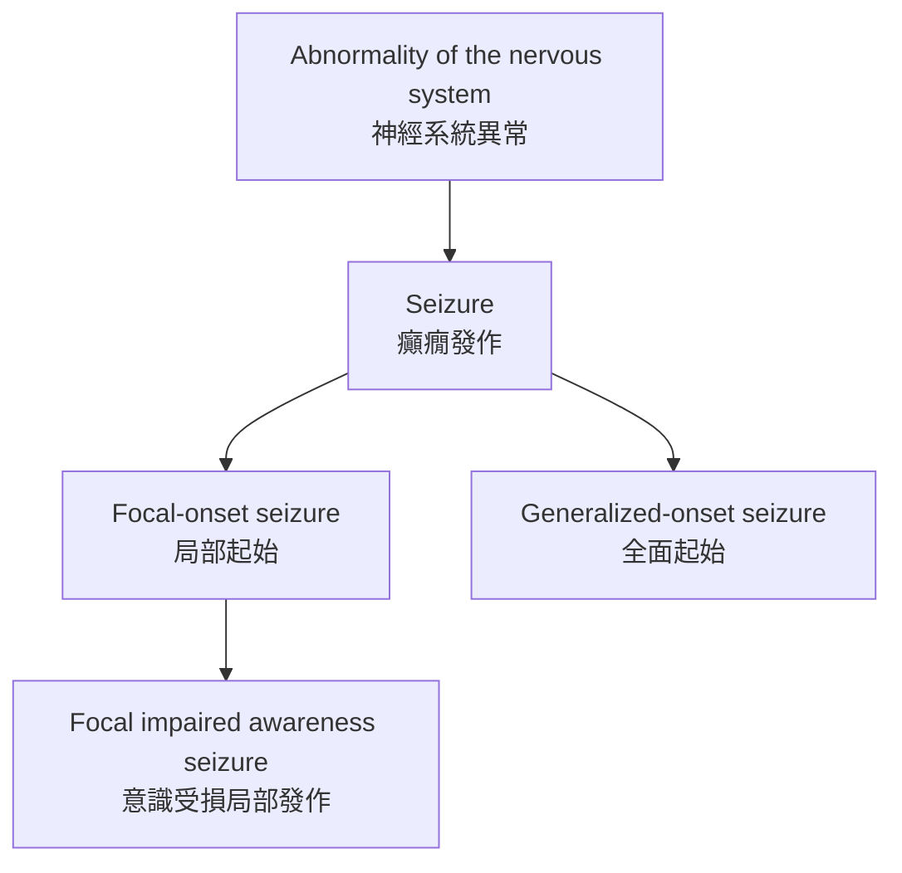
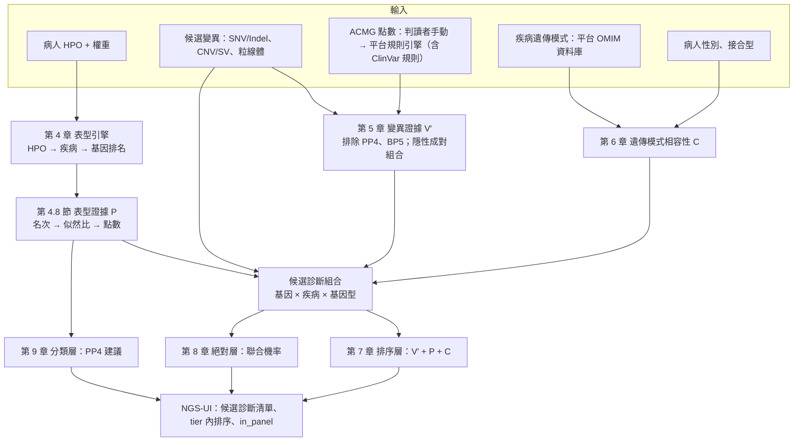
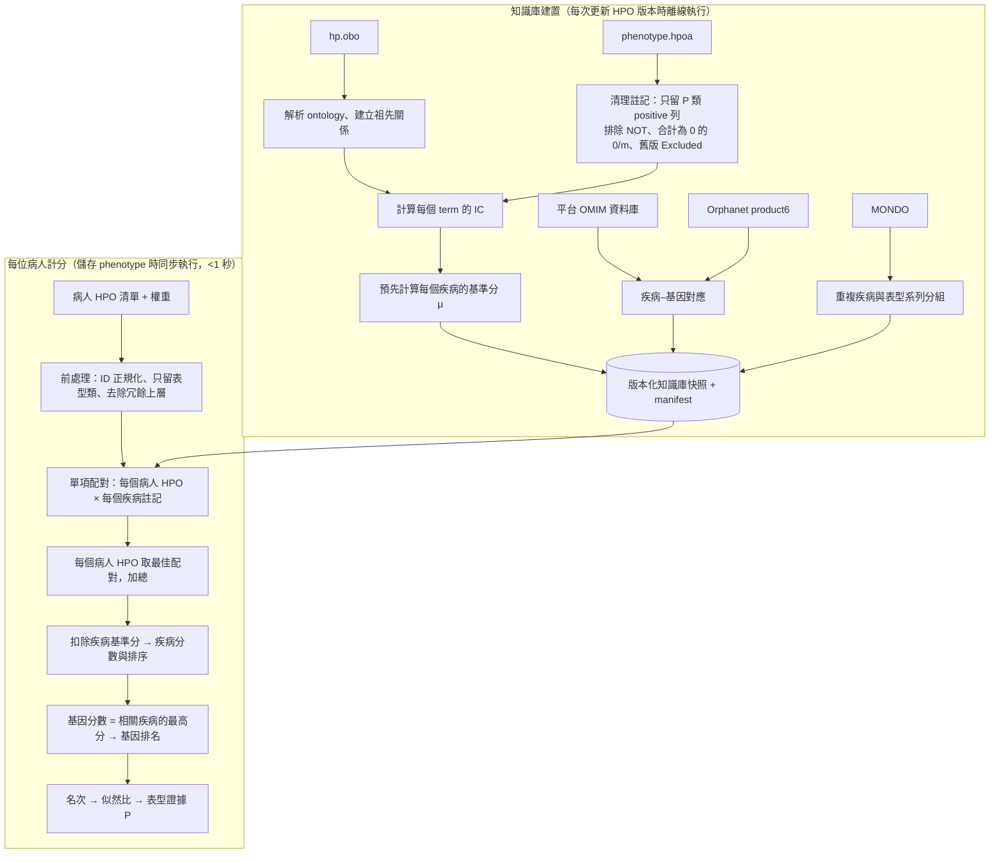

# NGS 候選診斷的整體排序：表型 × 變異 × 遺傳模式 研究與實作計畫（第三版）

| 項目 | 內容 |
|---|---|
| 文件定位 | 給臨床醫師、遺傳諮詢師、生物資訊工程師與研究團隊共同閱讀的完整計畫書：說明要解決的問題、整體架構、每一部分的概念與數學、資料處理、驗證方式、可能的問題，以及如何接進 NGS 分析平台 |
| 版本 | 第三版（2026-11-22；2026-11-23 加入變異規則引擎，第 5.2 節）。第一版只處理 HPO → 疾病 → 基因的表型排序；第二版經交叉審查與實測改寫表型排序；第三版把架構擴大為「表型 + 變異 + 遺傳模式」的整體排序，表型排序成為其中一章。版本差異見附錄 A |
| 研究範圍 | 從病人的 positive HPO 與 WES/WGS 候選變異出發，排出最可能的「候選診斷」，並說明每個候選的證據組成 |
| 暫不處理 | 從病歷自動擷取 HPO、negative HPO、自動完成 ACMG 分類（規則引擎只計算排序用的點數並預填建議，分類仍由判讀者決定） |
| 重要聲明 | 這是**待開發、待驗證的研究演算法**。目前所有校準數字都來自文獻病例與模擬，正式使用前必須用院內個案重新校準（第 11 章、第 15 章） |

---

## 0. 一頁摘要

**要解決的問題。** 一位病人的外顯子或基因體定序，過濾後通常仍有數百個候選變異。判讀者要找出哪一個（或哪一對）變異能解釋病人的臨床表現，或判斷其實沒有。平台目前把「變異致病性分數」和「表型分數」各自換成 0–100 後相加排序；這兩個分數尺度不同、相加等於「或」的邏輯，也沒有檢查遺傳模式，SNV、CNV、粒線體各自用不同公式排序。

**核心想法。** 一個變異要成為診斷，三件事必須**同時**成立：

1. 變異本身有害（變異證據 $V'$）；
2. 這個基因造成的疾病符合病人的表現（表型證據 $P$）；
3. 病人的基因型符合疾病的遺傳模式（遺傳模式相容性 $C$）。

「同時成立」在機率上是相乘；我們把三者都換成 ACMG 的 Bayesian 點數（1 點 = 可能性乘 2.08 倍），點數相加就等於可能性相乘：

$$
\text{總分}=V'+P+C
$$

排序的單位是「候選診斷」（基因 × 疾病 × 基因型組合），例如隱性疾病的兩個變異合成一個候選。

**三層設計。** 討論與實測中最重要的教訓是：「排先後」「有沒有可信的候選」「ACMG 怎麼分類」是三個不同的問題，必須分開回答。

| 層 | 回答的問題 | 做法 |
|---|---|---|
| 排序層 | 先看哪個候選？ | 總分 $V'+P+C$（第 7 章） |
| 絕對層 | 這個候選有多大機率就是診斷？到底有沒有可信的候選？ | 考慮診斷率（院內約 0.4）與「答案可能不在已知基因」的聯合機率（第 8 章） |
| 分類層 | ACMG 分類時，表型可以給 PP4 嗎？ | 依 ClinGen 2024 規則提供 PP4 建議，最多 +2 點，由判讀者決定（第 9 章） |

**表型證據怎麼來。** 先用 HPO 語意相似度把約 4,900 個疾病基因排序（第 4 章，原第二版表型計畫的全部內容），再用已知答案的病例校準「致病基因落在各名次的機率」與「隨機基因落在同名次的機率」之比，換成點數。例如真正答案排第 1 名的機率約 39%，隨機基因只有 1/4,888，倍數約 1,900 倍，相當於 +10 點；這些數字在另一組獨立病例上幾乎完全重現。

**變異證據怎麼來。** SNV/Indel 的 ACMG 點數改由平台自建的規則引擎計算（第 5.2 節）：依 ClinGen SVI 的公開規格逐條判斷，每一點都能追溯依據；ClinVar ≥2★ 直接採用分類（2026-11-23 起由 3–4★ 放寬到 2★）；判讀者可以覆寫。規則引擎直接取代平台上 pipeline 的 ACMG，平台的 ACMG 來源維持三個（判讀者手動、GeneBe、規則引擎）。

**初步結果（文獻病例與模擬，院內尚未驗證）。**

- 表型引擎：time-split 驗證中，致病基因排進前 10 名的比例從平台現行的 54.5% 提升到約 65%（基因 MRR +0.133，95% CI +0.094 至 +0.168）。
- 整體排序模擬：致病變異排在候選第 1 名的比例約 83%；表型排第 6–20 名、帶 P 變異的致病基因，有 99% 排在候選第 1 名。
- 模擬的 negative 個案（真正答案不在知識庫）中，最高候選的聯合機率超過 50% 的只有約 3%。

**第一版不納入、但列入院內再測的方法**：依分數落差切分的表型分層、表型系列（如 Noonan 各型）合併計分、疾病內發生率加權等（第 13 章）。

---

## 1. 背景與目標

### 1.1 臨床需求

一位疑似罕見遺傳疾病的病人做了外顯子或基因體定序。經過族群頻率、品質與區域等過濾後，每位病人通常仍有數百個候選變異（SNV/Indel、CNV/SV、粒線體）。判讀者要回答：

1. 哪一個（或哪一對）變異能解釋病人的臨床表現？
2. 如果沒有任何候選足夠可信，要能看出來「這可能是 negative 個案」，而不是被迫選一個。
3. 每個判斷的理由要說得清楚，讓判讀者能檢查、能不同意。

一個變異要成為診斷，三件事必須同時成立：變異本身有害、這個基因的疾病符合病人表現、病人的基因型符合疾病的遺傳模式。三者缺一不可：

- 一個明確致病的變異，如果落在與病人表現無關的基因，多半只是帶因者或次要發現；
- 一個表型非常吻合的基因，如果只有良性變異，也不是答案；
- 隱性疾病基因只找到一個異合子變異，在找到第二個變異之前，不能當成完整的診斷。

困難在於：

- **表型的用詞層級不同**：病人寫 Focal-onset seizure，疾病只註記 Seizure，或反過來。
- **表現的區辨力不同**：全面性發展遲緩出現在上千種疾病，嬰兒痙攣只出現在少數疾病。
- **疾病分得很細**：Noonan syndrome 有十幾型，表型幾乎分不出來，十幾個基因會同時擠在表型排名前面（locus heterogeneity）。
- **多數個案是 negative**：院內診斷率約 0.4，表示約六成個案在已知基因中找不到答案；系統不能假設答案一定在候選裡。

### 1.2 平台現況與限制

**變異排序。** SNV/Indel 先依 ClinVar 與 ACMG 點數分 tier；tier 內依 `total_score` 排序：

$$
\texttt{total\_score}=\underbrace{\texttt{geno\_score}}_{\text{ACMG 點數 }-10\sim+10\text{ 線性換成 }0\sim100}+\underbrace{\texttt{pheno\_score}}_{0\sim100}
$$

CNV/SV 依 `max_pheno_score + scaled AnnotSV_ranking_score` 排序，粒線體依 `in_panel`、heteroplasmy 等排序。三者各用不同公式，沒有共同的候選清單。

**表型分數。** `backend/app/services/phenotype_scorer.py`：

$$
\text{pheno\_score}(g)=100\times\frac{\sum_{h\in \text{病人 HPO 與 panel}} w_h\cdot \mathbf{1}[g \in \text{Genes}(h)]}{\sum_h w_h}
$$

其中 $\text{Genes}(h)$ 來自 HPO 官方檔 `phenotype_to_genes.txt`，$w_h$ 是使用者設定的權重。分數大於 0 的基因被視為 `in_panel`。

**限制：**

1. **尺度不一致。** ACMG 點數本身就是對數勝算尺度（每 1 點約等於可能性 ×2.08），表型分數則是比例。兩者換成 0–100 後直接相加沒有一致的意義。
2. **相加是「或」的邏輯。** 一項很強的分數可以補掉另一項的不足；但診斷需要「且」。
3. **沒有檢查遺傳模式。** 隱性基因只有一個異合子變異，和找到兩個變異排得一樣高；compound heterozygote 的兩個變異也沒有被當成一組。
4. **表型分數只看有或無。** 對上「全面性發展遲緩」和對上「嬰兒痙攣」得到一樣的分數；每位病人約有 1,900–2,100 個基因分數大於 0；在 time-split 測試中，致病基因通常和約 9 個基因同分。病人寫得比資料庫更精確時對不上（病人 Focal impaired awareness seizure、疾病只註記 Seizure，貢獻為 0）。
5. **官方檔案含有不該計分的列。** `phenotype_to_genes.txt` 收錄了 `NOT`（明確排除）的註記與遺傳方式等非表型 term。抽查 2026-09 版：726 筆表型類 `NOT` 註記中，有 474 筆的（疾病, HPO）組合出現在官方檔裡，現行分數會替「這個疾病明確**沒有**此表現」的基因加分。

平台另外已整合 LIRICAL 與 Exomiser（`backend/app/workers/exomiser_lirical.py`）。它們是需要 Java 與工作佇列的非同步作業，結果目前不參與排序與 `in_panel`。本計畫與它們互補而非取代（第 10.6 節）。

### 1.3 目標與範圍

**目標：** 建立可解釋、可重現、能在每次儲存 phenotype 或修改 ACMG 時同步更新的候選診斷排序，並以院內資料證明它比現行排序好。

**範圍內：**

- 表型引擎：HPO → 疾病 → 基因排序，以及表型證據的校準（第 4 章）；
- 變異證據：SNV/Indel 以平台自建的規則引擎計算 ACMG 點數；CNV/SV、粒線體換成同一套點數（第 5 章）；
- 遺傳模式相容性（第 6 章）；
- 排序層、絕對層、分類層（第 7–9 章）；
- 平台整合與驗證（第 10–11 章）。

**範圍外（第一版）：** 病歷自動擷取 HPO；negative HPO；疾病內發生率加權（研究分支）；需要大量訓練資料的機器學習模型；自動完成 ACMG 分類（規則引擎的結果只用於排序與預填，分類由判讀者決定）。

### 1.4 設計原則

1. **可解釋**：每個候選的總分都能拆成 $V'$、$P$、$C$，表型部分再拆到每個病人 HPO 的配對。
2. **同一套單位**：三種證據都用 ACMG Bayesian 點數表示，相加有明確的機率意義。
3. **問題分開回答**：排序、絕對機率、ACMG 分類各用適合的方法，不讓一個數字承擔三種意義。
4. **保守、可校準**：數字由資料估計，取保守值，並設定上下限；院內資料累積後重新校準。
5. **可重現**：知識庫、參數、程式版本全部凍結並記錄。
6. **先證明再上線**：任何設計都要在避免資料洩漏的驗證中勝過現行方法才能取代它。

---

## 2. 基本概念

這一章先把概念講清楚，後面的公式都建立在這些概念上。

### 2.1 HPO 是一張有上下層關係的網，不是單純的症狀清單

HPO 的 term 之間有「是一種」（`is_a`）的關係。簡化示意：



實際的 HPO 是「有向無環圖」（DAG）：一個 term 可以有多個上層。名詞：

- **祖先（ancestor）**：沿著箭頭往上能到達的所有 term。Seizure 是 Focal-onset seizure 的祖先。
- **後代（descendant）**：往下能到達的所有 term。
- **兄弟／旁系（non-lineage）**：彼此都不是對方的祖先，例如 Focal-onset 與 Generalized-onset，它們共享上層 Seizure。

記號：$A(t)$ 表示 term $t$ **包含自己**在內的所有祖先；$\mathrm{Anc}(t)=A(t)\setminus\{t\}$ 是嚴格祖先。

**True-path rule（真路徑規則）**：如果一個人有某個表現，他一定也有這個表現的所有上層表現。有 Focal-onset seizure 的人，一定「有癲癇發作」。這條規則是後面所有配對邏輯的基礎。

### 2.2 疾病註記與「面向」（aspect）

`phenotype.hpoa` 的每一列代表「某疾病與某 HPO term 有關」。但 HPO 不只收錄臨床表型，還有其他面向：

| aspect | 意義 | 例子 | 本計畫如何使用 |
|---|---|---|---|
| P | 表型異常（Phenotypic abnormality，`HP:0000118` 子樹） | Seizure、Microcephaly | **配對與 IC 計算只用這一類** |
| I | 遺傳方式 | Autosomal recessive inheritance | 不參與配對；保留供未來與變異的接合型比對 |
| C | 臨床病程／發病年齡 | Infantile onset | 不參與配對；保留供未來的發病年齡模組 |
| M | 臨床修飾 | Episodic | 不參與配對 |
| H | 過去病史 | — | 不參與配對 |

另外，一列註記可能帶 `NOT`（明確排除：這個疾病**沒有**此表現），或頻率寫成 `0/m`（m 個病人中 0 人有）。這些是「沒有」的證據，**絕對不能當成支持證據**（第 4.2.3 節）。

### 2.3 資訊量（Information Content, IC）：這個表現有多能縮小診斷範圍？

令 $\mathcal{D}$ 是候選疾病全集、$N=|\mathcal{D}|$，$H_D$ 是疾病 $D$ 直接註記的表型集合。一個 term $t$ 的「疾病覆蓋率」是：

$$
p(t)=\frac{\#\{D\in\mathcal{D}:\ t\in A(H_D)\}}{N}
$$

也就是「有多少比例的疾病註記了 $t$ 或比 $t$ 更具體的 term」。資訊量定義為：

$$
IC(t)=-\ln p(t)
$$

$p$ 越小，IC 越大，代表這個表現越稀有、越有區辨力。用 2026-09 版資料（約 12,900 個疾病）實際算出的例子：

| HPO term | IC（nats） | 白話 |
|---|---:|---|
| Phenotypic abnormality（表型根節點） | 0.00 | 每個疾病都有，毫無區辨力 |
| Abnormality of the nervous system | 0.43 | 約 65% 的疾病 |
| Intellectual disability | 1.37 | 約 25% 的疾病 |
| Seizure | 1.43 | 約 24% 的疾病 |
| Global developmental delay | 1.51 | 約 22% 的疾病 |
| Ataxia | 2.20 | 約 11% 的疾病 |
| Focal-onset seizure | 3.43 | 約 3% 的疾病 |
| Myoclonic seizure | 3.78 | 約 2.3% 的疾病 |
| Infantile spasms | 4.38 | 約 1.3% 的疾病 |

因為祖先的覆蓋率一定不小於後代，所以 $IC(\text{祖先})\le IC(\text{後代})$ 永遠成立。IC 的上限是 $\ln N\approx 9.46$（只出現在一個疾病的 term）。

> **白話說明：** IC 衡量的是「如果病人有這個表現，候選疾病可以刪掉多少」。它是**跨疾病**的區辨力，和「某個疾病的病人中有多少比例出現這個表現」（發生率）是兩回事。

### 2.4 最具資訊量的共同祖先（MICA）

兩個 term $q$ 和 $d$ 的 MICA，是它們共同祖先中 IC 最高的那一個：

$$
m(q,d)=\arg\max_{a\in A(q)\cap A(d)} IC(a)
$$

- $q$ 和 $d$ 相同：MICA 就是它自己。
- $q$ 是 $d$ 的祖先（例如 $q$=Seizure、$d$=Focal-onset）：MICA 是 $q$。
- $q$ 和 $d$ 是兄弟（Focal-onset 與 Generalized-onset）：MICA 是 Seizure。

$IC(m(q,d))$ 可以理解為「$q$ 和 $d$ 共同確認的資訊量」：兩個表現在 Seizure 這一層是一致的，這一層的資訊是兩者共享的。

### 2.5 疾病內發生率（frequency）

$f(t,D)$ 表示「患有疾病 $D$ 的人中，有多少比例出現表現 $t$」。HPO 用三種方式記錄：精確分子分母（如 `7/13`）、百分比、或類別（Very rare 1–4%、Occasional 5–29%、Frequent 30–79%、Very frequent 80–99%、Obligate 100%）。

發生率在臨床上很有意義，但現有資料品質問題很多（許多分母只有 1–3 人、不同研究互相矛盾、OMIM 與 Orphanet 記錄方式不同）。實測顯示，在做完第 4.5 節的基準分校正後，加入發生率沒有額外幫助。因此**第一版排序不使用發生率**，只在解釋輸出中顯示原始發生率資訊；如何正確使用發生率列為研究分支（第 13.1 節）。

### 2.6 排序分數不是機率

排序層的總分只用來比較**同一位病人**的候選誰該先看，不代表「得這個病的機率是幾 %」，不同病人之間也不能直接比較。「這個候選有多大機率就是診斷」由第 8 章的絕對層另外計算；兩者不能混用。

### 2.7 似然比（likelihood ratio, LR）：證據讓可能性變成幾倍

似然比回答的問題是：「如果這個假設是真的，看到這筆證據的機率」比「如果這個假設是假的，看到這筆證據的機率」高幾倍。

$$
LR=\frac{P(\text{證據}\mid\text{假設為真})}{P(\text{證據}\mid\text{假設為假})}
$$

例子：在已知答案的文獻病例中，真正的致病基因有 39.1% 排在表型排名第 1 名；而一個與病人無關的基因，排第 1 名的機率只有 1/4,888（0.02%）。所以「排第 1 名」這筆證據的似然比約是 39.1% ÷ 0.02% ≈ 1,900 倍。

似然比本身不是機率。它要乘上「事前的可能性」（先驗，第 2.9 節）才會變成「事後的可能性」：

$$
\text{事後勝算}=\text{事前勝算}\times LR_1\times LR_2\times\cdots
$$

勝算（odds）= 機率 ÷（1 − 機率）。多筆彼此獨立的證據，似然比可以相乘。

### 2.8 ACMG 的 Bayesian 點數制

Tavtigian 等人（2018、2020）把 ACMG/AMP 的變異分類規則改寫成 Bayesian 模型，並被 ClinGen 採用：

- 每一條證據對應一個似然比；supporting 證據的似然比約 2.08，moderate 約 4.33，strong 約 18.7，very strong 約 350（= $2.08^8$）。
- 因此可以把證據寫成**點數**：supporting 1 點、moderate 2 點、strong 4 點、very strong 8 點；良性證據為負點數。
- **1 點 = 可能性乘 2.08 倍。** 點數相加等於似然比相乘：

$$
\text{點數}=\log_{2.08} LR,\qquad LR=2.08^{\text{點數}}
$$

- 以事前機率 0.1 為起點，總點數 ≥10 對應 Pathogenic（事後機率 ≥0.99），6–9 為 Likely pathogenic（≥0.90），0–5 為 VUS，−1 到 −6 為 Likely benign，≤−7 為 Benign。

本計畫用這套點數當作共同單位：變異證據本來就是 ACMG 點數；表型證據與遺傳模式相容性也換成點數，三者才能相加。

### 2.9 先驗與診斷率：答案可能不在任何已知基因

**先驗**是看到這位病人的資料之前，某個假設成立的可能性。對「這位病人的診斷就是某個特定基因」而言，先驗由兩部分構成：

1. **診斷率**：這類病人最後能在已知疾病基因中找到答案的比例。院內 WES/WGS 約 0.4。
2. **答案在哪個基因**：如果有答案，大約平均分散在約 4,900 個疾病基因中。

所以單一基因的先驗約為 0.4 ÷ 4,900；另外有 0.6 的機率，答案根本不在已知基因裡（新基因、非遺傳原因、或目前技術測不到）。ClinGen 2024 的 PP4 指引把這部分稱為一個「未知位點」（phantom locus）。

先驗的作用就像臨床檢驗的事前機率：同一個陽性結果，在盛行率高與低的族群中意義不同。沒有先驗，系統會默認「答案一定在候選裡」，永遠挑出一個看起來很像的候選；有了先驗，只有變異與表型證據都夠強時，系統才會給出高機率。

先驗只影響第 8 章的絕對機率與第 9 章的 PP4 建議；同一位病人的所有候選先驗相同，所以**不影響排序**。

---

## 3. 整體架構：總分 = 表型 + 變異 + 遺傳模式

### 3.1 三件事都要成立

| 證據 | 回答的問題 | 來源 | 章節 |
|---|---|---|---|
| 變異證據 $V'$ | 這個變異（或這對變異）本身有沒有害？ | 平台規則引擎的 ACMG 點數（ClinGen SVI 規格；ClinVar ≥2★ 採用；判讀者可覆寫），排除 PP4 與 BP5 | 第 5 章 |
| 表型證據 $P$ | 這個基因造成的疾病，符不符合病人的表現？ | 表型引擎的基因排名，經校準換成點數 | 第 4 章 |
| 遺傳模式相容性 $C$ | 病人的基因型符不符合疾病的遺傳模式？ | 疾病的遺傳模式、變異接合型、性別 | 第 6 章 |

三者是「且」的關係。用機率的語言說，事後勝算等於事前勝算乘上三個似然比；取對數之後就是相加。

### 3.2 總分公式

$$
\text{Total}(c)=V'(c)+P\big(g(c)\big)+C(c)
$$

$c$ 是一個候選診斷，$g(c)$ 是它的基因。三項都以 ACMG Bayesian 點數表示（1 點 = 可能性 ×2.08）。

> **白話說明：** 變異有多可疑、表型有多吻合、遺傳模式對不對，各自換成點數後加起來。任何一項很差都會把總分拉下來，所以一個致病變異落在與病人無關的基因、或表型很像但變異是良性的，都不會排到最前面。

### 3.3 三層設計

| 層 | 回答的問題 | 計算方式 | 用途與顯示 |
|---|---|---|---|
| **排序層** | 先看哪個候選？ | $V'+P+C$ | 決定候選清單與各 tier 內的順序；只用來比較同一位病人的候選 |
| **絕對層** | 這個候選是診斷的機率？到底有沒有可信的候選？ | 加入先驗（診斷率、未知位點）與「沒有候選變異的基因」後的聯合機率 | 顯示「這個候選是診斷的機率」；整個個案沒有可信候選時明白提示 |
| **分類層** | ACMG 分類時表型可以給 PP4 嗎？ | ClinGen 2024 規則，依表型單獨支持的機率給點，設上限 | 給判讀者的 PP4 建議；分類仍由判讀者決定 |

**為什麼要分三層。** 本計畫在討論中曾把表型排名直接換成 ACMG 點數、並把總分當作絕對的致病證據。這是錯的：表型排名第 1 名的似然比約 1,900 倍（+10 點）用來**排序**是正確的，但它漏掉了「單一基因的先驗很低」這件事（約 −10 點），直接拿去和 Pathogenic 的 10 點門檻比較，會嚴重高估。排序只需要相對大小，先驗對同一病人的所有候選都一樣，可以略過；絕對判斷則必須把先驗算進去；ACMG 分類又有 ClinGen 自己的規則。三個問題分開處理，每個數字的意義才清楚。

### 3.4 排序的單位：候選診斷

**候選診斷 = 基因 × 疾病 × 基因型組合。**

- **顯性疾病**：一個變異就是一個候選。
- **隱性疾病**：兩個變異（compound heterozygote）、一個同型合子變異，或一個 SNV 加上另一個 allele 的 CNV deletion，合成一個候選；只有一個異合子變異時，仍列為候選，但遺傳模式相容性扣分並提示「需找第二個變異」。
- **X 性聯疾病**：依病人性別判斷（男性半合子、女性異合子）。
- **一個基因對應多個疾病**：每個疾病分別組合；表型點數依第 4.8.7 節在同基因內分配（最吻合的疾病拿基因點數，其他疾病依差距往下扣），取總分最高的那個作為這個基因的候選；其他組合保留在展開資訊中。

每個變異在 SNV/CNV/Mito 的 tier 清單中，顯示並依「它參與的最佳候選」的總分排序。

### 3.5 架構圖



### 3.6 數字的來源與對外說明

本計畫中的數字分成四類。對外說明時，要清楚指出每個數字屬於哪一類。

| 類別 | 數字 | 依據 |
|---|---|---|
| **公認標準** | 1 點 = 可能性 ×2.08；變異證據的點數（supporting 1、moderate 2、strong 4、very strong 8）；P ≥10、LP 6–9 | ACMG Bayesian 點數制（Tavtigian et al. 2018、2020），ClinGen SVI 採用 |
| | PP4 依表型的診斷率給點，20% 對應 +1，PP1 + PP4 最多 +5 | ClinGen 2024 PP1/PP4 指引（Biesecker et al., AJHG 2024） |
| | IC、MICA 等語意相似度定義 | Resnik 1995、Lin 1998、Phenomizer |
| | 變異規則引擎的主要門檻：BA1 5%、預測工具的校準門檻、剪接分數 0.2／0.1、PVS1 決策樹 | ClinGen SVI 規格（Ghosh 2018、Pejaver 2022、Bergquist 2025、Walker 2023、Abou Tayoun 2018；第 5.2.4 節） |
| **由資料計算** | 表型名次 → 點數表 | 時間切分的文獻病例統計（第 4.8.2 節），另一組病例獨立重現；院內累積足夠已解個案後重算 |
| | 診斷率 0.4 | 院內 WES/WGS 個案中有致病變異的比例；之後依檢測類型與表型類別分別估計 |
| | 變異類別在致病基因與背景基因中的分布、偵測敏感度 | 院內已解與 negative 個案（第 8 章，待估） |
| **設計選擇（實測比較後選定）** | 表型最多扣 3.1 點、最多加 13 點 | 與其他上下限比較後選出（第 4.8.4 節） |
| | 旁系配對係數 0.5 × min(1, lift)、基準分校正 | 與其他配對方式比較後選出（第 4.4、4.5 節） |
| | PP4 建議只在「表型第 1 名且明顯領先」時給，最多 +2 | 開發資料選定，院內驗證通過前關閉（第 9 章） |
| | ClinVar ≥2★ 直接採用、不加點（2026-11-23 由「3–4★ 採用、2★ P/LP 下限 6 點」放寬） | 團隊討論決定（第 5.2.8 節），依第一次院內驗證調整 |
| **暫定值（尚無資料依據）** | 遺傳模式扣分（例如隱性只有一個異合子：WES −3、WGS −4，分別對應「第二個變異被漏掉的機率」約 10% 與 5%） | 待院內已解個案估計（第 6.4 節） |
| | 規則引擎的通用頻率門檻（BS1 顯性 0.1%／其他 0.5%；PM2 隱性 ≤0.01%）；Pangolin 沿用 SpliceAI 的門檻；院內重複出現門檻（WES 5%、WGS 院內 AF 2.5%） | 待 ClinVar 時間切分與院內資料驗證（第 5.2.10 節） |
| | CNV、粒線體分級換算成點數 | 依分級邊界暫定對應，待校準（第 5.4、5.5 節） |

**對外說明範例：**

> 「我們把每個候選診斷的證據分成變異、表型、遺傳模式三部分，都換成 ACMG 的 Bayesian 點數（1 點相當於可能性乘 2.08 倍）後相加排序。變異點數由平台的規則引擎依 ClinGen 公開規格自動計算 ACMG 點數，每一點都可以追溯依據，判讀者可以覆寫。表型點數不是主觀給的：我們用已知答案的病例統計真正致病基因在表型排名中各名次出現的比例，和隨機基因出現在同樣名次的機率相比，得到似然比，再換成點數；這些數字在另一組獨立病例上幾乎完全重現。排序之外，系統另外以院內診斷率為起點計算『這個候選是診斷的機率』；PP4 的建議遵循 ClinGen 2024 的規則並設上限。目前的校準數字來自文獻病例，院內累積足夠個案後會重新校準。」

---

## 4. 表型模組：從 HPO 到表型證據 P

這一章是整體架構中的表型部分，內容即第二版表型計畫的全部方法，最後加上「把基因排名換成表型證據 $P$」的校準（第 4.8 節）。

### 4.1 這一章的角色與流程

表型模組回答：「這個基因造成的疾病，有多符合這位病人的表現？」它的輸出有三種：

1. **基因排名**：約 4,900 個疾病基因依表型吻合程度排序，也用於 `in_panel`（第 10.3 節）；
2. **表型證據 $P$**：把基因名次換成似然比，再換成 ACMG 點數，進入總分（第 4.8 節）；
3. **逐項解釋**：每個病人 HPO 對上疾病的哪個註記、為什麼給這個分數（第 4.7 節）。



純文字流程：

`病人 HPO → 前處理 → 單項配對 → 每項取最佳、加總 → 扣基準分 → 疾病排序 → 取最高 → 基因排名 → 名次換成表型點數 P`

### 4.2 知識庫建置

> **更新方式（v10.57）**：首頁「資料庫版本」的「更新 HPO」一鍵完成下載、清理、知識庫建置與啟用，服務不需重啟。伺服器若連不到 orphadata.com，Orphanet 疾病–基因改用 HPO `genes_to_disease.txt` 內轉載的 ORPHA 列（無法區分關聯類型），manifest 註明。

#### 4.2.1 資料來源

| 資料 | 內容 | 用途 | 取得方式 |
|---|---|---|---|
| `hp.obo` | HPO term、名稱、同義詞、上下層關係、`alt_id`、obsolete／`replaced_by` | ontology、IC、MICA、ID 正規化 | HPO GitHub release |
| `phenotype.hpoa` | 疾病–HPO 註記、頻率、出處、證據等級、aspect | 疾病表型、IC 計算 | HPO GitHub release |
| 平台 OMIM 資料庫 | phenotype MIM ↔ 基因、`{}`／`?`／`[]` 標記 | OMIM 疾病–基因對應 | 既有（`backend/app/services/omim_db.py`） |
| Orphanet product6 | Orphanet 疾病–基因關聯、關聯類型與驗證狀態 | Orphanet 疾病–基因對應 | orphadata |
| MONDO | 疾病等價關係 | 找出 OMIM 與 Orphanet 的重複疾病 | MONDO release |
| HPO `genes_to_disease.txt` | 官方疾病–基因對應 | 與上述來源交叉比對（QC） | HPO GitHub release |
| phenopacket-store | 文獻病例的表型與致病基因 | 驗證（第 11 章），**不進知識庫** | GA4GH GitHub release |

#### 4.2.2 `phenotype.hpoa` 欄位與用法

| 欄位 | 內容 | 本計畫用法 |
|---|---|---|
| `database_id` | `OMIM:…`、`ORPHA:…`、`DECIPHER:…` | 疾病 ID；DECIPHER 不進全集（第 4.2.4 節） |
| `disease_name` | 疾病名稱 | 顯示 |
| `qualifier` | 空白或 `NOT` | `NOT` 移到 negative 表 |
| `hpo_id` | HPO term | 經 `alt_id`／obsolete 正規化 |
| `reference` | 出處（PMID、OMIM 等） | 保留供解釋與驗證時排除洩漏 |
| `evidence` | IEA、PCS、TAS | 保留，供未來依證據強度加權的研究 |
| `onset` | 發病年齡 | 保留，第一版不用 |
| `frequency` | `n/m`、百分比、或 `HP:00402xx` 類別碼 | 第一版只用於判斷「是否為 0／Excluded」與解釋輸出 |
| `sex` | 性別限定 | 保留，第一版不用 |
| `modifier` | 修飾 | 保留，第一版不用 |
| `aspect` | P、I、C、M、H | **只有 P 進入配對與 IC** |
| `biocuration` | 整理者與日期 | 保留，驗證時用於 time-split 輔助判斷 |

#### 4.2.3 清理規則

以下規則中，R4 的判斷要在 R7 合併重複列之後進行；每一條都要在建置 log 中記錄被影響的列數：

| 編號 | 規則 | 理由 |
|---|---|---|
| R1 | 只保留 `aspect = P` 的列 | 遺傳方式、病程等不是臨床表型，不應參與表型相似度 |
| R2 | `qualifier = NOT` 的列移到 negative 表 | 明確排除不是支持證據（2026-09 版有 733 列，全部來自 Orphanet） |
| R3 | `frequency = HP:0040285`（Excluded）的列移到 negative 表 | 2023 年以前的版本用這個方式表示排除（2023-10 版有 705 列寫成 qualifier 空白的 positive 列），用舊快照重跑時必須正確處理 |
| R4 | 頻率為 `0/m`（分子為 0）的列：先與同一（疾病, HPO）的其他列合併（R7），合計分子仍為 0 才移到 negative 表；只要有任何一篇文獻報告 n>0，就保留為 positive，頻率記為合計值 | 2026-09 版有 3,072 列，全部來自 OMIM 的單篇文獻病例表，95% 出自同時報告其他 n>0 表現的同一篇文獻，絕大多數是「這篇文獻逐項檢查過、病人都沒有」，例如 Hypochondroplasia 的三叉手 0/2（三叉手正是用來和 achondroplasia 區分的特徵）。只有 35 個配對（1.1%）另有文獻報告 n>0，例如 Frontometaphyseal dysplasia 的唇顎裂 1/11 + 0/9、Loeys-Dietz syndrome 1 的開放性動脈導管 2/4 + 10/30 + 0/1，這些是發生率較低的表現，應保留 |
| R5 | `hpo_id` 經 `alt_id` 對應到現行 ID；obsolete term 若有 `replaced_by` 則替換，否則捨棄並記錄 | 確保同一概念只有一個 ID |
| R6 | 只保留位於 `HP:0000118` 子樹內、且能沿上層關係到達根節點的 term；斷鏈 term 記錄於 QC 報告 | 2026-09 版發現至少一條斷鏈（HP:0012220 → HP:5210340），沒有防呆會讓 MICA 計算失敗 |
| R7 | 同一（疾病, HPO）的重複列合併為一筆；頻率以 $\sum n/\sum m$ 合併，類別衝突時標記 `conflict` | 2026-09 版有 446 組重複、327 組頻率互相矛盾 |
| R8 | 疾病端**保留所有直接註記**，不做祖先去冗餘 | 同一疾病同時註記 Seizure 與 Generalized-onset seizure 時，兩者都可能是某位病人的最佳配對；第 4.5.1 節的「每項只取最佳」已避免重複加分 |

negative 表（R2–R4）第一版不參與計分，但完整保存，供未來的 negative 證據研究使用。其中合計為 0 的 `0/m` 常是文獻刻意檢查的鑑別特徵，未來作為負向證據特別有價值。

#### 4.2.4 疾病全集

**第一版全集 = 所有 OMIM 疾病 + 所有 Orphanet 疾病**，排除 DECIPHER（只有 47 個、多為早期自動註記、無基因對應）。

OMIM 與 Orphanet 有大量重複：依 MONDO 的等價關係，**48.8%（2,125 個）的 Orphanet 疾病和某個 OMIM 疾病是同一個疾病**，另有 558 個 Orphanet 條目是多個 OMIM 疾病的上層分組。處理方式：

1. **計分時兩者分開計算。** 同一疾病在兩邊的註記內容差異很大（直接註記集合的 Jaccard 相似度中位數只有 0.20），分開計算可以讓兩份註記各自發揮。
2. **IC 計算使用原始全集。** 實測依 MONDO 合併後 IC 幾乎是整體平移（多數 term 約 −0.185），對排序影響很小；合併版 IC 列為研究分支（第 13.4 節）。
3. **顯示時依 MONDO 分組。** 排序清單中，同一 MONDO 疾病的 OMIM 與 Orphanet 條目合併為一列，顯示較高分的那一筆，另一筆收在展開資訊中，避免清單重複。
4. **基因對應取聯集**（第 4.2.6 節）。

#### 4.2.5 IC 計算

依第 2.3 節的公式，在清理後的全集上計算每個 term 的 $p(t)$ 與 $IC(t)$。

**沒有任何疾病註記的 term（$p=0$）。** 2026-09 版 `HP:0000118` 子樹中有 6,418 個 term（33.5%）沒有任何疾病註記到它或它的後代，IC 無定義。病人卻可能選到這些 term（例如很細的 ILAE 癲癇分類）。本計畫的配對公式（第 4.4 節）**只會用到 MICA 的 IC**，而 MICA 一定是某個有註記疾病的祖先，IC 必定有定義，所以這些 term 仍能透過它們的上層正常計分，不會被丟掉。只有在計算「解釋比例」（第 4.5.5 節）時需要 term 本身的資訊量，這時定義：

$$
IC^{\ast}(q)=\begin{cases}IC(q), & p(q)>0\\ \max\{IC(a): a\in A(q),\ p(a)>0\}, & p(q)=0\end{cases}
$$

也就是用「最具資訊量的、有註記的上層」代替。

**建置時的 QC 檢查：**

- 每個 term 都能到達根節點（否則記錄並排除）；
- 對所有上下層 pair，$IC(\text{祖先})\le IC(\text{後代})$；
- 根節點 `HP:0000118` 的 IC = 0；
- 記錄 $N$、有 IC 的 term 數、$p=0$ 的 term 數。

#### 4.2.6 疾病–基因對應

| 來源 | 納入規則 | 排除 |
|---|---|---|
| OMIM（平台 OMIM 資料庫） | phenotype MIM ↔ 基因；一般疾病納入；`?`（provisional）與 `{}`（易感性）納入但加標記 | `[]`（非疾病，如血型）、體細胞突變 |
| Orphanet（product6） | germline 致病關聯（Disease-causing germline mutation(s) in，含 loss of function／gain of function） | somatic、biomarker、candidate gene tested、fusion gene；其他類型（如 Role in the phenotype of、Major susceptibility factor in、Modifying germline mutation in）標記後依驗證結果決定 |
| HPO `genes_to_disease.txt` | 只作交叉比對 | 其中 Orphanet 關聯全部標為 `UNKNOWN`，混有 somatic 與 biomarker 關聯，不直接採用 |

基因 ID 一律以 NCBI Gene ID／HGNC ID 對應到平台現行的 HGNC 名稱（沿用 `panel_deadzone.canonical_panel_gene_symbol`）。三個來源不一致的對應列入 QC 報告。

**沒有疾病對應的基因**在基因排序中標為 `NA`（未知），不是 0 分：「資料庫沒有資料」和「表型不符合」是兩件不同的事。

#### 4.2.7 預先計算與版本快照

每個知識庫快照放在：

```
NGS_UI_HOME/phenotype_data/hpo_kb/{hp版本}_{hpoa版本}/
  manifest.json            各來源版本與 sha256、MONDO/Orphanet/OMIM DB 版本、參數、引擎程式 commit、建置時間
  terms.tsv                term、名稱、IC、IC*、是否有註記
  ancestors.npz            祖先關係（壓縮矩陣或索引陣列）
  disease_terms.tsv        疾病、清理後的直接註記、頻率原文、出處
  negative_terms.tsv       NOT / Excluded / 合計為 0 的 0/m 註記（第一版不計分）
  disease_closure.npz      每個疾病展開祖先後的 term（計算旁系共現程度 lift）
  disease_baseline.tsv     每個疾病的基準分 μ(D)（第 4.5.4 節）
  disease_gene.tsv         疾病、基因、來源、關聯類型、標記
  disease_groups.tsv       MONDO 分組
  build_qc.md              QC 報告與各規則影響列數
```

病人的分析結果會記錄所使用的快照版本。更新知識庫時建立新快照，不覆寫舊快照；舊個案除非判讀者主動要求，不會在背景被靜默重算。

#### 4.2.8 實際資料規模（2026-09 版）

以下數字來自實際下載的 `hp.obo`（2026-09-01）與 `phenotype.hpoa`（2026-09-02），讓讀者對資料規模有概念：

| 項目 | 數值 |
|---|---|
| HPO term | 20,482（現行 19,894、obsolete 588）；`HP:0000118` 子樹 19,145；`alt_id` 3,974 |
| 有疾病註記（含透過後代）的表型 term | 12,727；直接被註記的 11,494 |
| `phenotype.hpoa` 總列數 | 286,651；positive 表型列 268,180 |
| 疾病數 | OMIM 8,478、Orphanet 4,355、DECIPHER 47 |
| 每個疾病的表型註記數（中位數，IQR） | OMIM 12（5–24，最多 230）；Orphanet 22（13–35，最多 185）；19.3% 的 OMIM 疾病只有 ≤3 個 |
| 有頻率資料的註記 | OMIM 66%（大多是 `n/m`）；Orphanet 100%（全為類別碼）；29.3% 的 OMIM 疾病完全沒有頻率 |
| `n/m` 的分母 | 中位數 4；45.1% 的分母 ≤3；42.2% 的值為 1.0（例如 1/1） |
| 同一疾病內上下層頻率矛盾（後代 > 祖先） | OMIM 26.6%、Orphanet 9.8% |
| 頻率為 `0/m` 的列 | 3,072 列（全部來自 OMIM 的單篇文獻）；合併後只有 35 個配對另有文獻報告 n>0 |
| 疾病–基因（`genes_to_disease.txt`） | 5,390 個基因；有基因的疾病：OMIM 76.7%、Orphanet 56.5% |

### 4.3 病人端前處理

#### 4.3.1 ID 正規化

病人的每個 HPO 依序處理：

1. 若是 `alt_id`，換成主 ID；
2. 若是 obsolete 且有 `replaced_by`，換成替代 term；沒有替代者則捨棄並記錄；
3. 不存在於 `hp.obo` 的 ID 捨棄並記錄。

#### 4.3.2 只保留表型類 term

只有位於 `HP:0000118` 子樹內的 term 進入計分。遺傳方式（如 Autosomal recessive inheritance）、發病年齡、頻率類別 term，以及根節點 `HP:0000001` 會被移出，記錄在解釋檔中，並保留給未來的遺傳方式與發病年齡模組。

平台現有的 HPO 選擇器可以選到這些非表型 term，因此這一步是必要的；介面上也應提示使用者這些 term 不參與表型排序。

#### 4.3.3 去除冗餘的上層 term

如果病人同時有 Seizure 與 Focal-onset seizure，兩者在同一條上下層路徑上；兩項都計分等於把同一次癲癇表現算兩次。因此保留較具體的那一個：

$$
Q=\{\,q\in Q_0:\ \nexists\, u\in Q_0\setminus\{q\}\ \text{使得}\ q\in \mathrm{Anc}(u)\,\}
$$

$Q_0$ 是經 5.1、5.2 處理後的病人 term 集合，$Q$ 是去冗餘後的集合。

> **白話說明：** 某個病人 HPO 如果已經被另一個更具體的病人 HPO 涵蓋，就移除較廣泛的那一個。兩個只是同屬某個上層、彼此不是上下層的 term（如 Focal-onset 與 Myoclonic seizure）都保留。

被移除的 term 與原因記錄在解釋檔中。

#### 4.3.4 病人 HPO 的權重

平台的 phenotype 檔允許判讀者為每個 HPO 設定權重 $w_q$（預設 1），用來強調關鍵表現。本引擎沿用這個權重：第 4.5 節的每項貢獻都乘以 $w_q$。

- 去冗餘時，被移除的上層 term 若權重高於保留的下層 term，保留的 term 取兩者中較大的權重，避免判讀者的強調因去冗餘而消失。
- 文獻病例沒有權重，驗證主要以全部 $w_q=1$ 進行；權重的效果在院內個案上另外評估（第 11.9 節）。

### 4.4 單項配對：一個病人 HPO 和一個疾病註記有多接近？

#### 4.4.1 三種關係

把一個病人 HPO $q$ 和一個疾病註記 $d$ 放在一起，只有三種可能：

| 關係 | 條件 | 例子 | 臨床意義 |
|---|---|---|---|
| **相同，或病人較廣** | $q\in A(d)$ | 病人 Seizure，疾病 Focal-onset seizure | 依 true-path rule，疾病的病人有 $d$ 就一定有 $q$。**疾病完全解釋了病人這項表現** |
| **病人較具體** | $d\in \mathrm{Anc}(q)$ | 病人 Focal-onset seizure，疾病 Seizure | 疾病解釋到「有癲癇」這一層；「是局部起始」這部分既沒被確認，也沒被否定 |
| **旁系** | 兩者都不是對方的祖先 | 病人 Focal-onset，疾病 Generalized-onset | 同屬一個上層類別，相關但沒有包含關係；有時甚至互斥（小頭 vs 大頭） |

#### 4.4.2 配對分數公式

$$
e(q,d)=\kappa(q,d)\cdot IC\big(m(q,d)\big)
$$

$$
\kappa(q,d)=\begin{cases}1, & q\in A(d)\ \text{或}\ d\in A(q)\quad\text{（上下層關係）}\\[4pt] \lambda\cdot\min\!\big(1,\ \widetilde{\mathrm{lift}}(q,d)\big), & \text{其他（旁系）}\end{cases}
\qquad \lambda=0.5
$$

其中旁系的**共現程度**（lift）為：

$$
\widetilde{\mathrm{lift}}(q,d)=\frac{(n_{qd}+0.5)\,(n_m+0.5)}{(n_q+0.5)\,(n_d+0.5)}
$$

$n_q$、$n_d$、$n_m$ 分別是祖先展開後註記了 $q$、$d$、MICA $m$ 的疾病數，$n_{qd}$ 是同時註記了 $q$ 與 $d$ 的疾病數；各加 0.5 是平滑，避免計數很小時估計不穩。

> **白話說明：** lift 比較「兩個表現實際同時出現在同一個疾病的次數」和「若兩者互不相干、只是剛好同屬 $m$ 這一類，預期會一起出現幾次」。lift ≥ 1 代表常一起出現（例如發展遲緩與智能障礙、不同的癲癇亞型），係數維持 0.5；lift 遠小於 1 代表幾乎不會同時出現，多半是互斥的兩端（例如小頭與大頭），係數依比例往下降。

展開來看：

- 相同或病人較廣：MICA 就是 $q$，所以 $e=IC(q)$，病人這項表現的資訊量全額計入；
- 病人較具體：MICA 就是 $d$，所以 $e=IC(d)$，計入疾病確認到的那一層；
- 旁系：$e=0.5\times\min(1,\widetilde{\mathrm{lift}})\times IC(\text{共同上層})$。

> **白話說明：** 配對分數 = 「兩者共同確認的資訊量」。有上下層關係時，共同確認的部分全額給分；只是同屬某一類（旁系）時最多給一半；如果這兩個表現在疾病中很少同時出現，再往下打折。

公式的性質：

1. **永遠有定義。** 只用到 MICA 的 IC，而 MICA 一定是某個有註記疾病的祖先，IC 有值；病人選了資料庫中沒人註記過的細 term 也能正常計分。
2. **有界。** $0\le e(q,d)\le \min\{IC^{\ast}(q),\,IC(d)\}$。只共享根節點的兩個表現（不同器官系統），$IC=0$，配對分數為 0。旁系配對最多只有共同資訊的一半。
3. **對病人寫得更精確不會吃虧。** 病人把 $q$ 改寫成更具體的 $q'$ 時，對於註記了 $q$ 或其上層的疾病，配對分數不會下降（見 6.3 節）。

#### 4.4.3 為什麼上下層關係給足共同資訊、不再額外打折

**病人較廣時（病人 Seizure，疾病 Focal-onset seizure）。** 疾病的病人都有局部起始癲癇，依 true-path rule 他們都「有癲癇發作」，病人這項表現被完整解釋。若在這裡打折，等於因為疾病「註記得比較細」而扣分，而註記粗細只取決於整理者的習慣。實際資料中，註記了某種癲癇亞型的 1,123 個疾病裡，只有 48% 同時直接註記了 Seizure；若打折，同樣能完整解釋「Seizure」的兩群疾病，分數會差到 1.7 倍。

**病人較具體時（病人 Focal-onset seizure，疾病 Seizure）。** 疾病只確認到 Seizure 這一層。$IC(\text{Seizure})=1.43$ 本身就已經比 $IC(\text{Focal-onset})=3.43$ 低很多，代表「只解釋了一部分」；若再乘上任何比例，等於同一件事扣兩次分。

**單調性。** 在這個規則下，病人把 Seizure 改寫成 Focal impaired awareness seizure，對只註記 Seizure 的疾病分數維持 1.43，不會下降；對註記了局部起始癲癇的疾病則上升。判讀者寫得越精確，越不會吃虧。（對照：若改用「共同資訊 × 相對相似度」的對稱公式，同一情境會從 1.43 降到 0.69，醫師寫得越仔細分數越低。）

**病人寫得比較籠統時，要不要降分？** 一個合理的疑慮是：疾病以局部起始癲癇為主，病人只寫 Seizure，病人實際上可能是全面性發作，所以應該比 exact match「不像」。這個配對確實已經比「局部起始對局部起始」低很多（1.43 vs 3.43）。但和「病人 Seizure 對疾病 Seizure」相比，兩個疾病都完整解釋了病人提供的資訊（有癲癇發作），病人沒提供的亞型對兩者同樣未知：只註記 Seizure 的疾病，它的病人也可能全是局部發作，只是註記得比較粗。若只對前者降分，等於懲罰註記比較精確的疾病。實測也不支持降分（疾病 MRR 相對於不降分的差異，95% CI）：

| 做法 | 開發資料（400 例） | 新病例（485 例） |
|---|---|---|
| 病人較廣的配對打 75 折 | −0.010 [−0.022, +0.001] | +0.002 [−0.007, +0.011] |
| 打 5 折 | −0.014 [−0.032, +0.003] | −0.005 [−0.018, +0.007] |
| 乘上 Lin 比例 $2IC(q)/(IC(q)+IC(d))$ | −0.010 [−0.022, +0.001] | −0.001 [−0.008, +0.006] |

這個處理方式和 Phenomizer（上下層配對以 MICA 的 IC 計分）以及 LIRICAL（病人較廣時不扣分）的邏輯一致。

#### 4.4.4 旁系配對：最多五折，再依共現程度往下調

**不能全額給分。** 旁系表現可能只是相關，甚至互相排斥。全額給分會讓「病人局部起始、疾病全面起始」和「病人局部起始、疾病只寫 Seizure」得到一樣的分數，等於忽略了疾病寫得更具體、而且和病人不一樣這件事。實測中，全額給分（Resnik 方式）的基因排序比固定五折差（time-split 基因 MRR −0.037，95% CI −0.059 至 −0.013）。

**不能歸零。** 有些旁系表現臨床上高度相關：

- 全面性發展遲緩 ↔ 智能障礙（同一群孩子，小時候稱發展遲緩，長大稱智能障礙）；
- 智能障礙 ↔ 自閉行為；
- 肌陣攣發作 ↔ 強直發作（同屬運動型發作）。

完全不給旁系分數，實測顯著變差（time-split 疾病 MRR −0.016，CI −0.029 至 −0.002；LOPO 基因 MRR −0.020，CI −0.033 至 −0.008）。

**上限為什麼是 0.5、而且不設門檻。** 0.5 是全額與歸零的中間值。曾考慮另外扣掉一段「太廣泛的共同上層」（例如只給 $0.5\times\max(0,IC(m)-\tau)$），但做了第 4.5 節的基準分校正之後，「大家都對得上的廣泛配對」已經被基準分抵銷；實測 $\tau=0$ 比 $\tau=0.5$ 略好（疾病 MRR +0.009，CI +0.001 至 +0.017），$\tau=1.0$ 還會讓發展遲緩 ↔ 智能障礙歸零。因此不設門檻。

**為什麼再乘上 $\min(1,\widetilde{\mathrm{lift}})$。** 只看 IC 分不出「會共存的兄弟」和「互斥的兄弟」：若固定五折，小頭 ↔ 大頭也會得到 $0.5\times1.64=0.82$ 分，和真正相關的配對差不多。乘上共現程度後，常共存的配對維持約 0.5（發展遲緩 ↔ 智能障礙 0.47、局部 ↔ 全面起始癲癇 0.50），互斥的配對降到約 0.1（小頭 ↔ 大頭 0.14、矮小 ↔ 高大 0.12）。

**實測。** 與固定五折相比，三組資料都打平（全新基因組略好）：開發資料 −0.002（CI −0.012 至 +0.007）、新病例 485 例 −0.002（CI −0.012 至 +0.008）、全新基因 78 例 +0.017（CI +0.002 至 +0.035）。排名上看不出大差異，可能是因為互斥配對很少剛好決定前幾名；選它作為主模型，是因為它在邏輯上能處理互斥的兄弟表現，而且在任何一組資料上都不比固定五折差。**固定五折保留為對照組**（第 13.2 節）。

**其他共現指標不採用。** 把 lift 直接當係數（不乘 0.5）、共同疾病或共同基因的 Jaccard、「有 $d$ 的疾病中也有 $q$ 的比例」都較差，部分顯著；共同疾病比例、共同基因比例則與固定五折打平（第 14.11 節）。從結果看，關鍵在於旁系分數的平均水準要維持在共同資訊的一半左右：lift 直接當係數等於讓常共存的兄弟拿全額，Jaccard 類比例普遍偏低，等於把旁系分數壓向 0，這兩種方向都已證明較差。

**代價。** 係數依賴知識庫的共同註記統計。罕見 term 計數少時估計不穩，因此加 0.5 平滑；病人 term 沒有任何疾病註記時，以最具資訊量的有註記上層（第 4.2.5 節的 $IC^{\ast}$ 定義）代替計數。

#### 4.4.5 實際數值例子（2026-09 版 IC）

| 病人 HPO | 疾病註記 | 關係 | MICA | IC(MICA) | 係數 $\kappa$（lift） | 配對分數 $e$ |
|---|---|---|---|---:|---|---:|
| Focal-onset seizure | Focal-onset seizure | 相同 | Focal-onset seizure | 3.43 | 1 | **3.43** |
| Seizure | Focal-onset seizure | 病人較廣 | Seizure | 1.43 | 1 | **1.43** |
| Focal-onset seizure | Seizure | 病人較具體 | Seizure | 1.43 | 1 | **1.43** |
| Focal impaired awareness seizure | Seizure | 病人較具體 | Seizure | 1.43 | 1 | **1.43** |
| Ataxia | Gait ataxia | 病人較廣 | Ataxia | 2.20 | 1 | **2.20** |
| Focal-onset seizure | Generalized-onset seizure | 旁系 | Seizure | 1.43 | 0.50（2.94） | 0.71 |
| Myoclonic seizure | Tonic seizure | 旁系 | Motor seizure | 3.10 | 0.48（0.95） | 1.48 |
| Global developmental delay | Intellectual disability | 旁系 | Neurodevelopmental abnormality | 0.95 | 0.47（0.94） | 0.45 |
| Intellectual disability | Autistic behavior | 旁系 | Abnormality of mental function | 0.84 | 0.50（1.42） | 0.42 |
| Focal-onset seizure | Global developmental delay | 旁系 | Abnormal nervous system physiology | 0.53 | 0.50（1.70） | 0.27 |
| Microcephaly | Macrocephaly | 旁系（互斥） | Abnormality of skull size | 1.64 | 0.14（0.28） | 0.23 |
| Short stature | Tall stature | 旁系（互斥） | Abnormality of body height | 1.67 | 0.12（0.24） | 0.20 |
| Ataxia | Hypertelorism | 不同器官系統 | Phenotypic abnormality | 0 | — | 0 |

#### 4.4.6 邊界情況的處理

| 情況 | 處理 |
|---|---|
| 病人 term 沒有疾病註記（$p=0$） | 正常計分：MICA 一定是有註記的上層；計算 lift 時以最具資訊量的有註記上層代替計數 |
| 兩個 term 只共享根節點 | $IC=0$，配對分數 0 |
| 多個共同上層 IC 相同（MICA 平手） | 取 HPO ID 字母序最小者，確保解釋輸出與 lift 計算固定 |
| 共同註記計數很小 | lift 的每個計數加 0.5 平滑；係數上限為 0.5 |
| 疾病沒有任何表型註記 | 該疾病所有配對分數為 0，不參與排序（列入 coverage 統計） |
| IC 計算出 NaN 或無窮大 | 建置時 QC 擋下；計分時視為 0 並記錄錯誤（不得默默產生 NaN 排序） |

### 4.5 從配對到疾病分數

#### 4.5.1 每個病人 HPO 只取最好的一項配對

一個疾病有很多註記。對病人的每個 HPO $q$，只取和它最接近的一個疾病註記：

$$
s(q,D)=\max_{d\in H_D} e(q,d)
$$

如果疾病同時註記 Seizure 與 Generalized-onset seizure，而病人是 Focal-onset seizure，病人這項只取較高的 1.43（對 Seizure），**不會**把 1.43 和 0.71 加起來。同一項病人表現，不會因為疾病列了好幾個相近的註記就被重複加分。

最佳配對平手時，依關係優先序（相同 > 病人較廣 > 病人較具體 > 旁系）再依 HPO ID 決定，確保解釋輸出固定。

#### 4.5.2 加總

$$
S(D)=\sum_{q\in Q} w_q\, s(q,D)
$$

每個病人 HPO 最多貢獻一次，同一個疾病註記可以同時是好幾個病人 HPO 的最佳配對。

#### 4.5.3 問題：註記越多的疾病越容易得高分

$s(q,D)$ 是在疾病的註記中取最大值。疾病註記越多，越容易找到配對，分數只會增加不會減少。結果：

- 用隨機抽出的症狀組合測試，排進前 10 名的疾病中，**81.9% 是註記數最多那 10% 的疾病**；
- 某些列了將近 200 個表型的症候群，幾乎對任何神經發展相關的病人都會擠進前 10 名；
- 很多疾病拿到完全一樣的分數（整排同分），無法區分。

這不是參數問題，而是「取最大值再加總」這個做法的結構性問題，必須校正。

#### 4.5.4 基準分校正：扣掉「隨便誰都對得上」的部分

**定義。** 令 $\mathcal{P}$ 為所有至少被一個疾病直接註記過的表型 term（2026-09 版共 11,494 個）。疾病 $D$ 的**基準分**是一個隨機表現對它的平均最佳配對分數：

$$
\mu(D)=\frac{1}{|\mathcal{P}|}\sum_{t\in\mathcal{P}} s(t,D)
$$

校正後的疾病分數：

$$
S^{\ast}(D)=\sum_{q\in Q} w_q\,\big[\,s(q,D)-\mu(D)\,\big]=S(D)-\mu(D)\sum_{q\in Q}w_q
$$

> **白話說明：** $\mu(D)$ 是「隨便拿一個症狀來，這個疾病平均能解釋多少」。註記很多的疾病什麼都對得上，$\mu$ 就高；註記少而專一的疾病，$\mu$ 就低。$S^{\ast}(D)$ 衡量的是：這個疾病解釋**這位病人**的表現，比解釋隨便一組表現多出多少。

**它與經典做法的關係。** Phenomizer 用「同樣數量的隨機症狀組合」來校正。若隨機組合的每個症狀獨立抽取，$|Q|$ 個症狀的期望總分正好是 $|Q|\cdot\mu(D)$，所以逐項扣基準分和「扣掉同樣大小隨機組合的平均分數」在期望上相同，但沒有隨機抽樣的誤差，也不需要依症狀數分組。實測兩者結果相同（time-split 疾病 MRR 差 −0.003，CI −0.008 至 +0.001）。

**只扣平均，不除以標準差，也不用 p 值。** Phenomizer 另外提供 z 分數與 p 值。實測兩者都會變差：

- z 分數要除以隨機分數的標準差；註記少的疾病標準差極小，一個配對就讓 z 分數暴衝（time-split 疾病 MRR .341 → .249）；
- 經驗 p 值在可行的抽樣次數下解析度不足，大量疾病並列，排序幾乎失效。

2025 年一篇比較研究（SetSim 預印本）也報告，Phenomizer 用原始相似度排序比用 p 值好。

**基準分的性質。** 在 2026-09 版中，$\mu(D)$ 與疾病註記數的等級相關係數約 0.90；例如 13 個註記的 Myoclonic epilepsy, familial infantile $\mu\approx0.08$，226 個註記的 Stolerman neurodevelopmental syndrome $\mu\approx1.2$。$S^{\ast}$ 可能是負數（這位病人和這個疾病的相符程度還不如隨機症狀），不影響排序。

**效果。** 這是所有設計中影響最大的一項：對第一版計畫的原始公式加上這個校正，time-split 疾病 MRR 就提升 +0.043（CI +0.027 至 +0.060）。

**基準症狀池的選擇。** 第一版的 $\mathcal{P}$ 是所有有註記的表型 term、每個權重相同，結果是固定的（不需要隨機種子）。實際上醫師常用的 term（發展遲緩、癲癇、肌張力低下）比冷門 term 更常出現，用院內實際輸入頻率加權的症狀池可能更貼近臨床，列為研究分支（第 13.3 節）。

#### 4.5.5 解釋比例

除了排序分數，另外計算「這個疾病解釋了病人多少比例的表型資訊」：

$$
X(D)=\frac{\sum_{q\in Q} w_q\, s(q,D)}{\sum_{q\in Q} w_q\, IC^{\ast}(q)}\ \in[0,1]
$$

因為 $s(q,D)\le IC^{\ast}(q)$，$X$ 一定落在 0 到 1 之間。$X=1$ 代表病人每項表現都被完整解釋。

$X$ 適合顯示給判讀者看（「這個疾病解釋了 73% 的表型資訊」），但**不能拿來排序**：註記很多的疾病對任何人的 $X$ 都很高。排序只用 $S^{\ast}$，$X$ 僅作同分時的次要依據。

#### 4.5.6 排序規則

1. 依 $S^{\ast}(D)$ 由高到低；
2. 同分時依 $X(D)$ 由高到低；
3. 仍同分時依疾病 ID 字母序；
4. 顯示時同一 MONDO 疾病的 OMIM／Orphanet 條目合併為一列（第 4.2.4 節）。

驗證時同分一律用平均名次（mid-rank）計算，避免因為字母序而得到虛假的好成績。

#### 4.5.7 從頭到尾的計算例子

以下 IC 是 2026-09 版的真實數值；疾病 X、Y、Z 與它們的基準分是為了教學而虛構的。

**病人原始 HPO：** Seizure、Focal-onset seizure、Global developmental delay（GDD）、Ataxia

**第 4.3 節前處理：** Seizure 是 Focal-onset seizure 的上層，移除。

$$
Q=\{\text{Focal-onset seizure }(3.43),\ \text{GDD }(1.51),\ \text{Ataxia }(2.20)\},\qquad \sum IC^{\ast}(q)=7.15
$$

**三個候選疾病：**

| 疾病 | 註記 | 基準分 $\mu$（教學假設） |
|---|---|---:|
| X | Seizure、Generalized-onset seizure、Intellectual disability、Gait ataxia（4 個） | 0.06 |
| Y | Focal-onset seizure、Global developmental delay、Hypertelorism、Cleft palate（4 個） | 0.05 |
| Z | 一個列了 150 個表型的症候群，包含 Focal-onset seizure、Global developmental delay、Ataxia | 1.00 |

**疾病 X：**

| 病人 HPO | 最佳疾病註記 | 關係 | $s(q,X)$ |
|---|---|---|---:|
| Focal-onset seizure | Seizure | 病人較具體 | 1.43 |
| GDD | Intellectual disability | 旁系（MICA：Neurodevelopmental abnormality；係數 0.47） | 0.45 |
| Ataxia | Gait ataxia | 病人較廣 | 2.20 |
| **合計 $S(X)$** | | | **4.08** |

（Focal-onset 對 Generalized-onset 只有 0.71、對 Intellectual disability 只有 0.27，都比 1.43 低，所以不採用。）

**疾病 Y：**

| 病人 HPO | 最佳疾病註記 | 關係 | $s(q,Y)$ |
|---|---|---|---:|
| Focal-onset seizure | Focal-onset seizure | 相同 | 3.43 |
| GDD | Global developmental delay | 相同 | 1.51 |
| Ataxia | Global developmental delay | 旁系（MICA：Abnormal nervous system physiology；係數 0.50） | 0.27 |
| **合計 $S(Y)$** | | | **5.21** |

**疾病 Z：** 三項都有完全相同的註記，$S(Z)=3.43+1.51+2.20=7.15$（未四捨五入前為 7.147）。

**扣基準分並排序：**

| 疾病 | $S$ | $\mu\times\lvert Q\rvert$ | $S^{\ast}$ | 解釋比例 $X$ | 未校正名次 | **校正後名次** |
|---|---:|---:|---:|---:|---:|---:|
| Y | 5.21 | 0.15 | **5.06** | 0.73 | 2 | **1** |
| Z | 7.15 | 3.00 | **4.15** | 1.00 | 1 | **2** |
| X | 4.08 | 0.18 | **3.90** | 0.57 | 3 | **3** |

**這個例子說明：**

1. 未校正時，什麼都列的 Z 排第一，即使它對任何病人都會有很高的分數。
2. 校正後，Y 以兩個高資訊量的精確配對排第一；Z 仍然排在前面，因為它確實解釋了全部表現，但它「什麼都對得上」的那部分被扣掉了。
3. 基準分校正不是懲罰註記多的疾病，而是扣掉「隨便誰都對得上」的那一部分。
4. Z 的解釋比例是 100%，Y 只有 73%，這正是解釋比例不能拿來排序的原因。

**轉換成基因：** 假設 GENE_A 對應疾病 Y 與 Z，GENE_B 對應疾病 X，GENE_C 沒有任何疾病對應。

| 基因 | 相關疾病分數 | 基因分數 | 支持疾病 |
|---|---|---:|---|
| GENE_A | Y 5.06、Z 4.15 | **5.06** | Y |
| GENE_B | X 3.90 | **3.90** | X |
| GENE_C | — | **NA** | 無疾病對應 |

#### 4.5.8 真實資料例子：基準分如何拆開同分

一個虛構病人有 5 個表現：Ataxia、GDD、Bilateral tonic-clonic seizure、Febrile seizure（3 個月至 6 歲）、Myoclonic seizure，全部資訊量合計 15.05。用 2026-09 版知識庫計算（基準分以 2,000 個隨機 term 估計）：

**未校正時**，18 個疾病拿到完全相同的滿分 15.04，無法區分，其中包括列了 226 個表型的 Stolerman neurodevelopmental syndrome、196 個表型的 Multiple congenital anomalies-hypotonia-seizures syndrome 2 等廣泛症候群。

**校正後**：

| 名次 | 疾病 | 註記數 | $\mu$ | $S$ | $S^{\ast}$ |
|---:|---|---:|---:|---:|---:|
| 1 | Myoclonic epilepsy, familial infantile（OMIM:605021） | 13 | 0.083 | 15.04 | 14.63 |
| 2 | Epileptic encephalopathy, early infantile, 52（OMIM:617350） | 13 | 0.117 | 15.04 | 14.46 |
| 3 | Myoclonic epilepsy of infancy（ORPHA:86909） | 34 | 0.239 | 15.04 | 13.85 |
| 4 | Epileptic encephalopathy, early infantile, 24（OMIM:615871） | 13 | 0.087 | 14.15 | 13.71 |
| 5 | Epilepsy with myoclonic-atonic seizures（ORPHA:1942） | 43 | 0.406 | 15.04 | 13.02 |
| 109 | Multiple congenital anomalies-hypotonia-seizures syndrome 2（OMIM:300868） | 196 | 1.192 | 15.04 | 9.09 |
| 123 | Stolerman neurodevelopmental syndrome（OMIM:618505） | 226 | 1.222 | 15.04 | 8.93 |

專一的嬰兒肌陣攣癲癇類疾病浮上來，泛用的神經發展症候群往後退（原本並列第 1 的兩個症候群掉到第 109、123 名），同分也被拆開了。

### 4.6 從疾病到基因

#### 4.6.1 基因分數

$$
G(g)=\max_{D\in \mathrm{Dis}(g)} S^{\ast}(D)
$$

$\mathrm{Dis}(g)$ 是與基因 $g$ 有對應的疾病集合（第 4.2.6 節）。沒有任何疾病對應的基因 $G(g)=\text{NA}$。每個基因都記錄「最佳支持疾病」，讓判讀者知道這個基因的分數是由哪個疾病來的。

#### 4.6.2 為什麼取最大值

- **不能把一個基因所有疾病的表型合併成一張大清單。** 同一個基因可能造成表型差很多的不同疾病（如 *LMNA*、*COL2A1* 各對應 30 個以上的疾病）。合併後的清單什麼都有，會重演第 4.5.3 節的問題。
- **不能加總。** 加總會讓疾病條目多的基因佔便宜。
- **最大值的偏差很輕微。** 理論上，疾病越多的基因，最大值的期望越高。實測基因分數與基因疾病數的等級相關係數只有 0.25–0.35。曾測試以統計方法校正多重比較（$p_g=1-(1-p_{\min})^k$），結果數值退化（基因 top-10 只剩 11%），不採用。疾病數多的基因列入次群組分析持續監測（第 11.9 節）。

#### 4.6.3 基因排序

依 $G(g)$ 由高到低排序；同分依最佳支持疾病的解釋比例，再依基因名稱。NA 基因不參與排序，另外列出。

### 4.7 可解釋的輸出

每次計分在分析版本目錄（`analyses/{ver}/`）寫出以下檔案：

| 檔案 | 內容 |
|---|---|
| `pheno_engine_diseases.tsv` | 名次、疾病 ID、名稱、MONDO 分組、$S^{\ast}$、$S$、$\mu$、解釋比例 $X$、註記數、相關基因 |
| `pheno_engine_genes.tsv` | 名次、基因、$G(g)$、最佳支持疾病、該基因的疾病數、對應來源與標記（provisional／susceptibility）；NA 基因另列 |
| `pheno_engine_explain.tsv` | 前 50 名疾病的逐項解釋：每個病人 HPO 的權重、最佳疾病註記、關係、MICA、IC(MICA)、旁系係數（含 lift）、配對分數、扣除的基準分、淨貢獻；並附上該疾病註記的原始頻率文字與出處（僅供參考，不參與計分） |
| `pheno_engine_run.json` | 知識庫快照版本與 manifest 雜湊、引擎程式版本、參數（$\lambda$ 等）、病人原始輸入、被移除的 term 與原因（alt_id 換算、obsolete、非表型類、冗餘上層） |

逐項解釋的例子（第 4.5.7 節疾病 Y）：

| 病人 HPO | 權重 | 最佳疾病註記 | 關係 | MICA | IC(MICA) | 係數 κ | 配對分數 | 基準分 | 淨貢獻 |
|---|---:|---|---|---|---:|---:|---:|---:|---:|
| Focal-onset seizure | 1 | Focal-onset seizure | 相同 | Focal-onset seizure | 3.43 | 1 | 3.43 | 0.05 | 3.38 |
| Global developmental delay | 1 | Global developmental delay | 相同 | Global developmental delay | 1.51 | 1 | 1.51 | 0.05 | 1.46 |
| Ataxia | 1 | Global developmental delay | 旁系 | Abnormal nervous system physiology | 0.53 | 0.50 | 0.27 | 0.05 | 0.22 |

判讀者可以一眼看出：這個疾病的分數主要來自局部起始癲癇的精確配對，步態不穩基本上沒有被解釋。

### 4.8 表型證據：從基因排名到點數 P

前面幾節產生了每位病人的基因排名。這一節說明如何把「排第幾名」換成可以和變異點數相加的表型證據 $P$，以及這些數字的依據。

#### 4.8.1 為什麼用名次，而不是絕對分數

直覺上，「表型證據」似乎應該用絕對的相似度分數：分數越高越像。實測顯示這行不通，原因有二：

1. **表型很像的疾病很多。** 真正答案不在知識庫時（negative 個案），總有別的基因的疾病跟病人很像（例如其他癲癇性腦病基因），它的絕對分數和真正答案一樣高。模擬中，「negative 個案排第 1 名的基因」與「已解個案的真正答案」，絕對分數換算的點數中位數都是 6.5，完全分不出來。
2. **表型越籠統，高分的基因越多。** 「發展遲緩 + 肌張力低下」這類病人，會有幾百個基因絕對分數都很高，誤報變多。

**名次的參考對象是固定的。** 這裡的名次是「在全部約 4,900 個疾病基因中排第幾」，不是「在這位病人的候選變異清單中排第幾」。如果某個基因不是答案，它在 4,900 個基因中的名次是隨機的，落在前 5 名的機率就是 5/4,900。這在 negative 個案中一樣成立，是一個絕對的機率陳述。negative 個案中剛好帶有候選變異的基因多半排在第 20–100 名，只會拿到小的表型點數。

**表型證據本來就是比較出來的。** ClinGen 對 PP4 的定義是「表型多專一地指向這個基因」：如果很多基因都能造成同樣的表型（locus heterogeneity），PP4 就要降級。變異證據也一樣需要參考：它是跟族群資料與已知良性變異比；表型證據則是跟這位病人的所有其他疾病基因比。

實測比較（第 12.2 節）：在相同誤報率下，名次抓到真正答案的比例明顯較高（誤報率 5% 時，名次 33%、絕對分數 0–8%；誤報率 20% 時，名次 53%、絕對分數 18–39%）。

#### 4.8.2 計算方法

**步驟 1：準備已知答案的病例。** 使用 phenopacket-store 的文獻病例，每例都有病人的 HPO 與已知的致病基因。以 2023 年的舊版知識庫排 2023 年以後才發表的病例（time-split，第 11.2 節），避免「考古題考到原題」。開發資料 396 例。

**步驟 2：統計真正答案落在各名次區間的比例** $f_1(b)$。

**步驟 3：計算隨機基因落在同一區間的機率** $f_0(b)$。如果一個基因與病人無關，它的名次是隨機的，所以 $f_0(b)$ = 區間寬度 ÷ 基因總數 $N$（2023 版 $N=4{,}888$）。

**步驟 4：似然比** $LR_b=f_1(b)/f_0(b)$。

**步驟 5：換成 ACMG 點數** $P_b=\log_{2.08}LR_b$。

$$
P(g)=\mathrm{clip}\Big(\log_{2.08}\frac{f_1(b(g))}{f_0(b(g))},\ -3.1,\ +13\Big)
$$

$b(g)$ 是基因 $g$ 的名次區間；上下限見第 4.8.4 節。

**以第 1 名為例：** 真正答案排第 1 名的比例 39.1%；隨機基因排第 1 名的機率 1/4,888 = 0.0205%；似然比 = 39.1% ÷ 0.0205% ≈ 1,913；$2.08^{10.3}\approx1{,}913$，所以是 +10.3 點。

#### 4.8.3 目前的數值

| 表型名次 | 真正答案落在這裡 $f_1$ | 隨機基因落在這裡 $f_0$ | 似然比 | 點數（開發 396 例） | 點數（另一組 481 例獨立重算） |
|---|---:|---:|---:|---:|---:|
| 第 1 名 | 39.1% | 0.020% | 1,913 | +10.3 | +10.1 |
| 2–5 名 | 19.4% | 0.082% | 238 | +7.5 | +7.4 |
| 6–10 名 | 6.8% | 0.102% | 67 | +5.7 | +6.2 |
| 11–50 名 | 17.7% | 0.82% | 22 | +4.2 | +4.3 |
| 51–200 名 | 9.8% | 3.1% | 3.2 | +1.6 | +1.6 |
| 201–1000 名 | 4.8% | 16.4% | 0.29 | −1.7 | −1.1 |
| 1000 名以後 | 1.5% | 79.5% | 0.019 | −5.4 → **−3.1**（下限） | −7.2 → **−3.1** |

兩組病例幾乎一致，表示這些數字是穩定的，不是剛好湊出來的。

**正式版的保守校準。** 比照 ClinGen 校準預測工具（Pejaver et al. 2022）的做法，正式版的 $f_1$ 取以基因為單位 bootstrap 的 95% 信賴區間下界（第 5 百分位），並限制點數隨名次單調下降；院內累積 ≥100 例已解個案後，以院內資料重新估計。院內病人的 HPO 通常比文獻少，預期點數會比上表低。

#### 4.8.4 上下限

- **下限 −3.1 點**（似然比 0.1）：表型讓一個基因的可能性最多降成十分之一。理由是病人的 HPO 常不完整，也可能有尚未報告過的新表現（phenotype expansion），表型不像不應把基因完全否定。
- **上限 +13 點**：安全上限，目前資料最高約 +12，實際不會碰到。

下限是實測比較後選的（模擬資料，第 12.2 節）：

| 表型下限 | 致病變異排候選第 1 名 | 表型排 6–20 名、帶 P 變異 | 表型排 6–20 名、帶 VUS-high | negative 個案誤報 |
|---|---:|---:|---:|---:|
| 相當於似然比 21（第 30 名以後全部同分） | 58% | 84% | 0% | 0.6% |
| 似然比 1（表型不扣分） | 78% | 99% | 13% | 0.6% |
| **似然比 0.1（−3.1 點）** | **83%** | **99%** | **58%** | 0.6% |
| 不設下限 | 83% | 99% | 58% | 0.6% |

下限設得太高（第一列）時，「表型排第 15 名的基因」和「表型排第 3,000 名的無關基因」拿到一樣的表型分數，無關基因上剛好有 P 變異（例如帶因者）時，就會跟真正的答案打平。

#### 4.8.5 「第 1 名且明顯領先」旗標

除了名次，另外記錄第 1 名與第 2 名的分數差（單位 nats）。「第 1 名且領先 ≥3 nats」代表表型明確指向單一基因：

| 情況 | 似然比（保守值） |
|---|---:|
| 第 1 名且領先 ≥3 nats | 6,084 |
| 第 1 名但領先 <3 nats | 606 |

這個旗標**不改變排序**（排序用第 4.8.3 節的名次點數），只用於分類層的 PP4 建議（第 9 章）。門檻 3 nats 是在開發資料上選定的；negative 模擬中出現這個旗標的比例為 16%。

#### 4.8.6 疾病分得很細時：表型系列與接近同分

**問題。** Noonan syndrome 有十幾型（MONDO:0018997 下有 16 個 OMIM 亞型），表型幾乎一樣。病人打上 Noonan 的表現後，十幾個 RASopathy 基因會擠在排名前面，真正的基因可能排第 10–15 名。實測：

- 19 例 RASopathy 病例中，排名前 12 的基因有 9–11 個是 RASopathy 基因；
- 真正的基因排第 1 到 19 名；同系列內，真正的基因常比第一名低 3–10 nats，這多半反映各亞型註記的差異，而非真正的表型差別；
- 全部病例中，27% 的個案有 ≥5 個基因與第一名相差在 2 nats 以內；排第 2–5 名的致病基因，38% 與第一名相差不到 1 nat。

**主要解法：放寬下限。** 第 4.8.4 節的下限修正後，表型排第 6–20 名、帶 P 變異的致病基因，有 99% 排在候選第 1 名。例如 Noonan 基因排表型第 10 名、帶 P 變異：$10+5.7\approx16$ 點；非 Noonan 基因排第 3 名、帶 VUS-high：$4+7.5=11.5$ 點。

**試過但沒有更好的方法（模擬資料，第 12.2 節）：**

| 方法 | 做法 | 結果 |
|---|---|---|
| 依分數落差切分（使用者提議） | 在前 K 名中找分數掉最多的位置切開，上層的基因共用較高的表型證據 | 與名次打平；改一個 HPO 斷點就可能移動 |
| 與第一名的分數差 | 以分數差取代名次，計算連續的似然比 | 打平 |
| 表型系列合併、平分 | 以 MONDO 的 OMIM 系列（OMIMPS）把同系列疾病合成一個單位，證據平分給系列內基因 | 排序變差 |
| 表型系列合併、不平分 | 每個基因都拿整個系列的證據 | negative 誤報從 3% 升到 19%，信心嚴重過高 |

為什麼系列越大，每個基因分到的證據越少？17 個 Noonan 基因，就等於 17 次「剛好有一個基因帶巧合變異」的機會。資料顯示，第一名的系列不論含 1 個還是 75 個基因，真正答案落在其中的機率都在 50–80%，所以每個基因的證據必須隨系列大小下降。另外，同系列不同亞型的分數差異平均來說仍有資訊（例如某些亞型特有的心臟表現）。

**介面上的處理（不影響計分）：**

- 同一 MONDO 表型系列的基因分組顯示，例如「Noonan series（17 基因）表型排名 #1；本基因亞型排 #10，系列內差距多半來自註記差異」；
- 與第一名相差 1 nat 以內的基因，標示「表型接近同分群」；
- 系列 ≥5 個基因時，不自動建議 PP4（第 9 章）。

**院內再測。** 文獻病例的 HPO 通常比院內完整；院內 HPO 較少、較籠統時，接近同分的情形會更多。因此「依分數落差切分」與「表型系列合併」都列入院內資料的待測方法（第 13.9、13.10 節）。

#### 4.8.7 同一基因內不同疾病的表型點數

**問題：借用別的疾病的分數。** 候選診斷的單位是「基因 × 疾病 × 基因型」，但第 4.8.3 節的表型點數是基因層級的（取該基因最吻合的疾病）。如果同一個基因的每個疾病都套用同一個表型點數，就會發生「借用」：例如基因 X 的隱性疾病 A 很符合病人、顯性疾病 B 不符合；病人只有一個異合子變異時，「基因 X ＋ 疾病 B」會拿疾病 A 的高表型分，又因為 B 是顯性而不被扣遺傳模式分數，錯排在最前面。

實測（877 例文獻病例）：致病基因「最吻合的疾病」就是真正診斷的只有 68%；其餘 32% 中有 15% 的遺傳模式不同（約 5% 的個案）；10.6% 的基因同時有顯性與隱性疾病。

**為什麼不直接改用疾病名次換點數。** 若把每個疾病依自己的名次換成點數，再取基因中最高者，疾病多的基因會因「多抽幾次獎」被高估：

| 基因對應的疾病數 | 1 個 | 2–3 個 | ≥4 個 |
|---|---:|---:|---:|
| 真實資料：這類基因成為答案的相對頻率 | 0.34 | 1.12 | 2.15 |
| 基因名次點數：對非答案基因的平均加成 | 0.46 | 0.95 | 1.91 |
| 疾病名次點數取最高：對非答案基因的平均加成 | 1.01 | 2.43 | 4.99 |

基因名次的加成與真實資料吻合，疾病名次取最高則高估一倍多。此外疾病排名會被重複條目（同一疾病的 OMIM 與 Orphanet 條目、表型系列的各型）分散：真正疾病排第 1 名的比例是 27%，基因層級是 38%。

**做法：不同基因之間用基因名次比較，同一基因內依疾病分配。**

$$
P(g,d)=\max\Big(-3.1,\ P_{\text{基因}}(g)-\big[P_{\text{疾病}}(d^{\ast}_g)-P_{\text{疾病}}(d)\big]\Big)
$$

- $P_{\text{基因}}(g)$：第 4.8.3 節的基因名次點數；
- $P_{\text{疾病}}(d)$：疾病 $d$ 在疾病排名中的名次換成的點數，校準方法與第 4.8.2 節相同；正式版校準時，同一 MONDO 疾病的 OMIM 與 Orphanet 條目取較佳名次，避免重複條目分散名次；
- $d^{\ast}_g$：基因 $g$ 最吻合的疾病，拿到完整的 $P_{\text{基因}}(g)$；其他疾病依與它的差距往下扣，下限 −3.1。

疾病名次點數（開發資料，疾病總數 12,458）：

| 疾病名次 | 1 | 2–5 | 6–10 | 11–50 | 51–200 | 201–1000 | >1000 |
|---|---:|---:|---:|---:|---:|---:|---:|
| 點數 | +11.1 | +8.9 | +7.6 | +5.4 | +3.1 | +0.2 | −3.1 |

**例子：** 基因 X 在基因排名第 2 名（+7.5）；疾病 A（隱性）在疾病排名第 3 名（+8.9），是 X 最吻合的疾病；疾病 B（顯性）排第 2,000 名（−3.1）。病人在 X 只有一個異合子 P 變異（+10）：

| 候選 | 變異 | 表型 | 遺傳模式 | 總分 |
|---|---:|---:|---:|---:|
| 基因 X ＋ 疾病 A（隱性） | +10 | +7.5 | −4（隱性單一異合子，以 WGS 為例） | **13.5**，並提示找第二個變異 |
| 基因 X ＋ 疾病 B（顯性） | +10 | 7.5 − (8.9 + 3.1) → −3.1（下限） | 0 | **6.9** |
| 對照：不分配時的疾病 B | +10 | +7.5（借用疾病 A） | 0 | 17.5（錯排第一） |

**院內再測：** 「完全以疾病名次計分，並以基因先驗修正多抽獎的高估」列為第 13.16 節。

#### 4.8.8 表型證據的限制

- 校準數字來自文獻病例，院內需重算（第 4.8.3 節）。
- 隨機基因的名次分布 $f_0$ 假設候選基因與表型無關；真實帶候選變異的基因偏向長基因與疾病多的基因，可能使誤報略高，需以院內 negative 個案估計。
- 表型證據只用 positive HPO；沒記錄不等於沒有。

---

## 5. 變異證據 V′

### 5.1 這一章的角色

變異證據回答：「這個變異（或這對變異）本身有沒有害？」它使用 ACMG 的點數：SNV/Indel 的點數由平台自建的規則引擎計算（第 5.2 節），CNV/SV 與粒線體依各自的分級換算（第 5.4、5.5 節）。之後再做兩件事：排除會與表型重複計算的條目，以及把隱性疾病的兩個變異合成一個候選的分數（第 5.3 節）。

### 5.2 SNV／Indel：平台自建的變異規則引擎

#### 5.2.1 為什麼要自建

平台現在的 ACMG 點數有兩個自動來源：GeneBe（本機資料庫，查不到才用 API）與 pipeline 現行的 `acmg_classifier.py`。兩者都不適合直接當作排序用的 $V'$：

| 問題 | GeneBe | pipeline 現行規則 |
|---|---|---|
| 規則由誰決定 | 外部維護，版本更新不受我們控制，平台無法逐條調整 | 規則寫在 pipeline 內，改規則要重跑三級分析 |
| 重現性 | 資料庫查不到時改查 API，結果可能隨時間改變；API 失敗時沒有分數 | 結果固定在當時的 TSV；規則更新後，舊個案不會跟著更新 |
| 已知的規則缺口 | — | 見第 5.2.9 節。最重要的是 PVS1 只給 ClinGen haploinsufficiency 分數 3 的基因，隱性基因的功能喪失變異一律拿不到 PVS1 |
| 缺值的處理 | 看不到 | 缺資料就當作「不成立」，判讀者分不出「評估後不成立」和「根本沒辦法評估」 |

因此本計畫在平台內建一個**變異規則引擎**：依 ClinGen SVI（Sequence Variant Interpretation 工作小組）公開的規格，用 pipeline 已經提供的註解欄位逐條判斷 ACMG criteria、計算點數。每一條規則的門檻與參考文獻都寫在版本化的規則檔中，任何一個點數都能追溯到「哪一條規則、用了哪個欄位的哪個值」。

> **白話說明：** 以前是別人幫我們打分數，我們只看得到總分；現在改成照公開的評分標準自己打，每一分怎麼來都寫清楚。規則要改由我們自己改，改了之後舊個案也可以一起重算。

#### 5.2.2 放在哪裡：NGS-UI 的後處理

規則引擎放在 NGS-UI 的三級分析後處理（`scripts/postprocess_batch.py` 的一個步驟），不放在 pipeline 裡。三級輸出統一放在 `/home/datalake_Intermediate/pipeline/tertiary_output/{LIS_ID}/`：pipeline 寫 `00`–`07`，NGS-UI 的衍生檔與判讀狀態寫在 `08_postprocessing/`。理由：

1. **改規則不用重跑 pipeline。** 規則或參考表更新時，只要重跑規則引擎（每個個案幾秒到一分鐘），不必重跑 VEP 與 Nextflow。
2. **舊個案可以一起更新。** 每個個案的結果都記錄規則版本；版本改變時可以批次重算，並列出分類改變的變異。
3. **平台已有的資料可以直接用。** 平台 OMIM 資料庫的遺傳模式（與第 6 章同一個來源）、每週更新的 ClinVar 快照、GIAB 困難區域標記（`GIAB_STRATA`）、dead-zone 資訊都在 NGS-UI 這一端。
4. **直接取代 pipeline 的 ACMG，不新增第四個來源。** 平台的 ACMG 來源維持三個：判讀者手動、GeneBe、規則引擎；規則引擎直接取代現在「In-house」（pipeline `ACMG_*`）那一格（2026-11-23 決定）。pipeline 的 `ACMG_*` 欄位仍留在 03 原始 TSV（不可改寫），只在離線驗證時拿來比較，平台不再顯示。有效分類的順序先維持「判讀者 → GeneBe → 規則引擎」；排序用的 $V'$ 則使用規則引擎（判讀者覆寫時用判讀者，第 5.2.8 節）。驗證後再決定規則引擎是否排到 GeneBe 前面。**2026-11-24 決定（步驟 7）**：規則引擎名稱沿用「In-house」，直接取代 pipeline 那一格並排到 GeneBe 前面，有效分類順序為「判讀者 → In-house → GeneBe」，分類、tier 1C、排序 $V$ 都用這個點數；WGS 驗證個案少且多為癌症，暫不作依據，依 WES 驗證結果上線，日後累積 WES 與 WGS 個案再驗證。

**輸入與輸出：**

| 項目 | 內容 |
|---|---|
| 輸入 | `03_acmg/{source}.snv_indel.acmg.tsv`（完整 SNV 來源，不可改寫；v3.6 起 81 欄，v3.8 起 82 欄，一律依欄名讀取）＋ `08_postprocessing/{LIS_ID}.snv_annotations.sqlite`（NGS-UI 補的 SpliceAI、GIAB、GeneBe、院內 AF 等 sparse overlay）、版本化的規則檔、參考表（第 5.2.11 節） |
| 輸出 | 每個個案一個附屬檔 `08_postprocessing/{LIS_ID}.snv_acmg_auto.tsv`（以變異 id 對應），以及記錄規則版本與參考表版本的 manifest。`03_acmg` 的原始 TSV 是唯一完整來源，不改寫；gene index 也依它的位置建立 |
| 每個變異的欄位 | `AUTO_ACMG_POINTS`（點數）、`AUTO_ACMG_CLASS`（分類）、`AUTO_ACMG_CRITERIA`（成立的條目與強度，如 `PVS1_Strong,PM2_Supporting`）、`AUTO_ACMG_NOT_EVALUATED`（因缺資料而無法評估的條目）、`AUTO_ACMG_NOTES`（每一條的判斷依據與數值）、`CLINVAR_RULE`（採用、下限或無） |
| 何時計算 | 三級分析後處理時，對整份 TSV 計算。manifest 記錄的規則或參考表版本改變時，載入個案會自動重算（比照現行 review TSV 的 signature 機制） |

**規則檔。** 一個版本化的檔案（例如 `acmg_rules/v1.yaml`），內容包括每條 criterion 的門檻與強度、預測工具的指定順序、基因專屬規格（ClinGen VCEP 規格，從院內常見的基因開始逐步加入），以及 BA1／BS1 例外清單。規則檔放在 repo 中，修改要經過 code review；參考表比較大，放在 `NGS_UI_HOME/biotools/` 下並記錄版本。

#### 5.2.3 點數制與分類門檻

點數依 Tavtigian 2020：supporting 1 點、moderate 2 點、strong 4 點、very strong 8 點，良性證據為負（strong −4、supporting −1）。部分預測工具的校準另有 ±3 點的中間等級（Bergquist 2025）。

| 分類 | 點數 |
|---|---|
| Pathogenic | ≥10 |
| Likely pathogenic | 6–9 |
| VUS | 0–5 |
| Likely benign | −1 至 −6 |
| Benign | ≤−7，或 BA1 單獨成立 |

#### 5.2.4 各條目的規則

下表是第一版的規則。「狀態」一欄說明和 pipeline 現行規則的關係：**沿用**、**修正**、**新增**、**不自動給**、**排除**。

| 條目（點數） | 第一版規則 | 使用的欄位或參考表 | 依據 | 狀態 |
|---|---|---|---|---|
| **BA1**（單獨成立為 Benign） | 大型族群資料（見表下說明，含 allele 數足夠的院內 AF）的全體或東亞 AF 任一 > 5%。例外：ClinGen BA1 例外清單、院內例外清單、ClinVar ≥2★ P/LP；例外時不給 BA1，並標示「族群頻率與 ClinVar 衝突」 | `GNOMAD_*`、`GNOMAD41_JOINT_*`、`INHOUSE_AF`；例外清單 | Ghosh 2018 | 修正（現行規則只看全體 AF，沒有例外） |
| **BS1**（−4） | AF 高於這個疾病可能的最大值。有 VCEP 規格的基因用規格的門檻；其他基因**暫定**：只有顯性或 X 性聯疾病的基因 > 0.1%，其他基因（隱性、兩者都有、遺傳模式未知）> 0.5%。例外同 BA1 | 同上；平台 OMIM 資料庫的遺傳模式 | Whiffin 2017（最大可信 AF） | 修正（現行規則一律 1%） |
| **PM2_Supporting**（+1） | 取大型族群資料中的**最大** AF。只有顯性（含 X 性聯顯性）：完全沒出現；只有 X 性聯隱性（或未分型 X 性聯）：≤ 0.01%（v1.5，女性可帶因；註解沒有 gnomAD 男性半合子數，只能用整體 AF）；其他：≤ 0.01%（**暫定**）。BS1 或 BA1 成立時不給；院內重複出現（第 5.2.5 節第 0 步）時也不給 | 同上 | ClinGen SVI 2020 | 修正（現行規則隱性基因取各來源的最小值，任一個來源很低就成立） |
| **PVS1**（8、4、2） | 先做假象檢查（院內重複出現、剪接位兩種寫法、MANE 轉錄本），再依 Abou Tayoun 決策樹（第 5.2.5 節）；基因層級的條件改為「功能喪失是已知的致病機轉」 | `CONSEQUENCE`、`HGVS_C`、`TRANSCRIPT_TYPE`、`NMD`、`PROTEIN_POSITION`、`EXON`、`LOFTEE`、`LOFTEE_FILTER`；WES 出現次數表、院內 AF、功能喪失機轉基因表、MANE exon 表、ClinVar 截斷變異位置表 | Abou Tayoun 2018 | 修正 |
| **PP3／BP4 missense**（±1 至 ±4） | 只用一個事先指定的工具：P-KNN；P-KNN 沒有值時才用 BayesDel_noAF。**工具有值但落在不確定區間時，不換下一個工具**。missense 要給 BP4，剪接預測也必須是無影響 | `PKNN_EVIDENCE`、`BAYESDEL_NOAF`、剪接分數 | Pejaver 2022、Bergquist 2025、Stenton 2024 | 修正（現行規則在不確定時改用下一個工具） |
| **PP3／BP4 剪接**（+1／−1） | 不在 ±1、2 剪接位的變異：剪接分數 ≥0.2 給 PP3，≤0.1 給 BP4。有 SpliceAI 用 SpliceAI，沒有才用 Pangolin（**暫定**沿用同樣門檻，待驗證） | `SPLICEAI_MAX`、`PANGOLIN_SCORE` | Walker 2023 | 新增 |
| **BP7**（−1） | 同義變異，或內含子 +7 以後、−21 以前的變異；剪接分數 ≤0.1；保守性條件沿用現行規則的 phyloP 參數，實作時依 Walker 2023 原文確認。phyloP 來自 dbNSFP、同義與內含子變異幾乎都沒有，缺 phyloP 時只依剪接預測給（2026-11-23） | 同上、`PHYLOP100` | Walker 2023 | 修正（擴大到內含子） |
| **PM4**（+2） | in-frame indel 不在重複區域，或 stop-loss；PVS1 成立時不給 | `CONSEQUENCE`、`GIAB_STRATA`（tandem repeat、homopolymer） | Richards 2015 | 修正（現行規則沒有檢查重複區域） |
| **BP3**（−1） | in-frame indel 落在重複區域，且該位置不保守；與 PM4 互斥 | `GIAB_STRATA`、`PHYLOP100` | Richards 2015 | 修正（現行規則用蛋白質結構域的關鍵字判斷重複區，而且可以和 PM4 同時成立） |
| **PS1**（+4） | 和一個 ClinVar ≥2★ P/LP 的 missense 造成相同的胺基酸改變、但核苷酸改變不同；已知變異的致病機轉不能是剪接 | ClinVar 蛋白質位置表 | Richards 2015 | 新增 |
| **PM5**（+2／+1） | 同一個胺基酸位置上，另有一個不同的 ClinVar ≥1★ P/LP missense（v1.4 由 ≥2★ 放寬，PS1 仍要 ≥2★）；參考變異是 P 給 Moderate，只有 LP 給 Supporting（2026-11-23） | 同上 | Richards 2015 | 新增 |
| **PM1**（+1／+2／+4） | 有 VCEP 規格的基因用 CSpec 的熱點或關鍵區域，強度照規格（區域外不給；熱點表無法自動讀取的基因改用 ClinVar 推算）；膠原蛋白基因三股螺旋 Gly-X-Y 的甘胺酸被取代給 Moderate（v1.4，UniProt 序列）；其他基因用 ClinVar 推算：前後 10 個胺基酸內，除本位置外有 ≥3 個位置有 ≥2★ P/LP missense 給 Supporting、≥6 個給 Moderate，窗口內有任何 ≥1★ B/LB missense 就不給（**暫定**；v1.2 曾收緊為 ≥6 個且只給 Supporting，致病變異名次略降，v1.3 改回）。PM1 與 PP3 合計不超過 4 點 | VCEP 區域；ClinVar 蛋白質位置表、良性 missense 表 | ClinGen 的 PM1 + PP3 上限（Pejaver 2022 的建議） | 新增 |
| **PS2、PM6、PP1、BS4、BP2、PS3、BS3** | 需要家族、功能實驗或病例對照資料，由判讀者在 `manual_acmg` 填寫 | — | — | 不自動給 |
| **PS4**（v1.6，取代 PP5） | 數病人（ClinGen 專家小組做法，SVI 2018 建議以實際證據取代 PP5）：只用於 OMIM 列有顯性（AD／XLD）且 PM2 成立的變異（隱性以 PM3 評估）。A＝本平台其他無親緣病人（MRN 或檢體編號去重、不含本人）把此變異判為致病（Causative）：1 位 Supporting、2–3 位 Moderate、≥4 位 Strong。B＝ClinVar VCV XML 中在受影響個案報告的提交者（clinical testing／research／provider interpretation／case-control；排除 literature only、curation、B/LB 提交與體細胞樣本），最多 Supporting。A、B 取較強者，不相加 | `manual_acmg.sqlite` observations；`clinvar_cases.sqlite` | 院內門檻、ClinVar 最少提交者數 | 院內判讀紀錄與 ClinVar 病例表都未載入時「未評估」 |
| **PM3**（v1.7，ClinVar） | 只用於 OMIM 列有 AR 的基因、且未達 BA1／BS1：ClinVar 提交（非 B/LB、current，任何方法含 literature only）以結構化計數（ObservedData `Homozygote`／`CompoundHeterozygote`）或提交者文字描述同型合子、複合異型合子、in trans、biallelic 的病人（逐句比對；提到族群資料庫、對照、未發病、帶因者或否定句者略過），依提交者去重：1 個 Supporting、≥2 個 Moderate；理由附原文片段供核對。另一個變異的分類與相位無法確認，且不同提交者可能描述同一批文獻病人，所以不比照 SVI 給到 Very strong。同時符合 PS4 時只計較強者 | `clinvar_cases.sqlite`（pm3 欄） | 提交者數門檻 | 病例表未載入或舊版時「未評估」 |
| **排序點數**（v1.7） | 只影響排序，不改分類：P-KNN 給的 PP3／BP4 點數改用 P-KNN LLR 實際數值（同一點數尺度，±1／2／4）；P-KNN 不確定（−1～1）且沒有其他 PP3／BP4、PVS1 時加上 LLR；ClinVar 採用／下限同樣套用 | review TSV `PKNN_LLR` | — | 缺 LLR 時用原點數 |
| **PM3** | 只計入**其他病人**的證據，由判讀者填寫。以這位病人自己的另一個變異為依據的 PM3 不計入 $V'$，因為隱性成對（第 5.3 節）與遺傳模式（第 6 章）已經處理了這件事 | — | — | 不自動給 |
| **BS2** | 需要 gnomAD 健康同型合子的人數；目前 TSV 沒有這個欄位 | — | — | 不自動給（缺欄位） |
| **PP2**（+1） | 基因的 MANE 轉錄本上 ≥1★ ClinVar missense 至少 10 個 P/LP，且 B/LB 占 ≤10%（**暫定**；v1.2 曾收緊為 25 個、≤5%，v1.3 改回）；常被 VCEP 停用，也和 PP3 的全基因組校準部分重疊，驗證時需單獨看 | ClinVar 基因 missense 計數表 | — | 新增 |
| **BP1** | 基因層級的 missense 良性證據 | — | — | 不自動給 |
| **PP4、BP5** | 與表型重複計分，或推論循環（第 5.2.8 節） | — | — | 排除 |
| **PP5、BP6** | ClinGen SVI 建議停用：拿別人的分類當證據會變成循環論證。ClinVar 改用第 5.2.8 節的方式處理 | — | Biesecker & Harrison 2018 | 不使用（與現行規則相同） |

**「大型族群資料」指哪些。** Ghosh 2018 要求族群資料至少有 2,000 個 allele，否則少數幾個人帶就可能讓頻率超過門檻。TSV 中符合的是 gnomAD v2.1.1 exome（全體、東亞）、gnomAD v2.1.1 genome（全體）、gnomAD v4.1 joint（全體、東亞，約 80 萬人；pipeline 說明文件標為「參考用」，規則引擎改為正式使用）。gnomAD v2.1.1 genome 東亞（約 1,560 個 allele）與 1000 Genomes 東亞（約 1,000 個 allele）樣本太小，只顯示、不用於 BA1、BS1、PM2：在 1,560 個 allele 中看到 2 個，頻率就是 0.13%，已經超過 0.1% 的 BS1 門檻。

**院內頻率。** 平台有兩種院內頻率資料，用途不同：

- **院內 AF**（nckuh-af，`INHOUSE_AF`，由院內 WGS 世代建立，約 1,400 人，平台已在 post-processing 補入）：每人兩個 allele，所以 AN 最多約 2,800（2026-11-23 檢查：抽樣位點中位數 2,784）。該位點 AN ≥2,000（約 1,000 人以上在此位點有資料）且 AC ≥5 時（**暫定**；避免 2–4 個人就觸發 BS1），和 gnomAD 一樣納入 BA1、BS1、PM2 的「最大 AF」。
- **WES 出現次數表**（新建，第 5.2.11 節）：統計每個變異出現在多少院內 WES 個案，用於 WES 個案的假象檢查（第 5.2.5 節第 0 步）。必須可以**增量更新**：舊 WES 個案的三級分析還沒全部補完，每個個案的貢獻單獨記錄，三級後處理完成時自動加入、重跑時整筆替換、刪除個案時移除，另有補算工具可分批加入舊個案；同一位病人的多個檢體只算一次：已登錄個案以病歷號合併（未登錄者用個案清單上的病歷號），檢體編號 `_1`～`_N` 視為同一位病人；結尾 `T` 的檢體是測試用，不納入（2026-11-23 確認）；只納入檢體編號為兩位數年份加 `W` 或 `WE` 開頭的個案（例如 23W、24WE、以後的 27WE），`WA`、`25G`、`VAL-`、`NA` 標準品及其他編號都不納入（2026-11-23）。WGS 個案不另建表，直接使用院內 AF（2026-11-23 決定）。

院內個案都是病人，常見的致病變異（例如 *GJB2*）在院內會比一般族群多，所以頻率規則的例外清單與 ClinVar ≥2★ 保護同樣適用於院內頻率。院內頻率原本列為研究項目、只顯示不計分；第 5.2.9 節的院內實測顯示大量重複出現的假象會被當成罕見變異，因此提前進第一版。

TSV 沒有各位點實際的 allele 數（AN），所以無法排除「這個位點在 gnomAD 覆蓋不足」的情況；這是第一版的已知限制，建議 pipeline 補欄位（第 5.2.11 節）。

**通用門檻為什麼這樣定。** BS1 的正確門檻取決於疾病盛行率、單一變異最多能解釋多少病例、外顯率（Whiffin 2017 的「最大可信 AF」），不同疾病可以相差百倍。多數 VCEP 對顯性疾病的 BS1 門檻在 0.1% 以下，隱性疾病多在 0.1%–0.5% 之間。第一版的通用門檻故意取在比多數 VCEP **寬鬆**的位置：寧可少給 BS1，也不要把真正致病的變異判成良性。遺傳模式未知或同時有顯性與隱性疾病時，採用比較寬鬆的隱性門檻。東亞常見的已知致病變異（例如 *GJB2* c.109G>A）由例外清單與 ClinVar 規則保護。

#### 5.2.5 PVS1 決策樹

PVS1 是最強的單一證據（8 點），也最容易給錯。院內實測（第 5.2.9 節）顯示問題有兩面：該給的沒給（隱性基因與 ClinGen 沒收錄的基因一律拿不到），不該給的可能被給（註解錯誤與比對假象被當成功能喪失）。第一版分四步：先確認變異是真的、而且真的會造成功能喪失（第 0 步），再依 Abou Tayoun 2018 的決策樹判斷基因條件與強度（第 1、2 步），最後處理和其他條目的關係（第 3 步）。**順序不能反**：先擋假象再放寬基因條件，否則像 CTU2 這種幾乎每位病人都有的假變異，放寬後反而會拿到 8 點。

**第 0 步：這個變異是不是真的、而且真的會造成功能喪失？**

| 檢查 | 規則 | 不通過時 |
|---|---|---|
| 院內重複出現 | WES 個案：出現在 ≥5% 的院內 WES 個案（WES 出現次數表，納入 ≥100 例才啟用）；WGS 個案：院內 AF ≥2.5%（約相當於 5% 的人帶有）且該位點 AN ≥2,000。兩者都要同時滿足 gnomAD 沒有收錄，或 gnomAD 最大 AF 低於院內頻率的十分之一（門檻皆**暫定**）。ClinVar ≥2★ P/LP 的變異不套用 | PVS1 標「未評估：院內重複出現，疑似假象或東亞常見變異」，不計分；PM2 也不給；卡片提示判讀者 |
| 剪接位用兩種寫法確認 | consequence 為 ±1、2 剪接位的 indel，VCF 寫法（基因體最左對齊）與 HGVS 寫法（轉錄本 3′ 端對齊，`HGVS_C`）都必須碰到 ±1 或 ±2 | 任一種寫法沒碰到：不走 PVS1，改用剪接預測（PP3／BP4 剪接） |
| 轉錄本 | 以 MANE Select（及 MANE Plus Clinical）那一列評估 | 只在其他轉錄本造成功能喪失：不給 PVS1，加註 |
| 品質提示 | 位在 GIAB 相似序列區或低 mappability 區、`STRAND_BIAS` 為 WARN、ALT reads 少 | 只加註，不改點數 |

**為什麼剪接位要用兩種寫法確認。** 重複序列裡的同一個缺失，可以寫在好幾個等價位置，突變後的序列完全一樣。只要有一種寫法沒有動到 ±1、±2，就代表突變後的序列在剪接位上仍是原本的鹼基，剪接位沒有被破壞。VCF 習慣寫在基因體最左邊，HGVS 規定寫在轉錄本 3′ 端，兩者在正股與負股基因上偏向不同方向，所以兩種都要檢查。例如院內出現在 248 個個案的 CTU2 `c.1097+6_1097+11del`，HGVS 寫法在內含子 +6 到 +11，剪接位其實沒有改變。

**第 1 步：功能喪失是不是這個基因的致病機轉？** 符合任一項即可：

1. ClinGen dosage 的 haploinsufficiency 分數為 3（顯性、劑量不足致病）；
2. ClinVar 中，這個基因有至少 2 個不同的截斷型變異（nonsense、frameshift、±1/2 剪接位）被分類為 P/LP（≥1★、沒有衝突）。這一項讓隱性基因（ClinGen 分數 30）與 ClinGen 尚未評估的基因也能成立。

ClinGen 分數 40（劑量不敏感），或基因的已知致病機轉是 gain-of-function 時，不給 PVS1。兩項都不符合時，標記為「**未評估：功能喪失機轉未確立**」，而不是「不成立」，提示判讀者人工確認。InterVar 等自動判讀工具也使用類似、由 ClinVar 整理出來的功能喪失基因清單。

pipeline 現行規則只接受第 1 項，所以隱性基因的功能喪失變異一律拿不到 PVS1；院內 250 個個案中，97% 的高信心功能喪失變異沒有 PVS1（第 5.2.9 節）。

**第 2 步：依變異類型與 NMD 決定強度。**

| 情況 | 強度 |
|---|---|
| nonsense 或 frameshift，預測會被 NMD 降解 | PVS1（8） |
| 逃過 NMD，被截掉的區域對功能重要 | PVS1_Strong（4） |
| 逃過 NMD，不確定被截掉的區域是否重要，但移除超過 10% 的蛋白質 | PVS1_Strong（4） |
| 逃過 NMD，移除 10% 以下的蛋白質 | PVS1_Moderate（2） |
| ±1、2 剪接位：先假設該 exon 被跳過，依 MANE exon 表判斷是否造成 frameshift（exon 長度不是 3 的倍數）與是否被 NMD 降解，再套用上面四列 | 同上 |
| 起始密碼子喪失（start_lost） | PVS1_Moderate（2） |

說明：

- **NMD**：`NMD` 欄位只在預測「逃過 NMD」時才有值；空白代表預測會被降解。`NMD` 與 `PROTEIN_POSITION` 直接沿用 pipeline 的欄位；缺欄的舊 TSV 才用 MANE exon 表自己判斷（終止碼位在最後一個 exon，或倒數第二個 exon 的最後 50 個鹼基內，就會逃過 NMD），讓新舊個案用同一套規則。
- **「對功能重要的區域」改用 ClinVar 判斷。** 現行規則用 `DOMAINS` 欄位，但幾乎每個位置都落在某個標註的 domain 中，太寬鬆。第一版改為：截斷位置的**下游**是否有 ClinVar P/LP（≥1★）的截斷變異。如果更下游的截斷也致病，代表被截掉的那段是重要的。
- **LOFTEE 低信心（LC）不直接排除**，依過濾原因處理：`END_TRUNC`（截在尾端）交給上表的 NMD 與截斷比例判斷；`NON_CAN_SPLICE`、`NAGNAG_SITE` 等剪接相關原因改用剪接規則；`ANC_ALLELE`（參考序列本身是祖先型）不給。
**第 3 步：和其他條目的關係。** PVS1 成立時，同一個變異不再給 PP3（missense 或剪接）與 PM4。隱性基因的單一異合子照樣給 PVS1，因為變異本身確實有害；排序時由遺傳模式扣分（WES −3、WGS −4，第 6 章）壓下來，帶因者不會排到前面。

#### 5.2.6 避免重複計分

| 規則 | 理由 |
|---|---|
| PVS1 成立 → 不給 PP3、PM4 | 同一個功能喪失機制，不重複算 |
| PP3 只給一次：missense 與剪接的預測取較強者 | Walker 2023 |
| PM1 + PP3 合計 ≤ 4 點 | ClinGen 的建議（Pejaver 2022） |
| PM4 與 BP3 互斥；BP4 與 BP7 只取一個 | 同一個觀察不算成兩條（BP4／BP7 這一條是本計畫的保守選擇） |
| BS1 或 BA1 成立 → 不給 PM2 | 同一份頻率資料，方向相反 |
| 院內重複出現（第 5.2.5 節第 0 步）→ PVS1 未評估，也不給 PM2 | 同一個疑似假象，不讓它從頻率或功能喪失任一方向拿分 |
| 預測工具若已經用到族群頻率，就不能再和 PM2、BS1 一起算；實作前確認 P-KNN 的輸入是否包含頻率 | Stenton 2024 |
| ClinVar 不加點，只「採用」或「設下限」（第 5.2.8 節） | 避免把別人的結論和自己的證據重複相加 |

#### 5.2.7 缺值：「沒辦法評估」和「不成立」分開

每個條目有三種結果：**成立**（含強度）、**評估後不成立**、**無法評估**（缺少需要的資料）。無法評估的條目不給點，但列在 `AUTO_ACMG_NOT_EVALUATED`，介面上顯示例如「未評估：PP3（沒有預測分數）」「未評估：PVS1（功能喪失機轉未確立）」。判讀者因此看得出哪些條目值得人工補看；驗證時也能統計每個條目無法評估的比例。

其他缺值規則：

- **多值格子**（以 `&` 分隔，例如 AlphaMissense 對多個轉錄本的分數）：取報告轉錄本（MANE Select）對應的值。無法對應時，PP3 用最不致病的值、BP4 用最致病的值，兩個方向都保守。
- **族群頻率完全沒有資料**：視為「未在資料庫中出現」，但在備註標示，因為也可能是覆蓋不足，而不是真的沒有人帶。

#### 5.2.8 ClinVar 的用法，以及從規則點數到 $V'$

**ClinVar。** ClinVar 不是 ACMG 的條目（PP5 已停用），所以不把它當成加分，而是依審查等級決定怎麼用：

| ClinVar | 處理 |
|---|---|
| 3★、4★（專家小組、實務指引），或 TSV 的 ClinGen 專家判讀 `CLINGEN_VCEP_CLASS` | **直接採用分類**：點數夾到該分類的範圍內。例如規則引擎算出 7 點、專家小組判 P → 10 點；算出 12 點、專家小組判 LP → 9 點。良性方向也一樣 |
| 2★（多位提交者、沒有衝突） | **直接採用分類**（2026-11-23 起；原為 P/LP 下限 6 點、B/LB 只顯示）。第一次院內驗證中，引擎名次輸給平台現行的 WES 致病變異有 9 個是 ClinVar 2★ P/LP |
| 0–1★，或有衝突（`CLINVAR_SIGCONF`） | 只顯示 |
| 低外顯、risk factor、drug response 等 | 不採用 |

**顯示與排序分開（2026-11-24 定案）。** ClinVar ≥2★ 的採用只用在排序的 $V'$；卡片與 ACMG 視窗上的「In-house」顯示規則引擎依條目自行算出的分類、點數與 criteria，ClinVar 分級另在 ClinVar 欄顯示。ClinGen 專家小組（`CLINGEN_VCEP_CLASS`）的分級則直接當作 In-house 顯示，來源標明「ClinGen 專家小組」。排序固定為 In-house（含上述採用）→ GeneBe，判讀者手動判讀只改變顯示與報告的分類，不改變排序，讓同一個個案的候選清單順序穩定；tier 1C 的「點數 ≥4」看畫面上的點數。

即時使用時，ClinVar 用平台每週更新的快照，反映最新知識；卡片上的 ClinVar 仍顯示固定版（2026-07-20），並以箭頭標出最新版的升降，報告也照舊使用固定版。回溯驗證時，用個案簽收日之前的 ClinVar 版本（第 5.2.10 節）。

**從規則點數到 $V'$**，依序：

1. 規則引擎的點數（第 5.2.4–5.2.7 節）；
2. 套用 ClinVar 規則；
3. 判讀者若已填寫手動 ACMG（`manual_acmg`，含跨個案共用的院內判讀），取代前兩步的結果；
4. 扣除會與表型重複、或推論循環的條目：

| 條目 | 為什麼排除 |
|---|---|
| PP4（表型高度專一） | 表型已經由 $P$ 計算；保留會重複計分 |
| BP5（在另有分子診斷的個案中發現） | 依賴「另一個候選才是診斷」的結論，用來排序會循環 |
| PM3（以這位病人自己的另一個變異為依據；只在隱性成對時扣除） | 隱性成對的合成（第 5.3 節）與遺傳模式（第 6 章）已經處理 |

$$
V'=\text{有效點數}-\text{PP4 點數}-\text{BP5 點數}-\text{本病人的 PM3 點數（僅隱性成對時）}
$$

其他與個案有關的證據保留：PS2、PM6（de novo）、BP2（cis/trans）、PP1、BS4（家族共分離），以及以其他病人為依據的 PM3。

**只有分類、沒有點數時**（例如判讀者只選了分類），用代表值：P = 10、LP = 7、VUS = 2、LB = −3、B = −8。

**判讀者介面。** 規則引擎的結果預先填入 ACMG 編輯介面：判讀者看到的是已經勾好的 criteria 與每一條的依據，只要修改不同意的部分；按下儲存後才成為手動 ACMG。判讀者手動、GeneBe、規則引擎三個來源並列顯示（規則引擎取代原本 pipeline 的位置），GeneBe 與規則引擎不一致時標示出來，方便優先複核。

#### 5.2.9 與 pipeline 現行規則的差異、欄位用法與實測檢查

**版本說明。** 本節的「pipeline 現行規則」指正式環境 `/home/pipeline/tertiary_code/` 使用的 `acmg_classifier.py`。審查的程式檔頭與命令列說明仍寫 v3.1，但內容已包含 v3.6 新增的 PVS1 決策樹（`PVS1_STRENGTH`／`PVS1_REASON`）與 ClinGen 專家判讀對照（`CLINGEN_AGREEMENT`），是 v3.6 時期的版本；頻率規則、ClinGen HI = 3 的基因條件、PP3 依序換工具等在 v3.6 都沒有改。院內 250 個 v3.6 以後個案的 `PVS1_REASON` 也證實這些規則仍在正式輸出中。v3.8（82 欄，新增 `HAPLOID_HET`）的分類程式尚未取得，部署規則引擎前需核對是否有變更。

| 項目 | pipeline 現行規則 | 規則引擎第一版 |
|---|---|---|
| BA1 | 只看全體 AF > 5%，沒有例外 | 全體與東亞的最大值；ClinGen 例外清單 + ClinVar ≥2★ P/LP 例外 |
| BS1 | 一律 1% | 有 VCEP 規格用規格；否則依遺傳模式：顯性／X 性聯 0.1%，其他 0.5% |
| PM2 | 顯性用全體 AF < 0.01%；隱性用各東亞來源的**最小值** < 0.001%（任一來源低就成立） | 大型資料的**最大值**；顯性完全沒出現，X 性聯隱性 ≤ 0.01%（v1.5），只有隱性遺傳 ≤ 0.07%（v1.4，原 0.01%），遺傳模式未知或混合 ≤ 0.01%；有 VCEP 規格的基因用規格門檻 |
| PVS1 基因條件 | 只有 ClinGen HI = 3 | HI = 3，或 ClinVar 有 ≥2 個 P/LP 截斷變異（含隱性基因） |
| PVS1 細節 | LOFTEE LC 一律排除；「重要區域」用 `DOMAINS` | LC 依過濾原因處理；「重要區域」用下游 ClinVar 截斷變異；剪接位用 MANE exon 表判斷 frameshift |
| PP3／BP4 missense | 依序嘗試五個工具，前一個落在不確定區間就換下一個 | 事先指定一個工具，只有缺值才換；不確定就是不確定 |
| 剪接 PP3／BP4 | 沒有（只有 BP7） | SpliceAI，沒有才用 Pangolin：≥0.2 PP3、≤0.1 BP4 |
| PM4／BP3 | PM4 不檢查重複區；BP3 用蛋白質結構域關鍵字；兩者可同時成立 | 用 GIAB 的 tandem repeat、homopolymer 判斷；兩者互斥 |
| BP7 | 只限同義變異 | 加上內含子 +7 以後、−21 以前 |
| PS1、PM5、PM1、PP2 | 沒有 | PS1、PM5 由 ClinVar 蛋白質位置表判斷；PM1 用 VCEP 規格，沒有規格的基因用 ClinVar 熱點推算；PP2 用 ClinVar 基因 missense 計數 |
| ClinVar | 不使用（不實作 PP5） | ≥2★ 直接採用；不加點 |
| 缺值 | 當作不成立 | 另列「無法評估」 |
| 遺傳模式來源 | pipeline 自己的基因遺傳模式表 | 平台 OMIM 資料庫（與第 6 章相同） |
| 假象檢查 | 沒有 | 院內重複出現、剪接位兩種寫法、MANE 轉錄本（第 5.2.5 節第 0 步） |
| 院內頻率 | 不使用 | 院內 AF 納入頻率規則並用於 WGS 個案的假象檢查；WES 出現次數表用於 WES 個案的假象檢查 |
| 版本與重算 | 固定在當時的 TSV | 規則檔有版本；版本改變時可以重算所有個案 |

**pipeline 欄位的用法：**

| 用法 | 內容 |
|---|---|
| 原始資料，直接沿用 | 族群頻率（gnomAD 各欄）、ClinVar（`CLINVAR_*`）、`LOFTEE*`、`CONSEQUENCE`、`HGVS_C`／`HGVS_P`、`EXON`、`NMD`、`PROTEIN_POSITION`、`TRANSCRIPT_TYPE`、各預測分數（`BAYESDEL_NOAF` 等）、`PANGOLIN_SCORE`、`PHYLOP100`；以及 NGS-UI 補的 `GIAB_STRATA`、`INHOUSE_AF`、`SPLICEAI_MAX`、每週 ClinVar |
| 已校準的結論，直接沿用 | `PKNN_EVIDENCE`（P-KNN 的 PP3／BP4 強度）；`CLINGEN_VCEP_CLASS`（視同 ClinVar 3★）與 `CLINGEN_VCEP_CRITERIA`（條目層級驗證） |
| 判斷規則可沿用 | 點數表與分類門檻；預測工具的校準門檻表（AlphaMissense、ESM1b、VARITY_R、BayesDel_noAF）；PVS1 決策樹第 2 步的架構；PVS1 成立時停用 PP3、PM4；不用 PP5、BP6 |
| 只作對照、不進分數 | `ACMG_CRITERIA`、`ACMG_SCORE`、`ACMG_CLASS`、`ACMG_NOTES`、`PVS1_STRENGTH`、`PVS1_REASON`、`CLINGEN_AGREEMENT`：平台不再顯示，只在離線驗證時比較；`GENEBE_ACMG_*`：仍是平台三個來源之一，與規則引擎不一致時提示複核 |
| 不再使用 | `DOMAINS`（判斷「重要區域」太寬鬆，改用 ClinVar 下游截斷變異） |

**dev 機上的實測檢查（2026-11）。** 在設計規則引擎前，先檢查了現行程式幾個可能的問題，其中兩個懷疑被排除：

| 原本的懷疑 | 檢查結果 | 結論 |
|---|---|---|
| 沒有 `NMD`、`PROTEIN_POSITION` 欄位，PVS1 決策樹的降級分支沒有作用 | v3.6 已有這兩欄 | 懷疑錯誤；決策樹有在運作 |
| 多值格子無法解析，PP3／BP4 被當成沒資料 | 11,730 個 missense 中，AlphaMissense 為多值的 8,023 個有 14.5% 拿到 PP3／BP4，單值的 2,650 個為 17.6% | 影響很小：程式先用 P-KNN（單值），P-KNN 沒有結論時才輪到後面的工具。新引擎仍會修正多值的解析 |
| gnomAD AF 為多值，造成誤給 PM2；Pangolin 為負值時誤給 BP7 | 兩者都是 0 筆 | 不存在 |

**PVS1 覆蓋率實測（2026-11-23）**：最近修改的 250 個院內 WES 個案（全部為 v3.6 以後的格式，都有 `PVS1_REASON`），LOFTEE = HC、gnomAD AF < 1% 的功能喪失變異（每個個案分開計算）共 11,748 個：

| pipeline 現行規則的 PVS1 判斷 | 變異數 | 比例 | 基因數 |
|---|---:|---:|---:|
| 有給 PVS1 | 343 | 2.9% | 83 |
| 沒給：ClinGen 分數 30（隱性基因） | 513 | 4.4% | 158 |
| 沒給：不在 ClinGen dosage | 10,642 | 90.6% | 3,086 |
| 沒給：ClinGen 分數 2 | 13 | 0.1% | 4 |
| 沒給：其他原因 | 237 | 2.0% | 79 |

97% 的高信心功能喪失變異拿不到 PVS1。再依疾病相關基因清單（`panel_loose_plus_clinical`，7,363 個基因）分層，並以不重複的變異計算出現在多少個案（括號內為累計個案次數）：

| 組別 | pipeline 判斷 | 少見（<12 個個案） | 重複出現（≥12 個個案，約 5%） |
|---|---|---:|---:|
| 疾病基因 | 有給 PVS1 | 140（183） | 4（160） |
| 疾病基因 | 沒給：隱性基因 | 223（318） | 4（194） |
| 疾病基因 | 沒給：不在 ClinGen | 1,630（2,423） | 31（1,400） |
| 疾病基因 | 沒給：ClinGen 分數 2 或其他 | 110（148） | 2（28） |
| 非疾病基因 | 沒給（全部） | 2,779（4,293） | 51（2,601） |

觀察：

1. **重複出現的變異很少，卻占大量次數。** 疾病基因裡沒給 PVS1 的變異中，只有 37 個重複出現，累計 1,622 次，約占這組 4,511 次的 36%。罕見的致病變異不會出現在這麼多無親屬關係的病人身上。
2. **最常見的三個是註解錯誤。** CTU2 `c.1097+6_1097+11del`（248 個個案）、PEX5 `c.147+77_147+121del`（247）、SLC22A1 `c.1276+9_1276+16del`（221），HGVS 位置都在 ±1、±2 剪接位之外，gnomAD 都查不到。推測是重複序列裡缺失的寫法差異，讓 VEP／LOFTEE 判成剪接位變異（第 5.2.5 節第 0 步）。
3. **其他重複出現者**包括疑似比對假象（CATSPER2、NEB、ANKRD36、PABPC1、DDX60L、CCDC34、RPH3A；PACSIN1 同一剪接位兩種突變分別出現 34 與 28 例；gnomAD 都沒有資料），以及院內頻率遠高於 gnomAD 者（BRD7 88 例、gnomAD 0.79%；SDHA、ATXN2、CEP164 `c.347del`、ATP6V1C2）。
4. **現行規則已給 PVS1 的變異中，也有 4 個重複出現、累計 160 次**，可能正在替假象加 8 點。
5. **扣掉重複出現者**，疾病基因中「少見又沒給 PVS1」約 1,960 個不重複變異（2,889 次，平均每個個案約 11.6 次）。這是新規則能救回的上限；第 1 步的 ClinVar 條件會再篩掉功能喪失不致病的基因。

這些結果是第 0 步（假象檢查）與院內頻率提前進第一版的依據。這批是 WES；PVS1 的基因條件與檢測類型無關，但假象因平台而異，WGS 需以 DRAGEN 個案另外建立出現次數表並確認。

#### 5.2.10 驗證

| 驗證 | 做法 | 回答的問題 |
|---|---|---|
| 1. ClinVar 時間切分 | 所有由 ClinVar 整理的參考表凍結在某個時間點 T0；評估 T0 之後才第一次達到 ≥2★、沒有衝突的 P/LP 與 B/LB 變異。指標：P/LP 被評為 ≥6 點與 ≥10 點的比例、B/LB 被評為 ≤−1 點的比例、點數的 AUC；依變異類型（missense、截斷、剪接、in-frame、同義）分層；與 pipeline 現行規則、GeneBe 在同一批變異上比較 | 點數整體準不準？比現有兩個來源好嗎？ |
| 2. 條目層級對照 ClinGen 專家判讀 | ClinGen Evidence Repository 記錄了專家小組實際套用的 criteria（TSV 的 `CLINGEN_VCEP_CRITERIA` 只涵蓋本院變異；完整的資料庫有數千個變異）。逐條計算一致性，例如 PVS1 的 precision 與 recall | 哪幾條規則和專家系統性不同？（專家規格是基因專屬的，通用規則本來就會有差異） |
| 3. 院內判讀者的手動 ACMG | 比較判讀者在 `manual_acmg` 勾選的 criteria（排除個案層級的條目）與規則引擎的結果 | 和本院判讀習慣差在哪裡？ |
| 4. 對排序的影響 | 院內已解個案中，以規則引擎、pipeline 現行規則、GeneBe 三種 $V'$ 分別計算致病變異的候選名次（第 11.4 節） | 換成規則引擎後，排序有沒有變好？ |
| 5. 覆蓋率 | 隱性基因中 LOFTEE HC 的功能喪失變異拿到 PVS1 的比例；各條目「無法評估」的比例 | 「常沒被評到」的問題改善多少？ |
| 6. 假象檢查 | 對被第 0 步擋下的變異抽樣，以 IGV、gnomAD 原始位點與 ClinVar 人工核對；比較 3%、5%、10% 門檻下被擋下的變異中真正致病者的比例 | 5% 門檻會不會誤擋真的致病變異？ |

**實作（2026-11-23，實作步驟 5）**：`scripts/acmg_engine/validate_engine.py`（核心 `validation.py`）一次讀完所有個案的 review TSV 與規則引擎結果，輸出 `report.md`、`summary.json` 與三份變異表（ClinVar 已定論變異、被院內重複出現擋下的變異、WES 門檻候選），只寫彙總數字與變異座標／基因，不含檢體編號、病人或判讀者名稱；不改任何個案檔案。

- 驗證 1：ClinVar ≥2★、無衝突的 P/LP 與 B/LB（每個變異只算一次），以遮住 ClinVar 與 VCEP 分類後重新評估的點數，和 pipeline、GeneBe 的點數比較（各自有分數者，以及三者皆有分數的共同集合）。時間切分：以舊版 `variant_summary` 另建參考表（`build_references.py --clinvar 舊檔 --out 另一個目錄`），再以 `--refs-dir` 與 `--t0-clinvar` 執行，只評 T0 之後才達 ≥2★ 的變異。
- 驗證 2：`CLINGEN_VCEP_CRITERIA` 逐條比較引擎可評的 12 個條目（同樣遮住 ClinVar）；另列專家用了但引擎不評的條目。
- 驗證 3：`manual_acmg` 目前版本的可重複使用條目，對到來源個案的引擎結果。
- 驗證 4：`observations` 中狀態 1 的變異，在各自個案所有 review 變異中的名次；分別以平台現行公式（ACMG 換算分數＋表型分數）與只看 ACMG 點數，比較規則引擎、規則引擎（不含 ClinVar 採用）、pipeline、GeneBe 與平台現行來源。
- 驗證 5：依 OMIM 遺傳模式分組，LOFTEE HC 功能喪失變異拿到 PVS1 的比例；各條目無法評估的次數；引擎與 pipeline、GeneBe 分類的對照。
- 驗證 6：被擋下的變異清單，以及 WES 門檻 3%、5%、10% 下會被擋的變異數、其中 ClinVar 0–1★ P/LP 與功能喪失變異數。IGV 人工核對需另外抽樣進行。
- 診斷（2026-11-23 第一次院內結果後加入）：專家給 BA1／BS1 時引擎給了什麼（依最大 AF 分組）；引擎名次比平台現行差的致病變異依 ClinVar 星等、變異類型、雙方條目差異彙總；各來源在 ClinVar P/LP 與 B/LB 上使用各條目的比例（檢查是否重用 ClinVar 分類）；無法評估的原因與各預測分數欄位的有值比例。

**第一次院內結果（2026-11-23，1,222 例：WES 668、WGS 554）**：

- ClinVar ≥2★ 標籤（遮住 ClinVar 後重新評估）：規則引擎 AUC 0.97、pipeline 0.84。時間切分（2024-01 的 ClinVar 建參考表，只評之後才有定論的 408 個 P/LP、9,421 個 B/LB）引擎 AUC 0.96，和不切分幾乎相同。只看序列證據時引擎沒有 P/LP 達 10 點（PVS1＋PM2 Supporting 最多 9 點，需要個案層級證據才到 P），符合規則設計。GeneBe 在 90% 的 P/LP 給 PP5、89% 的 B/LB 給 BP6（直接引用 ClinVar），AUC 1.0 不能作為公平比較。
- ClinGen 專家 337 個變異：PVS1 precision 94%／recall 83%；BA1 recall 7%（專家多用基因專屬的較低門檻，引擎給 BS1；另約 48 個 AF <0.1% 的專家 BA1／BS1 推測用了族群別 filtering AF，TSV 沒有此欄）；PM5 precision 19%；BP7 0 次（剪接預測與 phyloP 缺值）。
- 判讀者標為致病的變異名次（平台公式）：WES 62 個，MRR 規則引擎 0.42、平台現行（GeneBe→pipeline）0.45、pipeline 0.39；WGS 21 個，0.76、0.82、0.59。引擎較差的 31 個 WES 變異中，GeneBe 多出的條目以 PP5（12）、PM1（8）、PM5（5）、PP2（5）為主。
- 隱性基因 LOFTEE HC 功能喪失變異給 PVS1：WES 引擎 61%、GeneBe 78%、pipeline 1%。
- WES 出現次數門檻 5% 會擋 3,690 個變異，其中 ClinVar 0–1★ P/LP 6 個、功能喪失 254 個。

據此調整為規則 v1.1（`rulebook_v1.json` 版本 `ngsui-acmg-v1.1`）：ClinVar ≥2★ 直接採用；PM5 依參考變異等級分強度；新增 ClinVar 推算的 PM1 熱點與 PP2；BP7 缺 phyloP 時只依剪接預測。參考表 schema 2 新增良性 missense 與基因 missense 計數，需重建參考表並重算結果。filtering AF 由 pipeline 補（第 5.2.11 節）。

**第二次院內結果（v1.1，2026-11-23）**：

- 時間切分 AUC 0.962（v1.0 0.960），新規則沒有引入 ClinVar 洩漏；不切分 0.973。
- 判讀者標為致病的變異名次：WES 規則引擎 MRR 0.452、前 20 名 82%，平台現行 0.449、74%（引擎較好 21 例、相同 17、較差 24，較差者 GeneBe 多出的條目為 PP5 9、PM5 5、PM1 5）；WGS 0.758 對 0.824，4 個較差者都是 ClinVar 1–2★ LP，GeneBe 多給 PP5、PS3、PM1。PP5／PS3 引擎刻意不給。
- ClinGen 專家 337 個變異：ClinVar 推算的 PM1 precision 4%（25 次中 1 次一致），PP2 1.8%（55 次中 1 次）；判讀者手動給的 PP2 引擎都有給到。這些變異都在 VCEP 基因上，多數 VCEP 停用 PP2、PM1 只限指定區域，引擎尚未載入 VCEP 規格。BP7 precision 59%／recall 55%，BP4 recall 因同義變異改給 BP7 降到 33%。PM5 precision 仍 19%。

據此調整為規則 v1.2（版本 `ngsui-acmg-v1.2`）：ClinVar 推算的 PM1 改為 ≥6 個位置才給，且只給 Supporting（Moderate 只留給 VCEP 區域）；PP2 改為 ≥25 個 P/LP、B/LB ≤5%；BP4／BP7 不變（同義變異只計一次）。參考表 schema 不變，不需重建參考表，只需 `build_engine_results.py --all` 重算（規則檔 hash 改變，舊結果自動視為過期）。載入 ClinGen CSpec 的基因專屬規格（停用 PP2、PM1 區域、BA1／BS1 門檻）留待之後決定。

**第三次院內結果（v1.2，2026-11-23）**：和專家比，PM1 多給由 24 降到 14、PP2 由 54 降到 31，但原本各 1 個一致的也沒了（0 一致）；判讀者給的 PP2 引擎有給到的由 2 個降到 1 個。找出致病變異的指標都略降：WES 前 20 名 82.3% → 79.0%（62 個中少 2 個）、MRR 0.452 → 0.448，時間切分 AUC 0.962 → 0.961，missense P/LP 達 6 點（不切分）12.2% → 8.2%（時間切分兩版都是 1.6%）。專家變異全在有 VCEP 的基因上，多數 VCEP 停用 PP2、PM1 只限指定區域，所以這項比較只說明「VCEP 基因不該用通用規則」，不足以支持在其他基因收緊；院內判讀者（多為非 VCEP 基因）反而較支持 v1.1。

據此改為規則 v1.3（版本 `ngsui-acmg-v1.3`）：PM1／PP2 門檻改回 v1.1，其餘與 v1.2 相同。VCEP 基因的處理留待載入 CSpec 規格後再做。同樣只需重算結果。院內重算後的驗證數字與 v1.1 相同（WES 前 20 名 82.3%、MRR 0.452；AUC 0.973；PM1 1／24、PP2 1／54），確認改回無誤。

**規則 v1.4（2026-11-24）**：判讀者標為第一類的點位中，有 11 個在取代後由 LP／P 降為 VUS（`explain_marked.py` 逐點比較）。主要差距是 GeneBe 的 PM2 Moderate 與 PP5（依 ClinGen 建議維持不用），其次是平台規則缺少的三項知識，依使用者決定一起補上：

1. **PM5 放寬為另一個 missense 在 ClinVar ≥1★**（強度仍依參考變異 P／LP）；PS1 維持 ≥2★。
2. **只有隱性遺傳（OMIM 只列 AR）的基因，PM2 門檻改為最大 AF ≤ 0.07%**（聽損等專家小組對隱性基因常用的門檻；原 0.01%）。顯性維持完全沒出現；遺傳模式未知或混合維持 0.01%。
3. **膠原蛋白 Gly-X-Y**：COL1A1／1A2／2A1／3A1／4A1–4A6／5A1／5A2／6A1–6A3／7A1／9A1–9A3／10A1／11A1／11A2／17A1 的三股螺旋甘胺酸被取代給 PM1_Moderate。位置由 UniProt 序列計算（連續 ≥6 個 Gly-X-Y 重複；有 UniProt 三股螺旋註記時只取註記範圍，沒有時只取成熟鏈），蛋白質長度須與 MANE 轉錄本一致。
4. **ClinGen CSpec（VCEP 規格）**：133 個基因（129 份 Released／Approved For Release 規格；RYR1、VWF、ITGA2B、ITGB3、ACTA1 有多份不同疾病的規格，無法依變異選擇，略過）。套用方式：
   - 規格標為不適用的條目不給（例如多數 VCEP 停用 PP2、GOF 基因停用 PVS1）；強度超過規格上限的降到上限。
   - BA1／BS1／PM2 門檻改用規格數字。規格為自由文字，只讀比較符號旁的數字；同一條列出多個值時，BA1 取最大、BS1 取最小（「≥X 且 <Y」的下限）、PM2 取最小；分別寫出隱性與顯性門檻的（聽損規格），依 OMIM 遺傳模式選用。規格多以 gnomAD FAF 定義，平台以最大 AF（含東亞與院內）近似，略為保守。
   - PM1 用規格列出的胺基酸範圍與位置（67 個基因讀得出來），強度照規格；以附件表格、exon 或 cDNA 位置定義的 21 個基因讀不出來，改用 ClinVar 推算。多基因規格中只寫給其中某些基因的熱點，不套用到其他基因。
   - 自由文字讀取可能有誤，`docs/research/acmg_vcep_specs_review.tsv` 列出每個基因採用的門檻、PM1 範圍與原文，供人工核對。

規則版本 `ngsui-acmg-v1.4`，新的表格放在引擎資料夾，舊結果自動視為過期，需 `build_engine_results.py --all --force` 重算，再跑驗證與差異報告。11 個降為 VUS 的第一類點位都不在有 VCEP 規格的基因；COL4A4 p.Gly816Glu 與 COL7A1 p.Gly1752Glu 會因膠原蛋白規則多得 PM1。

**第四次院內結果（v1.4，2026-11-24）**：WES 判讀者狀態 1 的 62 個變異，前 20 名 82.3% → 83.9%、前 10 名 77.4%、MRR 0.452 → 0.447（平台取代前 0.449）；ClinVar ≥2★ 標籤 AUC 0.973 → 0.970。和專家比，載入 CSpec 後 PM1 由 1 一致／24 多給改為 5／10（precision 33%、recall 63%），PP2 由 1／54 改為 1／5；PM5 放寬為 ≥1★ 後 4 一致／25 多給（precision 14%），是這版主要的代價。第一類點位中，取代後降為 VUS 的 11 個點位：KIF5A p.Thr88Ile 回到 LP（多得 PM5）；SLC12A3 p.Arg862His 3 → 5（隱性 PM2、PM5）、COL4A4 p.Gly816Glu 2 → 5、COL7A1 p.Gly1752Glu 3 → 5（膠原蛋白 PM1）、KCNQ2 p.Ile540Leu 4 → 5（PM5）；其餘不變。仍是 VUS 的點位，差距主要是 GeneBe 的 PP5 與 PM2 Moderate（依 ClinGen 建議不採用），以及 de novo、共分離等個案證據（KCNQ2、PCDH19、TSC1 為 de novo 常見基因），需由判讀者手動判讀補上；TMEM151A 功能喪失機轉未確立的 PVS1 缺口維持。WGS 狀態 1 的 21 個變異 MRR 0.758（平台取代前 0.824），依 2026-11-24 決定暫不作依據。

**取代前後差異報告（實作步驟 6，2026-11-23）**：`scripts/acmg_engine/diff_replacement.py`（核心 `replacement_diff.py`）讀各個案已存的規則引擎結果、review TSV、判讀者狀態與手動 ACMG、表型分數，模擬兩種情境，不改任何個案檔案：

- **A（取代 pipeline）**：有效分類改為「判讀者 → GeneBe → 規則引擎」；只有取代前落到 pipeline ACMG 的變異會改變，分類、tier 1C（點數 ≥4）與 total_score 都跟著新的有效點數。
- **B（排序改用規則引擎）**：分類與 tier 同 A，但排序點數為「判讀者 → 規則引擎」（第 5.2.8 節的 $V'$，略過 GeneBe；尚未扣除 PP4／BP5／隱性成對 PM3）。

報告列出：有效分類來源比例、A 的分類轉換與方向、tier 改變、判讀者已標記變異（1／2／C）的分類與 tier 改變（含會出現在診斷報告者的數量）、三種情境下標記變異的名次，以及每個個案前 20 名與取代前相同的比例。規則或參考表版本已過期的個案略過。`report.md`／`summary.json` 只有彙總數字；`tier_changes.tsv` 只有變異座標與基因；`marked_variants.tsv` 含檢體編號，只供在伺服器上逐筆核對。是否採用 B 的排序與步驟 7 的取代範圍，依這份報告決定。

**避免循環。** 院內個案的致病變異可能由本實驗室提交到 ClinVar。回溯驗證時，ClinVar 規則與所有由 ClinVar 整理出來的參考表（功能喪失基因表、蛋白質位置表、截斷變異位置表），都必須使用個案簽收日之前的 ClinVar 版本。

**院內常見的排序扣分（2026-11-24 決定）**：除了規則引擎擋下 PM2／PVS1，平台另在排序點數上扣分（ACMG 分類與 tier 不變）：WES 病人比例 ≥5% 扣 4 點、≥10% 扣 8 點；WGS／TITAN 與所有個案的院內 WGS AF（AN ≥2000）≥2.5% 扣 4 點、≥5% 扣 8 點（AF 約為帶因比例的一半），取兩者較高者。院內 AF 已是 BS1／BA1 最大頻率的來源之一，所以有效點數中已有的 BS1（4 點）／BA1（8 點）先抵扣，不重複扣；判讀者手動判讀與 ClinVar ≥2★ P/LP 不扣。主畫面原本的本院 AF 顯示開關改為「院內常見」，也隱藏 ≥5% WES 病人帶有的變異（ClinVar／有效 P/LP、判讀者標記者保留）。實作在 `backend/app/services/inhouse_common.py`。

#### 5.2.11 參考表與需要 pipeline 補的欄位

| 參考表 | 內容 | 來源 | 更新方式 |
|---|---|---|---|
| WES 出現次數表 | 每個變異出現在多少院內 WES 個案（同一位病人只算一次） | 各 WES 個案的 08 review TSV（只含罕見候選變異，足以涵蓋假象檢查與 PM2） | 增量更新：後處理完成時加入、重跑時替換、刪除時移除；補算工具分批加入舊個案；納入 ≥100 例才啟用 |
| 院內 AF | 院內 WGS 世代的 AC／AN／AF | 平台既有的 `INHOUSE_AF_DB` | 隨院內資料庫 |
| 遺傳模式 | 基因 → 各疾病的遺傳模式 | 平台 OMIM 資料庫 | 隨 OMIM 資料庫 |
| ClinGen dosage | 基因的 haploinsufficiency、triplosensitivity 分數 | ClinGen Dosage Sensitivity | 定期下載 |
| 功能喪失機轉基因表 | 第 5.2.5 節第一步的結果 | ClinGen dosage + ClinVar | 隨 ClinVar 快照 |
| ClinVar 蛋白質位置表 | ≥2★ P/LP missense 的胺基酸位置、改變與等級（P／LP）；B/LB missense 的位置；每個基因 ≥1★ P/LP 與 B/LB missense 數；P/LP 截斷變異的位置 | ClinVar `variant_summary` 的 HGVS 名稱，只取 MANE RefSeq 轉錄本上的變異（不另跑 VEP） | 隨 ClinVar 快照 |
| MANE exon 表 | 每個 exon 的編碼長度、跳過後是否 frameshift、佔整個蛋白質的比例、是否為最後一個 exon | MANE Ensembl GTF | 隨 MANE 版本 |
| BA1／BS1 例外清單 | ClinGen BA1 例外 + 東亞常見的已知致病變異 | Ghosh 2018 + 院內整理 | 手動維護，放在 repo |
| VCEP 規格 | 基因專屬的條目適用性與強度上限、BA1／BS1／PM2 門檻、PM1 熱點 | ClinGen Criteria Specification Registry（CSpec API） | v1.4 載入全部 Released／Approved For Release 規格：`scripts/acmg_engine/update_vcep_specs.py` 產生 `vcep_specs.json`，人工核對表 `docs/research/acmg_vcep_specs_review.tsv` |

**實作（2026-11-23）**：程式在 `backend/app/services/acmg_engine/`（`ref_store.py` 建置與讀取參考表，`recurrence.py` 為 WES 出現次數表），工具在 `scripts/acmg_engine/`：

- `download_references.py`：下載 ClinVar `variant_summary.txt.gz` 與最新的 MANE Ensembl GTF 到 `NGS_UI_ACMG_REFS_DIR/raw/`（預設 `NGS_UI_HOME/biotools/acmg_refs/raw/`），旁邊的 `.json` 記錄來源網址與 Last-Modified；檔案沒變就跳過。驗證用的舊月份 ClinVar 以 `--clinvar-url` 指定封存檔。
- `build_references.py`：把 ClinGen dosage、MANE summary、ClinVar 與 MANE GTF 建成單一 `acmg_refs.sqlite`（功能喪失機轉基因表、截斷變異位置表、missense 位置表、exon 表與版本資訊），整份建好並檢查後才替換舊檔。ClinVar 版本日期取下載時的 Last-Modified。
- `update_wes_recurrence.py`：`--all` 掃描所有個案並移除已不符合的個案，`--sample` 加入或更新指定個案，`--remove` 移除，`--dry-run` 只列出會變動的內容。只納入 WES、有 08 review TSV、檢體編號為兩位數年份加 `W`／`WE` 開頭、不是 `T` 測試檢體的個案；`--list` 列出已納入的檢體；review TSV 沒變的個案略過。病人合併順序：已登錄的病歷號 → 個案清單（roster）上的病歷號 → 去掉 caller 後綴與 `_N` 的檢體編號。資料庫預設在 `NGS_UI_HOME/data/acmg_wes_recurrence.sqlite`（`NGS_UI_ACMG_WES_RECURRENCE_DB`）。

**接進三級後處理（2026-11-23，實作步驟 4）**：

- 每個個案在 review TSV 建好後多一步 `acmg-engine`（`scripts/acmg_engine/build_engine_results.py`，核心在 `runner.py`）：逐一評估 review TSV 的每個變異，結果存成 `08_postprocessing/{LIS_ID}.snv_acmg_engine.sqlite`（每個變異一列：分類、點數、criteria 文字、摘要，以及完整的逐條證據與理由）。這一步失敗只記警告，不影響個案發布。
- 結果檔記錄 review TSV、參考表、引擎程式（engine／parse／refs／ref_store）與規則檔的簽章；任一改變就視為過期（runner、recurrence、validation 等工具程式不列入，改動不會讓結果過期；若改到 runner 內影響結果的評估邏輯，須調升 FORMAT_VERSION）。WES 出現次數表與 OMIM 遺傳模式不列入（它們隨任何個案或 OMIM 更新而變），出現次數表大幅更新後用 `--force` 重算。
- 評估 WES 個案的出現次數時，排除個案本人（同一位病人的其他檢體也一併排除），避免自己的變異被算成「院內常見」。
- 三級分析發布個案後自動把 WES 個案加入或更新出現次數表；從三級分析清單完整刪除個案時同步移除。
- 主畫面載入個案時，把結果檔的摘要附到每個變異（`engine_acmg`，狀態 current／stale）；gene search 查到 review TSV 以外的變異時當場計算（狀態 on_demand）。畫面尚未顯示，留待步驟 7 取代 pipeline ACMG。
- 既有個案用 `build_engine_results.py --all` 補算（只算缺少或過期的個案，取得三級 sample lock，執行中的個案會略過）。補算只需標準函式庫加讀 OMIM 的套件，不載入網頁服務（fastapi）；讀不到 OMIM 遺傳模式時拒絕執行（否則會靜默漏掉隱性遺傳規則），可用 `--allow-no-omim` 強制。結果檔記錄當時 OMIM 是否可讀，讀不到時產生的結果一律視為過期，下次補算重做。

功能喪失機轉的判斷：ClinGen HI=3 → 是；HI=40 → 否（即使 ClinVar 有截斷變異）；其餘依 ClinVar ≥1★ P/LP 截斷或典型剪接位變異的個數（任何轉錄本，≥2 個）→ 是；都沒有 → 未確立（PVS1 不評估）。

**建議 pipeline 補的欄位**：gnomAD v4.1 的 filtering AF（`fafmax_faf95_max`，ClinGen 建議用於 BA1／BS1 的頻率）與各來源的 AN（確認資料量足夠），以及健康同型合子人數 `nhomalt`（BS2）。補上後，第 5.2.4 節的頻率規則改用 filtering AF，BS2 也可以自動評估。

### 5.3 隱性疾病：兩個變異合成一個候選

隱性疾病需要兩個 allele 都有害。把兩個變異各自的點數換成「致病機率」，兩者相乘（兩個都要有害），再換回點數：

$$
p_i=\sigma\big(L_0+0.733\,V'_i\big),\qquad L_0=\ln\frac{0.1}{0.9},\qquad
V'_{\text{pair}}=\frac{\mathrm{logit}(p_1p_2)-L_0}{0.733}
$$

$\sigma$ 是 logistic 函數，0.733 = $\ln 2.08$。同型合子則直接使用該變異的點數。

| 兩個變異的點數 | 合成點數 | 白話 |
|---|---:|---|
| P（10）+ P（10） | 9.0 | 兩個都致病，仍接近 Pathogenic |
| LP（7）+ LP（7） | 6.0 | 剛好在 LP 門檻 |
| P（10）+ VUS-high（4） | 4.0 | 取決於比較弱的那個 |
| VUS-high（4）+ VUS-high（4） | 2.8 | 兩個都不確定，合起來更不確定 |

phase 未知（沒有親代資料、無法確定兩個變異在不同 allele）時，由遺傳模式相容性小幅扣分（第 6.3 節）。

### 5.4 CNV／SV

AnnotSV 的 ranking score 本身就是 ClinGen CNV 點數制（Riggs et al. 2020）：≥0.99 為 Pathogenic、0.90–0.98 為 Likely pathogenic、−0.89 至 0.89 為 VUS、−0.90 至 −0.98 為 Likely benign、≤−0.99 為 Benign。兩套點數的尺度不同，**暫定**依類別邊界做分段線性對應：

| AnnotSV 分數 $s$ | 對應的 ACMG 點數 |
|---|---|
| $s\ge0.99$ | 10 |
| $0.90\le s<0.99$ | 6 → 10（線性） |
| $-0.90\le s<0.90$ | −1 → 6（線性；$s=0$ 對應 2.5） |
| $-0.99\le s<-0.90$ | −7 → −1（線性） |
| $s<-0.99$ | −7 |

判讀者覆寫的 CNV/SV ACMG 分類，使用第 5.2 節的代表值。

**CNV 的表型證據要避免「基因多就容易碰到」。** 大型 CNV 涵蓋很多基因，幾乎一定碰到某個表型排名高的基因。暫定做法：deletion 只看 haploinsufficient 基因，duplication 只看 triplosensitive 基因（依 ClinGen dosage 分數或已知的 loss-of-function 致病機轉），取其中表型點數最高者作為這個 CNV 的 $P$；替代做法（依涵蓋基因數校正）列入第 13.14 節比較。

### 5.5 粒線體

平台目前沒有粒線體專用的 ACMG 分類（McCormick et al. 2020 的 mtDNA 規格）。**暫定**對應：

| 分級 | 暫定點數 |
|---|---:|
| MITO-1（ClinVar P/LP，或 MITOMAP confirmed） | 8 |
| MITO-2（罕見或有疾病紀錄） | 2 |
| MITO-3（其他） | 0 |

判讀者覆寫的粒線體 ACMG 分類使用代表值。heteroplasmy 很低時不改點數，而是加註提醒，由判讀者判斷。

### 5.6 限制

- 規則引擎是通用規則，和專家小組的基因專屬規格會有差異；BS2、PM1（大部分基因）與家族、功能實驗的證據，第一版無法自動評估；通用頻率門檻、Pangolin 門檻、P-KNN 的表現都待驗證（第 5.2.10 節）。判讀者的覆寫會即時改變排序，這是設計上的優點。
- 院內重複出現檢查可能誤擋真的致病變異：院內個案都是病人，常見的致病變異本來就會比較多。以三層保護降低風險：ClinVar ≥2★ 致病變異不套用、被擋下的只標「未評估」並提示（不判成良性）、判讀者可以覆寫；5% 門檻待驗證（第 5.2.10 節）。
- CNV、粒線體的點數對應是暫定的，跨變異類型比較時需要校準。
- ACMG 點數衡量的是「變異致病的可能性」，和「這個基因就是這位病人的診斷」不完全相同；排序層把它當作近似值，絕對層則另外校準（第 8.2 節）。

---

## 6. 遺傳模式相容性 C

### 6.1 這一章的角色

遺傳模式相容性回答：「病人的基因型符不符合這個疾病的遺傳模式？」它防止「隱性疾病只找到一個異合子變異」排得和完整的雙等位一樣高，也處理 X 性聯疾病的性別差異。

### 6.2 資料來源

| 資料 | 來源 |
|---|---|
| 疾病的遺傳模式 | 平台 OMIM 資料庫的 Inheritance；HPO `phenotype.hpoa` 的 I 類註記為輔；Orphanet 遺傳模式（product9）為後續補充 |
| 變異接合型 | 平台現行的 zygosity（含 chrX 非 PAR 區的半合子校正） |
| 病人性別 | 基本資料；ploidy 檢查結果 |
| 檢測類型 | WES 或 WGS（決定隱性單一異合子的扣分，第 6.4 節） |
| 家族資料（有 trio 時） | de novo 與共分離已經透過 PS2、PM6、PP1、BS4 算在 $V'$，這裡不重複計算 |

### 6.3 規則與暫定點數

| 情況 | 暫定點數 | 說明 |
|---|---:|---|
| 顯性（AD）：異合子或同型合子 | 0 | 相容 |
| 隱性（AR）：同型合子，或兩個不同變異 | 0 | 相容；phase 未知時 −1 |
| 隱性（AR）：兩個變異已知在同一 allele（cis） | 視為單一異合子 | — |
| **隱性（AR）：只有一個異合子，找不到第二個** | **WES −3、WGS −4**（暫定，第 6.4 節） | 提示「需找第二個變異（CNV、深層內含子、低覆蓋區、dead zone）」 |
| X 性聯隱性（XLR）：男性半合子 | 0 | 相容 |
| X 性聯隱性（XLR）：女性異合子 | −3 | 保留 skewed X-inactivation 的可能 |
| X 性聯顯性（XLD） | 0 | 相容 |
| 粒線體 | 0 | heteroplasmy 由第 5.5 節處理 |
| 遺傳模式未知 | 0 | 不扣分 |
| 同一疾病有多種遺傳模式（如 AD/AR） | 取最相容者 | — |

WES 的 −3 點代表可能性約除以 9，WGS 的 −4 點約除以 19。隱性單一異合子仍會列在候選清單中（常是重要線索），但不會排在證據相當的完整候選前面。

### 6.4 數值依據與校準計畫

上表點數是**暫定值**，尚無院內資料依據。

**隱性單一異合子的扣分怎麼來。** 如果這個隱性基因真的是答案，病人一定有兩個有害的 allele。我們只看到一個，代表另一個被檢測漏掉了。所以這個候選要成立，必須多加一個條件：「第二個變異剛好沒被測到」，這件事的機率記為 $m$。找到兩個變異的完整候選不需要這個條件。因此：

$$
C=\log_{2.08} m
$$

| 第二個變異被漏掉的機率 $m$ | $C$（點） |
|---:|---:|
| 5% | −4.1 |
| 10% | −3.1 |
| 20% | −2.2 |
| 30% | −1.6 |

$m$ 取決於檢測能力：WES 對 CNV、深層內含子、調控區與低覆蓋區的偵測較弱，$m$ 較大；WGS 偵測得到 CNV 與內含子變異（但深層內含子變異常無法判讀），$m$ 較小。**第一版依檢測類型使用不同的值：WES −3（假設 $m\approx10\%$）、WGS −4（假設 $m\approx5\%$）**（2026-11-23 團隊決定）。兩個 $m$ 都只是假設，文獻沒有直接可用的數字，必須以院內資料校準。基因的 exon 落在 dead zone 時 $m$ 應該更大，是否再少扣，待院內資料評估。

實際影響：第 7.3 節例子中「表型第 2 名的隱性基因、只有一個 P 異合子」，WGS（−4）總分 13.5、排第 4；WES（−3）總分 14.5、排第 2，超過「表型第 1 名的 VUS-high（14.3）」。也就是說，這一點決定的是「表型很吻合但只找到一個致病變異的隱性基因」要不要排在「表型最吻合但變異只是 VUS-high」前面。

嚴格來說，「不是答案的基因帶一個異合子變異」在背景中很常見，這部分不在 $C$ 裡，而是由變異證據與絕對層的背景分布處理（第 8 章）。$C$ 只回答：和完整的候選相比，單一異合子的候選需要多一個「剛好漏掉」的巧合。

院內校準方式：

- **隱性單一異合子**：$m$ = 院內已解的隱性個案中，第一輪分析只找到一個變異的比例（第二個變異後來由 CNV 分析、RNA、長讀長定序等找到）。WES 與 WGS 分開估計。
- **女性 XLR 異合子**：由院內與文獻中女性異合子發病的比例估計。

這些值在院內開發資料上決定，鎖定後才評估測試資料（第 11.8 節）。

### 6.5 候選診斷的組合步驟

對每個帶有候選變異的基因 $g$：

1. 列出 $g$ 對應的所有疾病與各自的遺傳模式；
2. 對每個疾病，依遺傳模式組出最佳的基因型組合（顯性：最強的單一變異；隱性：最佳的一對、同型合子，或單一異合子；X 性聯：依性別）；
3. 計算 $\text{Total}=V'+P(g,d)+C$，其中 $P(g,d)$ 是這個疾病分配到的表型點數（第 4.8.7 節）；
4. 取總分最高的組合作為這個基因的候選診斷，其他組合保留在展開資訊。

CNV deletion 與另一個 allele 的 SNV，可以組成隱性的雙等位候選。

### 6.6 限制

- phase 通常未知，compound heterozygote 可能其實在同一 allele。
- 第二個變異可能在 CNV、深層內含子、重複區或低覆蓋區；平台的 dead-zone 資訊可用來提示。
- 不完全外顯、鑲嵌、銘印、雙基因遺傳等情況，第一版沒有建模。

---

## 7. 排序層：先看哪個候選

### 7.1 公式

$$
\text{Total}(c)=V'(c)+P\big(g(c)\big)+C(c)
$$

| 項目 | 定義 | 範圍 | 章節 |
|---|---|---|---|
| $V'$ | 規則引擎（或判讀者）的 ACMG 點數，套用 ClinVar 規則並排除 PP4、BP5；隱性成對時用合成點數 | 約 −10 至 +10 | 第 5 章 |
| $P$ | 基因表型名次換成的點數，並依疾病在同基因內分配 | −3.1 至 +13（目前最高約 +10） | 第 4.8.3、4.8.7 節 |
| $C$ | 遺傳模式相容性 | 0 至約 −4 | 第 6 章 |

### 7.2 為什麼可以相加

依 Bayes 定理，對同一位病人的候選 $c$：

$$
\text{事後勝算}(c)=\text{先驗勝算}(c)\times LR_V(c)\times LR_P(c)\times LR_C(c)
$$

同一位病人的每個候選先驗相同，所以排序只取決於三個似然比的乘積，取 $\log_{2.08}$ 之後就是 $V'+P+C$。這裡假設三種證據彼此大致獨立：變異是否有害、表型是否吻合、遺傳模式是否相容，分別來自不同的資料。

$V'$ 是 ACMG 點數，衡量「變異致病的可能性」，與「這個基因就是這位病人的診斷」的似然比不完全相同（第 8.2 節）。排序層暫時把它當作近似值，院內資料累積後可以改用校準過的 $LR_V$。

### 7.3 例子

表型點數依第 4.8.3 節的表格（第 1 名 +10.3、2–5 名 +7.5、6–10 名 +5.7、11–50 名 +4.2、1000 名以後 −3.1）。例子以 WGS 為準（隱性單一異合子 −4）。

| 候選 | $V'$ | $P$ | $C$ | 總分 | 說明 |
|---|---:|---:|---:|---:|---|
| Noonan 基因（表型第 10 名），P 變異，顯性 | +10 | +5.7 | 0 | **15.7** | 表型系列中排名較後，仍排在最前面 |
| 身材矮小症候群基因（表型第 1 名），VUS-high | +4 | +10.3 | 0 | **14.3** | 表型最吻合但變異證據普通 |
| Noonan 基因（表型第 15 名），P 變異，顯性 | +10 | +4.2 | 0 | **14.2** | 與上一列接近，並列在前兩名讓判讀者一起看 |
| 隱性基因（表型第 2 名），P 變異但只有一個異合子 | +10 | +7.5 | −4 | **13.5** | 排得前面，並提示「需找第二個變異」（WGS；WES 扣 −3，總分 14.5，排第 2） |
| 身材矮小症候群基因（表型第 3 名），VUS-high | +4 | +7.5 | 0 | **11.5** | — |
| 表型第 1 名的基因，VUS-low | +1 | +10.3 | 0 | **11.3** | 表型很像但變異證據弱 |
| 隱性基因（表型第 2 名），兩個 VUS-high | +2.8 | +7.5 | −1 | **9.3** | compound heterozygote 被當成一組；phase 未知 −1 |
| 顯性基因（表型第 3,000 名），P nonsense | +10 | −3.1 | 0 | **6.9** | 可能是與表型無關的次要發現 |
| 隱性基因（表型第 3,000 名），P 異合子（帶因者） | +10 | −3.1 | −4 | **2.9** | 帶因者不會排到前面（WES 為 3.9） |

**這個例子說明：**

1. 一個 P 變異如果落在與表型無關的基因，總分不到 7；它仍在清單中，但不會排在表型吻合的候選前面。
2. Noonan 這類表型系列中排名較後的基因，只要帶 P 變異，仍排在最前面。
3. 表型最吻合的基因如果只有 VUS，會和「表型系列中排名較後的 P 變異」接近並列。這時兩者都在前兩名，讓判讀者一起比較；這是證據本身接近的誠實結果（第 12.2 節：最壞情況下佔系列個案的 26%，且需要那個基因剛好帶 VUS-high）。

### 7.4 同分與排序規則

1. 依總分由高到低；
2. 同分時依 $P$ 由高到低；
3. 再依 $V'$ 由高到低；
4. 仍同分時依基因名稱與變異 ID，確保結果固定。

### 7.5 解讀上的限制

- 總分只用來比較**同一位病人**的候選先後，不是機率，也不能跨病人比較。
- 總分高不等於「可信的診斷」：negative 個案中仍然有人排第一。是否可信要看第 8 章的絕對層。
- 總分不是 ACMG 分類，不能用 10 點、6 點等門檻來判定 Pathogenic 或 Likely pathogenic。

### 7.6 與現行 tier 的關係

- SNV/Indel 現有的 tier（依 ClinVar 與 ACMG）保留，方便判讀者依致病性瀏覽；
- tier 內的排序由 `total_score` 改為「該變異所參與的最佳候選診斷」的總分；
- 另外新增跨 SNV、CNV/SV、粒線體的「候選診斷」清單（第 10.11 節）。

---

## 8. 絕對層：這個候選有多大機率是診斷

### 8.1 要回答的問題

排序層只告訴我們「誰先看」。判讀時還需要知道：排第一的候選到底有多可信？整個個案是否其實沒有可信的候選？院內約六成個案在已知基因中找不到答案，這個問題非常重要。

### 8.2 聯合機率

把所有疾病基因加上「答案不在已知基因」一起考慮：

$$
\text{post}(c)=\frac{\pi\cdot LR_P(g)\cdot LR_V(c)\cdot LR_C(c)}{\pi_0+\sum_{h}\pi\cdot LR_P(h)\cdot LR_V(h)\cdot LR_C(h)}
$$

| 符號 | 意義 | 預設值 |
|---|---|---|
| $\pi$ | 單一基因的先驗 = 診斷率 ÷ 疾病基因數 | 0.4 ÷ $N$ |
| $\pi_0$ | 答案不在已知基因的先驗 = 1 − 診斷率 | 0.6 |
| $LR_P$ | 表型似然比（第 4.8 節） | — |
| $LR_V$ | 變異證據的似然比（見下） | 院內估計 |
| $LR_C$ | 遺傳模式相容性的似然比 | $2.08^{C}$ |

分母的加總涵蓋**所有**疾病基因，包括沒有候選變異的基因。

**沒有候選變異的基因**：

$$
LR_V=\frac{1-s}{1-\rho}
$$

$s$ 是偵測敏感度：如果這個基因真的是答案，我們能找到合格候選變異的機率（預設 0.85；dead-zone 基因較低）。$\rho$ 是一般外顯子中帶有候選變異的基因比例。例如 $s=0.85$、$\rho\approx0.04$ 時，$LR_V\approx0.16$：表型很像、但完全沒有變異的基因，可能性被壓低約 6 倍。

**有候選變異的基因**：

$$
LR_V(\text{類別})=\frac{s\cdot f_{\text{致病}}(\text{類別})}{\rho\cdot f_{\text{背景}}(\text{類別})}
$$

$f_{\text{致病}}$ 是院內已解個案中，致病變異屬於各 ACMG 類別（P、LP、VUS-high…）的比例；$f_{\text{背景}}$ 是院內所有候選變異屬於各類別的比例。

**為什麼不能直接用 $2.08^{V'}$。** ACMG 點數衡量的是「這個變異致病」，但「這個基因就是這位病人的診斷」還要考慮：一般人平均帶有一到兩個隱性疾病的 P/LP 變異（帶因者），每個外顯子也常有與表型無關的次要發現。所以在一位病人的外顯子中「某個基因帶 P 變異」並不罕見，它作為診斷證據的似然比遠小於 $2.08^{10}$。這個值必須用院內資料估計。

### 8.3 診斷率的影響

診斷率只影響絕對機率，不影響排序。從 0.3 改為院內的 0.4，「答案存在」的勝算約為 1.56 倍，顯示的機率最多約如下變化（有其他強候選競爭時變化更小）：

| 用 0.3 算出的機率 | 改用 0.4 後約為 |
|---:|---:|
| 10% | 15% |
| 20% | 28% |
| 50% | 61% |
| 80% | 86% |
| 95% | 97% |

院內診斷率可能因檢測類型（WES／WGS）與表型類別（例如癲癇、發展遲緩 vs 單一器官表現）而不同，之後可分別估計，限制在合理範圍內（例如 0.2–0.5）。

### 8.4 顯示方式

- **院內校準完成前**：只顯示分級（高／中／低）並標註「暫定」，不顯示百分比。
- **校準完成後**：顯示「這個候選是診斷的機率 xx%」。
- **個案層級提示**：若所有候選的機率都低於某個門檻（例如 10%），顯示「沒有變異與表型證據都足夠的候選；可能是 negative 個案，可考慮 CNV、重複區、低覆蓋區或日後再分析」。

### 8.5 模擬結果

在模擬資料中（變異類別的似然比使用模擬設定下的真實值，診斷率 0.3；第 12.2 節）：

- 聯合機率校準良好：預測 ≥0.9 的候選，實際 96% 是答案；預測 0.5–0.9 的區間，預測平均 0.72、實際 0.76。
- negative 個案中，最高候選機率 ≥0.5 的只有 3.0%。

### 8.6 限制

- 必須先用院內資料估計 $LR_V$、$s$、$\rho$ 與診斷率，才能顯示百分比。
- 假設三種證據彼此獨立；實際上可能有相關（例如註記完整的疾病，變異也常被詳細研究）。
- 雙重診斷（約 5% 的個案）會讓單一候選的機率低估；介面要允許多個候選同時偏高。

---

## 9. 分類層：PP4 建議

### 9.1 原則

ACMG 分類（包含是否給 PP4、給多少）仍由判讀者決定。系統只依 ClinGen 的規則提供建議，而且在院內驗證通過前預設關閉。

### 9.2 ClinGen 2024 的 PP4 規則

Biesecker 等人（AJHG 2024，PMID 38103548）的建議：

- PP4 的強度取決於「在同樣表型、同樣檢測方法下，這個基因的診斷率 $y$」；
- 點數換算：

$$
\text{PP4 點數}=\log_{2.08}\frac{y/(1-y)}{0.1/0.9}
$$

  $y=20\%$ 約對應 +1，$y=91\%$ 約對應 +6（封頂）；
- 單一致病基因的表型最多 +5；PP1 與 PP4 合計最多 +5；
- 同一表型可由很多基因造成（locus heterogeneity）時只能給較低點數或不給；
- 把「1 − 診斷率」視為一個未知位點（phantom locus）。

### 9.3 系統的 PP4 建議

以表型單獨估計「這個基因是診斷」的機率（含未知位點）：

$$
y_g=\frac{\pi\cdot LR_P(g)}{\pi_0+\pi\sum_h LR_P(h)}
$$

這裡的 $LR_P$ 使用加入「第 1 名且明顯領先」旗標的版本（第 4.8.5 節）。建議規則：

- $y_g<0.2$：不建議 PP4；
- $y_g\ge0.2$：建議 $\min\big(+2,\ \log_{2.08}[(y_g/(1-y_g))\cdot9]\big)$ 點；
- 實際上只有「表型第 1 名且領先 ≥3 nats」會達到門檻：診斷率 0.3 時 $y\approx0.31$（+1.9）；0.4 時 $y\approx0.40$（+2.6，封頂為 +2）。「第 1 名但沒有明顯領先」約 4–6%，不建議。

**附加條件：**

- 遺傳模式相容（$C\ge0$），且變異所屬的疾病就是這個基因的最佳表型疾病；
- 基因屬於 ≥5 個基因的表型系列、且該系列排第一時，不自動建議，由判讀者依該基因自己的診斷率判斷（例如 PTPN11 約佔 Noonan 的一半）；
- 判讀者已手動給 PP4 時，不再另外建議；PP1 + PP4 合計不超過 +5。

### 9.4 啟用條件

院內驗證前關閉。啟用前需確認：在院內資料中，系統建議 PP4 的候選，實際是致病基因的比例，其 95% 信賴區間下界 ≥0.2；否則維持關閉。

### 9.5 與排序層的關係

- 排序層的 $V'$ 一律排除 PP4，因為表型已經由 $P$ 計算；即使判讀者在 ACMG 中給了 PP4，排序也不會重複計算。
- PP4 建議不會自動寫入分類，只顯示在 ACMG 編輯介面供判讀者參考。

---

## 10. 與 NGS-UI 平台整合

### 10.1 何時計算

沿用現行 `pheno_score.tsv` 的機制：`analyses_store.write_version()` 寫入 `analysis.json` 後，同步呼叫新引擎產生第 4.7 節的檔案（每位病人 1 秒以內）。另提供命令列工具供批次重算與驗證使用。

### 10.2 先平行運作，驗證通過才取代

> **2026-11-24 調整：** 院內舊個案多數尚未登錄，改為先以暫定參數上線並直接切換 tier 內排序（第 15 章階段 3–4），原分數保留為「Score (old)」並列比較，院內驗證與校準移到上線之後（階段 7–9）。下列原規劃保留供參考。

1. **平行運作期**：新檔案與現行 `pheno_score.tsv` 並存，現行分數照常驅動 `in_panel` 與 total_score；介面新增「表型排序」卡片（疾病排序與逐項解釋），SNV 卡片新增「表型排名」欄。判讀者可同時看到兩種結果。變異規則引擎不在這裡並列：它直接取代 pipeline 的 ACMG，所以先完成離線驗證（第 5.2.10 節），並列出取代前後 tier、排序與報告分類的差異，經確認後才替換（第 5.2.2 節）。
2. **取代**：完成第 11 章的院內驗證、確認新方法優於現行方法後，才切換第 10.3–10.4 節的定義。

### 10.3 重新定義 `in_panel`

新方法幾乎所有有疾病對應的基因都會有分數（實測約 4,000 個），「分數大於 0」不再有意義。切換後：

$$
\texttt{in\_panel}(g)=\big[\,g\in \text{使用者選的 panel}\,\big]\ \lor\ \big[\,g\ \text{在 HPO 基因排序的前}\ K\ \text{名}\,\big]
$$

$K$ 在開發資料上校準，目標是讓絕大多數（例如 90–95%）的致病基因落在前 $K$ 名內，候選值 50、100、200、500。這個定義會同時影響 SNV 主畫面篩選、CNV/SV Clinical 分區、粒線體排序與 DOCX §五.4 的基因清單；DOCX 措辭需改為「表型排序相關基因」，並經主管核可。

### 10.4 以新總分取代 total_score

現行 `total_score = geno_score + pheno_score`（各 0–100）將由第 7 章的總分 $V'+P+C$ 取代。步驟：

1. **平行運作期**：新總分與三項分數（$V'$、$P$、$C$）顯示在卡片上，tier 內仍依舊的 `total_score` 排序；判讀者可以比較兩種順序。
2. **院內驗證**（第 11 章）：主要比較「致病變異在病人候選中的名次」，確認新總分較好。
3. **切換**：tier 內排序改用新總分；`geno_score` 與舊 `pheno_score` 保留為顯示欄位一段時間，之後移除。

DOCX 診斷報告不受影響：報告內容仍由判讀者的標記與分類決定。

### 10.5 Gene panel 維持獨立通道

使用者選的 gene panel 是二元的成員關係（在或不在），與 HPO 的語意相似度是不同性質的證據。新引擎不再沿用現行程式把 panel 名稱當成假 HPO ID 混算的做法；panel 只透過 `in_panel` 的聯集條件發揮作用。

### 10.6 與 LIRICAL、Exomiser 的關係

LIRICAL 以似然比（likelihood ratio）處理表型證據，並使用疾病內發生率；Exomiser 結合跨物種表型與蛋白質交互作用網路。兩者與本引擎互補：

- 本引擎：同步、即時、可逐項解釋，負責 `in_panel` 與排序的日常使用；
- LIRICAL／Exomiser：非同步重算，提供發生率與似然比的觀點；
- 介面上並列顯示三者的基因名次，三者都排在前面的基因值得優先檢視；
- 三者的結合方式（例如名次融合）列為研究分支（第 13.5 節）。

### 10.7 現行方法的立即修正（可獨立先做）

第 1.2 節指出現行查表會替「明確排除」的註記與非表型 term 加分。不論新引擎何時上線，都可以先修正：依第 4.2.3 節規則 R1–R7 從 `phenotype.hpoa` 重建 HPO → 基因查表（含往上層傳遞），取代直接讀取官方 `phenotype_to_genes.txt`。修正後在既有個案上比較修正前後的基因清單差異，確認變動合理再上線。

**實作（2026-11-24，v10.51）。** `backend/app/services/hpo_gene_table.py` 與 `scripts/hpo/build_hpo_gene_table.py` 依 R1–R7 重建查表並寫成快照（`phenotype_data/hpo_kb/{hp}_{hpoa}/`，含 negative 表與 `build_qc.md`）；疾病–基因暫時沿用 `genes_to_disease.txt`，與舊表是同一個基因全集，差異只來自註記清理。快照要以 `--activate` 啟用才生效。啟用後，病人選的非表型 term（遺傳方式、發病年齡等，第 10.9 節）同時移出分子與分母，舊版 HPO ID 先換成現行 ID。

實際核對：官方 `phenotype_to_genes.txt`（2026-09）等於「所有 aspect、含 NOT、全部往上層傳遞」，以此規則重建的 term–基因配對與官方檔 99.9% 一致。清理後的差異如下：

| 項目 | 數量 |
|---|---|
| term–基因配對 | 927,836 → 874,049（只移除，不新增） |
| 非表型 term 移除的配對 | 約 4.7 萬（104 個 term，例如 Autosomal recessive inheritance 3,223 個基因、Autosomal dominant inheritance 2,055 個） |
| 表型 term 移除的配對 | 約 7 千（例如 Intellectual disability 2,089 → 2,005，被移除的疾病只以 NOT 或 0/m 註記） |
| R2 NOT／R4 合計為 0 的 0/m | 726 列／3,018 組（另有 54 列 0/m 與同一疾病的 n>0 列合併後保留） |
| R3 Excluded | 2026-09 版 0 列；2023-10 版 705 列 |
| R7 重複／頻率類別矛盾 | 446 組／202 組 |
| R6 斷鏈 | HP:0012220 |

既有個案的修正前後比較由 `scripts/hpo/compare_pheno_tables.py` 產生（表型相關基因數、使用非表型 term 的個案、判讀者標記變異的名次與「臨床表現相關」得失），待判讀者確認後啟用。

### 10.8 版本與重現性

- `analysis.json` 記錄所使用的知識庫快照版本；
- `sample_loader` 的自動補算只在新檔案缺少、或 `analysis.json` 比結果新時執行，**不因知識庫更新而在背景靜默重算舊個案**；
- 更新知識庫後，由判讀者主動按「以新版知識庫重算」，並顯示新舊排序差異。
- 規則引擎的結果記錄規則檔版本、ClinVar 快照日期與參考表版本；規則版本改變時以批次工具重算，並列出分類改變的變異（第 5.2.2 節）。

### 10.9 HPO 選擇器

輸入臨床表徵工具與個案頁的 HPO 選擇器，對非表型類 term（遺傳方式、發病年齡、頻率類別、根節點）加註「不參與表型排序」，避免使用者誤以為它們會影響排序。

### 10.10 效能

先導實作（純 Python + numpy）每位病人約 0.6–0.8 秒；知識庫建置與基準分預先計算每個版本只需數分鐘。記憶體用量與正式實作的速度在第二階段量測。

### 10.11 候選診斷清單（介面）

分析區最上方新增「候選診斷」卡片，跨 SNV/Indel、CNV/SV、粒線體：

| 欄位 | 內容 |
|---|---|
| 名次、基因 | — |
| 最佳疾病與遺傳模式 | 例如 Noonan syndrome 1（AD） |
| 變異與接合型 | 隱性候選顯示兩個變異；CNV 顯示區間 |
| 三項分數 | 致病性 $V'$｜表型 $P$（附表型名次）｜遺傳相容 $C$ |
| 總分 | 排序依據 |
| 機率 | 絕對層結果（校準前顯示「暫定」分級） |
| 提示 | 「需找第二個變異」「表型接近同分群」「Noonan series（17 基因）」等 |

展開後顯示：ACMG criteria、表型逐項配對（第 4.7 節）、遺傳模式判斷理由。所有候選標示「排序依據，不是致病性分類，也不是診斷機率」（機率欄除外）。

### 10.12 判讀者互動

- 規則引擎的結果預先填入 ACMG 編輯介面（勾好的 criteria 與每一條的依據）；判讀者修改並儲存後才成為手動 ACMG（第 5.2.8 節）。GeneBe 與規則引擎分類不一致時標示出來。
- 判讀者修改 ACMG（`manual_acmg`）時，$V'$ 即時更新，候選清單與 tier 內排序跟著改變。
- 「未評估」的條目（例如功能喪失機轉未確立的 PVS1）列在 ACMG 編輯介面中，提示判讀者人工確認。
- PP4 建議（第 9 章，啟用後）顯示在 ACMG 編輯介面，由判讀者決定是否採用；採用後排序不會重複計算。
- 隱性單一異合子的候選，提供連結到 CNV、dead-zone 與 IGV，方便找第二個變異。
- 個案沒有可信候選時（第 8.4 節），在候選清單上方顯示提示。

---

## 11. 驗證計畫

### 11.1 驗證要回答的問題

**主要問題（事先登錄，不得事後更改）：** 在院內鎖定測試集上，新的整體排序（$V'+P+C$）是否比現行排序（tier + `total_score`）讓致病變異排得更前面？主要指標為「致病變異在該病人所有候選中的名次」之 MRR，次要指標為 top-1、top-5、top-10。

**次要問題：**

1. 表型引擎的基因排序是否優於現行 `pheno_score`（文獻 time-split 與院內）？
2. negative 個案的誤報：最高候選的聯合機率 ≥0.5 的比例、系統建議 PP4 的比例。
3. 絕對層的校準：預測機率與實際比例是否一致？
4. PP4 建議的正確率。
5. 與 LIRICAL、Exomiser 相比如何？
6. 各元件的貢獻：只用 $V'$、只用 $P$、$V'+P$、$V'+P+C$。
7. 院內再測的方法（第 13.9、13.10 節）是否在院內資料上有幫助？
8. 在哪些次群組表現好或差（第 11.9 節）？

### 11.2 最大的陷阱：考古題考到原題

公開的文獻病例（例如 phenopacket-store）和 HPO 疾病註記常常來自同一批文獻：phenopacket-store 中 **74.4% 的病例**，其疾病的 HPO 註記引用的正是同一篇文獻。用最新版知識庫去排這些病例，等於考試考到課本原題，成績嚴重高估。

因此每次評估都在三種條件下進行：

| 條件 | 做法 | 代表意義 | 本計畫方法的基因 top-10（先導實測） |
|---|---|---|---:|
| 完整知識庫 | 直接用最新版知識庫 | 樂觀上限，只當程式正確性檢查 | 94% |
| LOPO（leave-one-publication-out） | 把病例出處文獻貢獻的註記從目標疾病中移除（中位數移除 80% 的註記） | 悲觀壓力測試：模擬「這個病只能從其他文獻得知」，對應剛被描述的新疾病 | 29% |
| **Time-split（主要）** | 凍結舊版知識庫（2023-10-09），只評估知識庫建立時尚未引用其文獻的病例 | **最接近臨床實況**：病人不會剛好是資料庫的來源文獻 | 65% |

此外，time-split 中有 **33% 的病例，其疾病在 2023 年的知識庫中還不存在**。任何以疾病為單位的方法都排不到這些病例，這部分必須以「覆蓋率」單獨報告，不能悄悄排除。

### 11.3 資料集

**(a) phenopacket-store（表型引擎的開發與測試）**

- 規模（v0.1.27）：10,377 例、780 個 OMIM 疾病、699 個基因、1,755 篇文獻；每例觀察到的 HPO 中位數 7 個。
- 每個基因最多取 3 例。符合 time-split 條件的病例共 4,722 例；先導實測已使用其中 400 例（309 個基因）為開發資料。
- 測試組從其餘病例中，以與開發資料不重疊的基因抽樣，抽一次後鎖定。
- 只有表型與致病變異，沒有完整外顯子，因此只能驗證表型部分；整體排序需靠院內資料或模擬。

**(b) 院內已解個案（整體排序的主要測試）**

- **納入**：已簽收、有 status=1 致病變異的個案。HPO 取「登錄時的稽核副本」（`{LIS_ID}_{MRN}_phenotype.txt`）或 EMR 原始紀錄，且時間早於簽收時間。
- **標準答案**：致病基因與變異 = status=1 的變異；致病疾病 = 報告勾選疾病（`report_disease_picks`）的 phenotype MIM；CNV 的疾病欄是自由文字，需人工編碼。
- **候選清單**：該個案主畫面的候選（review TSV 與 CNV/SV、粒線體），以避免把整個原始 VCF 當作候選。
- **變異證據**：以規則引擎重新計算，ClinVar 規則與所有由 ClinVar 整理的參考表都使用個案簽收日之前的版本；不用判讀者確診後的手動分類（第 5.2.8、5.2.10 節）。pipeline 現行規則 與 GeneBe 的點數作為對照。
- **已知偏差**：判讀者當初是看著現行 `in_panel` 排序找到致病變異的，院內確診個案對現行方法有利；若新方法仍勝出，結論更可信。部分 HPO 可能是確診後才補上，必須依時間篩選。

**(c) 院內 negative 個案（誤報與校準的關鍵）**

- 完整審閱後沒有找到致病變異的個案。
- 用途：估計真實候選基因的表型名次分布（取代「隨機基因」假設）、「第 1 名且明顯領先」在 negative 個案中的頻率、變異類別的背景分布 $f_{\text{背景}}$，以及 negative 個案的誤報率。

**(d) 合成的 negative 個案**

- 把致病基因的疾病從知識庫移除（先導模擬已用此法）；
- HPO 對調：把不同表型類別病人的 HPO 配到另一位病人的外顯子；
- 有 trio 資料時，用父母的外顯子配上子代的 HPO。

**(e) 其他文獻資料集（選用）**：如 LIRICAL 論文的 384 例，需套用相同的 time-split 或 LOPO 規則。

**前瞻資料**：從現在起，對 HPO 修改與 status 變更建立只增不刪的紀錄，供未來前瞻驗證使用。

### 11.4 對照方法

| 層級 | 對照方法 |
|---|---|
| 整體排序 | 現行 tier + `total_score`；只用 $V'$；只用 $P$；$V'+P$；$V'+P+C$（本計畫）；LIRICAL（表型 + 基因型 posterior）；Exomiser combined score |
| 變異證據 $V'$ 的來源 | 規則引擎（本計畫）；pipeline 現行的 `acmg_classifier.py`；GeneBe；條目層級另與 ClinGen 專家判讀比較（第 5.2.10 節） |
| 表型 | 平台現行 `pheno_score`（修正前與第 10.7 節修正後）；第一版計畫公式；本計畫表型引擎；LIRICAL phenotype-only；Exomiser 表型分數；經典 Resnik best-match |

所有方法盡量使用同一個知識庫快照；無法共用時在結果中註明。

### 11.5 指標

| 指標 | 定義 | 白話 |
|---|---|---|
| 候選名次（主要） | 致病變異（或候選診斷）在該病人所有候選中的名次；top-1／5／10、MRR | 判讀者要看幾個候選才看到答案 |
| 基因表型名次 | 致病基因在表型排名中的名次；top-1／5／10、MRR、名次中位數 | 表型引擎本身的表現 |
| 覆蓋率 | 真正答案存在於知識庫中的比例 | 方法「有機會」排到的比例 |
| negative 誤報 | negative 個案中，最高候選聯合機率 ≥0.5 的比例；系統建議 PP4 的比例 | 系統多常讓不是答案的候選看起來可信 |
| 校準 | 預測機率分組後與實際比例比較（reliability 圖、校準斜率與截距），按真實盛行率混合已解與 negative 個案 | 「70%」是否真的約七成正確 |
| MRR | 真正答案名次倒數的平均；第 1 名得 1、第 10 名得 0.1 | 越接近 1 越好 |

同分一律用平均名次（mid-rank）計算。

### 11.6 統計方法

- **Top-K 比較**：只看兩種方法結果不一致的病例，用 exact McNemar 檢定。
- **MRR 差異**：成對 bootstrap（以基因或家系為單位重抽 2,000 次），報告 95% 信賴區間。
- **不對未截斷的名次做 sign test 或 Wilcoxon。** 很多答案排在 2,000 名以後，這段臨床上無意義的長尾會主導檢定結果。先導實測曾出現兩種方法 MRR 完全相同、sign test 卻 p=1e-24 的情況。若需要比較名次，先截斷在 100 名。
- **多重比較**：只有一個事先登錄的主要比較；其他比較都報告信賴區間，作為探索性結果。

### 11.7 樣本數

- **整體排序的主要比較**：以 McNemar 檢定偵測 top-10 提升 10 個百分點、不一致比例 20%、α=0.05、檢定力 80% 估算，約需 155 例已解個案。
- **negative 誤報**：若要把約 2% 的誤報率估計到 ±1.5% 的精確度，約需 340 例 negative 個案。
- 若院內符合條件的個案不足，院內結果以描述性統計與信賴區間呈現，表型部分以 phenopacket-store 測試組為主。

### 11.8 參數選擇規則

需要在院內開發資料上決定的參數：

| 參數 | 初始值 | 候選或做法 |
|---|---|---|
| 旁系係數上限 $\lambda$ 與形式 | 0.5 × min(1, lift) | λ ∈ {0.25, 0.5, 0.75}；與固定 0.5 比較 |
| 表型名次 → 似然比表 | 文獻校準值（第 4.8.3 節） | 以院內已解個案重估，取保守下界 |
| 表型點數下限 | −3.1（似然比 0.1） | 似然比 0.05、0.1、0.2 |
| 「明顯領先」門檻 | 3 nats | 2、3、4 nats（只影響 PP4 建議） |
| 遺傳模式扣分 | 第 6.3 節暫定值 | 依第 6.4 節方法估計 |
| $s$、$\rho$、$LR_V$ 各類別、診斷率 | 0.85、約 0.04、待估、0.4 | 院內已解與 negative 個案估計 |
| CNV、粒線體點數對應 | 第 5.4、5.5 節暫定值 | 院內資料校準 |
| `in_panel` 的 $K$ | 200 | 50、100、200、500 |

規則：

- 只在開發資料上選擇；差異在雜訊範圍內時選最簡單的設定。
- 選定後鎖定，才評估測試資料；測試資料只評估一次，不得回頭調整。
- 第 12 章的數字是文獻與模擬資料上的結果，會偏樂觀，**不是最終效能**。

### 11.9 次群組分析

| 分組方式 | 目的 |
|---|---|
| 病人 HPO 數量（≤3、4–7、≥8） | 表型資訊少時是否仍可用 |
| 病人 HPO 平均 IC（低 vs 高） | 表型很泛用時的表現 |
| 目標疾病註記數（≤5、6–20、>20） | 基準分校正是否過度偏向註記少的疾病 |
| 致病基因屬於 ≥5 個基因的表型系列 vs 否 | locus heterogeneity 的影響 |
| 疾病類別（癲癇／神經發展 vs 其他系統） | 不同臨床領域的表現 |
| 遺傳模式（AD、AR、XL、粒線體） | 遺傳模式相容性是否合理 |
| 變異類型（SNV/Indel、CNV/SV、粒線體） | 跨類型的點數對應是否合理 |
| 檢測類型（WES、WGS） | 診斷率與候選數不同 |
| 基因對應的疾病數（1 vs ≥5） | 監測基因取最大值的偏差 |
| 有無使用 HPO 權重 | 權重是否有幫助 |

### 11.10 臨床邏輯單元測試

以下測試不需病人資料，寫成自動化測試，每次修改程式都必須全部通過：

| 測試情境 | 預期行為 |
|---|---|
| 病人與疾病註記相同 | $e=IC(q)$ |
| 病人 Seizure、疾病 Focal-onset seizure；再交換兩者 | 兩種情況都是 $e=IC(\text{Seizure})$ |
| 病人把 Seizure 改寫成 Focal impaired awareness seizure，疾病只註記 Seizure | 配對分數不變（單調性） |
| 病人 Focal-onset、疾病 Generalized-onset（常共存，lift ≥ 1） | $e=0.5\times IC(\text{Seizure})$ |
| 病人 GDD、疾病 Intellectual disability | $e>0$（不得歸零） |
| 病人 Microcephaly、疾病 Macrocephaly（互斥） | 配對分數低於固定五折，也低於 GDD ↔ Intellectual disability |
| 兩個不同器官系統的表現 | $e=0$ |
| 病人 term 沒有任何疾病註記 | 透過上層正常計分，不產生 NaN |
| 病人同時有 Seizure 與 Focal-onset seizure | 去冗餘後分數等於只有 Focal-onset seizure |
| 疾病同時註記 Seizure 與 Generalized-onset seizure | 每個病人 HPO 只取一個最佳配對，不相加 |
| 註記為 `NOT`、`HP:0040285`，或合併後合計為 `0/m` | 不出現在任何 positive 配對候選中 |
| 同一配對一篇文獻 `0/9`、另一篇 `1/11` | 合併為 `1/20`，保留為 positive |
| 病人輸入遺傳方式、發病年齡、`HP:0000001` | 被移出計分並記錄原因 |
| 病人輸入 `alt_id` 或 obsolete term | 換算為現行 ID 或記錄捨棄 |
| 對每個疾病，隨機症狀組合的 $S^{\ast}$ 平均 | 約等於 0 |
| 沒有疾病對應的基因 | $G(g)=\text{NA}$，不是 0 |
| 同樣輸入、同樣知識庫，執行兩次 | 輸出檔案逐位元組相同 |
| 平手的 MICA、最佳配對、排序 | 依規則固定，結果可重現 |
| $V'$ 計算時，ACMG criteria 含 PP4 或 BP5 | 這些點數被扣除 |
| 隱性基因（ClinGen 分數 30）的 nonsense，ClinVar 有 ≥2 個 P/LP 截斷變異，預測會被 NMD 降解 | PVS1（8 點） |
| 基因的功能喪失機轉未確立 | PVS1 列為「未評估」，不是「不成立」 |
| P-KNN 有值但落在不確定區間 | 不給 PP3／BP4，不改用其他工具 |
| 預測分數缺值 | 該條目列為「未評估」，點數為 0 |
| ClinVar 3★ P、規則點數 7；ClinVar 2★ LP、規則點數 3 | 分別為 10 點與 6 點 |
| in-frame deletion 落在 tandem repeat | 給 BP3，不給 PM4 |
| 剪接位 indel 的 HGVS 寫法在 ±1、2 之外（例如 `c.1097+6_1097+11del`） | 不走 PVS1，改用剪接預測 |
| 變異出現在 ≥5% 同平台院內個案、gnomAD 沒有收錄、ClinVar 沒有 ≥2★ 致病紀錄 | PVS1 列為「未評估：院內重複出現」，不給 PM2 |
| 同上，但 ClinVar ≥2★ P/LP | 不套用重複出現檢查 |
| 只在非 MANE 轉錄本造成功能喪失 | 不給 PVS1，加註 |
| 規則檔版本改變 | 載入個案時自動重算，manifest 記錄新版本 |
| 隱性基因只有一個異合子 | WES 的 $C=-3$、WGS 的 $C=-4$，並出現「需找第二個變異」提示 |
| 隱性兩個 P 變異 | 合成點數約 9.0；P + VUS-high 約 4.0 |
| 表型排名 1000 名以後 | $P=-3.1$（下限），不會更低 |
| 大型 CNV deletion | 表型點數只看 haploinsufficient 基因 |
| 同一位病人加入或移除一個與排序無關的常數先驗 | 候選順序不變 |
| 絕對層所有候選機率加上「答案不在已知基因」 | 總和 ≤ 1 |
| 判讀者修改 ACMG | 候選順序即時更新；PP4 不會重複計算 |

---

## 12. 初步結果

本章分兩部分：表型模組本身的先導實測（第 12.1 節），以及整體排序架構的模擬（第 12.2 節）。所有數字都來自文獻病例與模擬，院內尚未驗證。

### 12.1 表型模組的先導實測（time-split、LOPO、完整知識庫）

#### 12.1.1 設計

- **病例**：phenopacket-store v0.1.27，每個基因最多 3 例，共 400 例。
- **知識庫**：完整知識庫與 LOPO 條件使用 2026-09 版；time-split 使用 2023-10-09 版的 `hp.obo`、`phenotype.hpoa`、`genes_to_disease.txt` 與 `phenotype_to_genes.txt`，從 4,722 例符合條件者中抽 400 例（309 個基因）。
- **重複驗證**：另外抽兩組未參與開發的 time-split 病例，作為「沒有調過參數」的檢查：新病例 485 例（與開發資料不同病例，可能屬於相同基因），以及全新基因 78 例（基因不在開發資料中；樣本小，只作參考）。
- **方法**：所有方法以同一套先導程式實作；同分用平均名次；信賴區間為以基因為單位重抽的 bootstrap 95% CI。
- **與正式版的差異**：先導實測的疾病全集另含 47 個 DECIPHER 疾病（影響可忽略），疾病–基因對應使用 HPO 官方 `genes_to_disease.txt`；正式版改用第 4.2.4、4.2.6 節的定義。
- **身分**：開發資料的 400 例中，部分參數是在同一批病例上選定的，結果偏樂觀。

#### 12.1.2 Time-split 結果（主要條件，開發資料 400 例）

| 方法 | 疾病 top-1 | 疾病 top-10 | 疾病 MRR | 基因 top-1 | 基因 top-10 | 基因 MRR |
|---|---:|---:|---:|---:|---:|---:|
| 平台現行方法（有或無查表） | — | — | — | .230 | .545 | .348 |
| 第一版計畫公式（Lin × IC，未校正） | .195 | .485 | .308 | .301 | .609 | .413 |
| 第一版計畫公式 + 頻率模組 | .207 | .502 | .314 | .301 | .591 | .410 |
| Resnik（旁系全額），未校正 | .193 | .458 | .296 | .301 | .566 | .403 |
| Phrank 式 closure 加總 | .195 | .453 | .292 | .290 | .571 | .396 |
| 上下層全額 + 旁系固定五折（$\tau=0.5$），未校正 | .207 | .507 | .318 | .316 | .604 | .424 |
| 第一版計畫公式 + 基準分校正 | .240 | .555 | .351 | .348 | .646 | .453 |
| Resnik（旁系全額）+ 基準分校正 | .242 | .552 | .349 | .333 | .631 | .435 |
| 上下層全額 + 旁系固定五折（$\tau=0.5$）+ 基準分校正 | .258 | .588 | .370 | .366 | .646 | .472 |
| 上下層全額 + 旁系固定五折（$\tau=0$）+ 基準分校正（**對照組**） | .268 | .605 | .379 | .371 | .657 | .477 |
| **本計畫第一版：旁系 $0.5\times\min(1,\mathrm{lift})$ + 基準分校正** | **.268** | **.595** | **.377** | **.379** | **.654** | **.481** |
| 固定五折（$\tau=0.5$）+ 頻率研究分支 + 基準分校正 | .253 | .585 | .373 | .364 | .644 | .471 |
| 同上，但改用 z 分數校正 | .150 | .450 | .249 | .207 | .528 | .320 |

#### 12.1.3 成對比較（time-split，開發資料）

| 比較 | 層級 | ΔMRR [95% CI] | top-10：改善 vs 變差 |
|---|---|---|---|
| **本計畫第一版 vs 平台現行** | 基因 | **+0.133 [+0.094, +0.168]** | 57 vs 14 |
| 第一版公式加校正 vs 不加 | 疾病 | +0.043 [+0.027, +0.060] | 28 vs 0 |
| 上下層全額＋旁系五折 vs 第一版公式（兩者都校正） | 疾病 | +0.019 [+0.002, +0.038] | 18 vs 5 |
| 同上 | 基因 | +0.019 [+0.001, +0.038] | 11 vs 11 |
| 旁系五折 vs 旁系全額（都校正） | 基因 | +0.037 [+0.013, +0.059] | 27 vs 21 |
| 旁系五折 vs 旁系歸零（都校正） | 疾病 | +0.016 [+0.002, +0.029] | 11 vs 2 |
| 不設門檻（$\tau=0$）vs $\tau=0.5$（都校正） | 疾病 | +0.009 [+0.001, +0.017] | 7 vs 0 |
| 逐項基準分 vs 依症狀數分組的隨機基準 | 疾病 | −0.003 [−0.008, +0.001] | 0 vs 0 |
| 加頻率 vs 不加（都校正） | 疾病 | 0.000 [−0.018, +0.017] | — |

（第 2–8 列是在固定五折版本上測得的元件貢獻。）

#### 12.1.4 旁系係數與「病人較廣」降分的比較（含重複驗證）

以「上下層全額 + 旁系固定五折（$\tau=0$）+ 基準分校正」為比較基準，各變體的疾病 MRR 差異（95% CI）。三組資料中基準版的疾病 MRR 分別為 .379、.359、.291。

| 變體 | 開發資料（400 例） | 新病例（485 例） | 全新基因（78 例） |
|---|---|---|---|
| **旁系 $0.5\times\min(1,\mathrm{lift})$（第一版主模型）** | −0.002 [−0.012, +0.007] | −0.002 [−0.012, +0.008] | +0.017 [+0.002, +0.035] |
| 旁系 $\min(1,\mathrm{lift})$（lift 直接當係數） | **−0.021 [−0.038, −0.003]** | −0.014 [−0.034, +0.005] | 0.000 [−0.025, +0.027] |
| 旁系 × 共同疾病比例 $n_{qd}/\min(n_q,n_d)$ | −0.001 [−0.017, +0.017] | −0.004 [−0.020, +0.011] | +0.004 [−0.022, +0.028] |
| 旁系 × 共同基因比例 | +0.006 [−0.011, +0.023] | +0.003 [−0.012, +0.020] | −0.005 [−0.031, +0.021] |
| 旁系 × 疾病 Jaccard | **−0.019 [−0.037, −0.001]** | **−0.020 [−0.039, −0.002]** | −0.015 [−0.048, +0.014] |
| 旁系 × 基因 Jaccard | −0.018 [−0.036, +0.000] | −0.017 [−0.036, +0.002] | −0.006 [−0.036, +0.021] |
| 旁系 × 有 $d$ 的疾病中也有 $q$ 的比例 | **−0.020 [−0.039, −0.002]** | **−0.022 [−0.041, −0.003]** | −0.008 [−0.039, +0.020] |
| 病人較廣的配對打 75 折 | −0.010 [−0.022, +0.001] | +0.002 [−0.007, +0.011] | −0.009 [−0.046, +0.024] |
| 病人較廣的配對打 5 折 | −0.014 [−0.032, +0.003] | −0.005 [−0.018, +0.007] | −0.010 [−0.051, +0.026] |
| 病人較廣的配對乘 Lin 比例 | −0.010 [−0.022, +0.001] | −0.001 [−0.008, +0.006] | +0.002 [−0.037, +0.032] |

#### 12.1.5 三種條件的對照（基因層級）

| 條件 | 平台現行（top-10／MRR） | 第一版計畫公式（top-10／MRR） | 本計畫第一版（top-10／MRR） |
|---|---|---|---|
| 完整知識庫（樂觀） | .879／.742 | .914／.807 | .935／.835 |
| Time-split（主要） | .545／.348 | .609／.413 | .657／.482 |
| LOPO（悲觀） | .217／.110 | .264／.141 | .292／.165 |

（本計畫一欄的基準分以「依症狀數分組的隨機組合」估計，與逐項基準等價。）

LOPO 條件下，現行方法有 30% 的病例致病基因直接變成 0 分（因為移除註記後完全沒有精確 ID 對上）；本計畫方法仍能透過上下層與旁系配對給出名次。

#### 12.1.6 解讀

1. **三種條件下，本計畫方法都優於平台現行方法**，time-split 基因 MRR 提升約 0.13，top-10 從 54.5% 提升到約 65%。
2. **最大的改善來自基準分校正**（單獨就有 +0.043），其次是配對公式（校正後再 +0.019）與旁系五折（相對全額 +0.037、相對歸零 +0.016）。
3. **旁系共現係數**與固定五折打平，在三組資料上都不較差，並能處理互斥的兄弟表現，因此作為主模型；其他共現指標沒有更好。
4. **病人較廣時降分**沒有幫助，維持全額。
5. **頻率模組**：第一版計畫的寫法沒有幫助，LOPO 下還顯著變差；改良版在未校正時有幫助，但在做完基準分校正後沒有額外效益。因此第一版不納入。
6. **z 分數、p 值、Phrank、多重比較校正都讓結果變差**，不採用。
7. 完整知識庫的高分（約 94%）大部分來自考古題效應，不能拿來代表實際效能。

#### 12.1.7 限制

- 病例全部來自文獻，與院內病人的表型記錄習慣可能不同。
- 開發資料的 400 例中部分參數在同一批病例上選定；重複驗證的兩組病例規模較小（尤其全新基因只有 78 例）。正式結論需等第 11 章的鎖定測試。
- LOPO 移除註記時沒有重新計算 IC。
- 基準分以隨機抽取的 term 估計；正式實作改用全部有註記的 term。
- LIRICAL 與 Exomiser 尚未納入比較。
- 院內個案尚未評估。

### 12.2 整體排序的模擬

#### 12.2.1 設計

- **病例**：877 例 time-split 文獻病例（知識庫 2023-10）；開發 396 例用來校準，另外 481 例新病例用來評估。
- **表型**：本計畫第一版表型引擎（上下層全額、旁系 $0.5\times\min(1,\mathrm{lift})$、基準分校正）。
- **negative 模擬**：把致病基因的所有疾病從知識庫移除，模擬「真正答案不在知識庫」。
- **候選基因**：每例隨機抽 200 個基因，代表「剛好帶有候選變異的基因」（真實候選偏向長基因與疾病多的基因，這是粗略的近似）。
- **合成變異證據**：致病變異 P（+10）40%、LP（+7）35%、VUS-high（+4）25%；背景候選 P 1%、LP 4%、VUS-high 15%、VUS-low/mid（0–2）60%、LB（−3）20%。$\text{Total}=V+P$（$C=0$）；5 個亂數種子平均。
- **絕對層**：診斷率 0.3（當時尚未取得院內的 0.4）；變異類別的似然比使用模擬設定下的真實值。

#### 12.2.2 名次 vs 絕對分數（新病例 481 例）

| 表型證據的形式 | 誤報 5% 時抓到真正答案 | 誤報 10% 時 | 誤報 20% 時 |
|---|---:|---:|---:|
| **名次** | **33%** | **33%** | **53%** |
| 絕對分數（三種版本中最好的） | 8% | 24% | 39% |

- 排第 1 名的基因：已解個案的真正答案與 negative 個案的第一名，絕對分數換算的點數中位數都是 6.5；解釋比例 $X$ 分別為 0.81 與 0.71。
- 名次再加上解釋比例 $X$ 的二維似然比，區分能力只從 0.661 提升到 0.670（AUC）。

#### 12.2.3 漏掉先驗會高估多少

- 表型第 1 名的似然比約 1,913（+10.3 點）。
- 單一基因的先驗（診斷率 0.3 ÷ 4,888）相對於 ACMG 的 0.1 起點，約 −10.2 點，兩者剛好抵銷。
- 換回機率：在已解的文獻病例中，第 1 名真的是答案的機率約 0.38；在診斷率 0.3 的真實族群中只有約 0.11（診斷率 0.4 時約 0.15）。
- 所以表型名次點數只能用來排序，不能直接和 Pathogenic 的門檻比較（第 3.3 節）。

#### 12.2.4 表型系列的處理方法比較

表型點數下限一律為 −3.1（似然比 0.1）。

| 方法 | 全體 top-1／MRR | 系列 ≥5 基因的個案 top-1／MRR | 使用者情境碰撞率¹ | negative 最高候選聯合機率 ≥0.5 | 聯合機率校準（0.5–0.9 區間，預測／實際） |
|---|---|---|---:|---:|---|
| 只用變異證據 | .047／.280 | — | — | — | — |
| **基因名次（本計畫）** | **.827／.891** | .818／.891 | 26% | 3.0% | .72／.76 |
| 名次 + 第 1 名明顯領先旗標 | .827／.891 | .817／.890 | 17% | 3.0% | .71／.74 |
| 依分數落差切分 | .827／.891 | .821／.892 | 22% | 3.5% | .71／.75 |
| 與第一名的分數差 | .817／.882 | .813／.884 | 24% | 3.0% | .75／.79 |
| 表型系列合併、平分 | .768／.848 | .761／.853 | 22% | 3.6% | .73／.77 |
| 表型系列合併、不平分 | .761／.843 | .763／.858 | 11% | **19.4%** | **.70／.37** |
| 系列名次 × 基因在系列內的落後幅度 | .825／.884 | .823／.887 | 28% | 2.6% | .76／.81 |

¹ 系列個案中，「致病基因帶 P」的總分 ≤「系列以外表型分數最高的基因帶 VUS-high」的比例。這是最壞情況：實際上那個基因剛好帶候選變異的機率只有約 4% × 15%。

#### 12.2.5 每個基因的表型證據是否應隨系列大小下降

| 第一名系列的基因數 | 1 | 2–4 | 5–15 | 16–50 | >50 |
|---|---:|---:|---:|---:|---:|
| 真正答案落在第一名系列中的比例 | .52 | .63 | .77 | .60 | .57 |
| 每個基因應得的似然比 | 2,700 | 950 | 400 | 120 | 38 |

第一名系列不論大小，真正答案落在其中的比例都差不多，所以系列越大，每個基因分到的證據越少（第 4.8.6 節）。

#### 12.2.6 PP4 建議的觸發率（診斷率 0.3）

| 情況 | 建議 PP4 ≥+1 的比例 |
|---|---:|
| 已解個案的致病基因 | 20% |
| negative 個案中，隨機候選基因的最高者 | 1.5% |
| negative 個案中，表型第一名的基因（通常沒有候選變異） | 19% |

#### 12.2.7 同一基因內的疾病分配

- 致病基因「最吻合的疾病」就是真正診斷的比例：68%；其餘 32% 中，15% 遺傳模式不同。
- 10.6% 的基因同時有顯性與隱性疾病。
- 對非答案基因的平均加成（1 個／2–3 個／≥4 個疾病）：基因名次 0.46／0.95／1.91，疾病名次取最高 1.01／2.43／4.99；真實資料中這三類基因成為答案的相對頻率為 0.34／1.12／2.15。
- 真正疾病在疾病排名第 1 名的比例 27%（開發資料），基因層級 38%。

#### 12.2.8 限制

- 變異證據是合成的，背景候選基因是隨機抽的。
- RASopathy 病例只有 9 至 19 例（依子集定義）。
- 文獻病例的 HPO 比院內完整；開發與評估病例可能共用基因。
- 診斷率使用 0.3，院內為 0.4（影響見第 8.3 節）。

---

## 13. 研究分支與待測方法（第一版不納入、但規劃進行的實驗）

每個研究分支都要在開發資料上證明有改善（MRR 差異的信賴區間不含 0，且在 LOPO 不變差），再經鎖定測試確認，才能併入正式版本。

### 13.1 疾病內發生率

第一版計畫的頻率模組有根本性問題（第 14.4 節），改良版定義如下：

**點估計（含收縮）：**

$$
\hat r(d,D)=\begin{cases}
\dfrac{n+\alpha m_0}{m+\alpha}, & \text{精確分子分母 } n/m\ (\alpha=4,\ m_0=0.5)\\[8pt]
\text{類別區間中點}, & \text{Very rare 0.025、Occasional 0.17、Frequent 0.545、Very frequent 0.895、Obligate 1.0}\\[4pt]
\text{原值}, & \text{百分比}\\[2pt]
\text{無證據}, & \text{未提供}
\end{cases}
$$

收縮的作用：1/1 不再等於 100%，而是 $(1+2)/(1+4)=0.6$；分母越大越接近原始比例。

**依 ontology 方向取上下界：**

- 疾病註記了 $q$ 或 $q$ 的後代，且有頻率：因為有後代就一定有 $q$，$q$ 的頻率**至少**是這個值。下界 $L(q,D)=\max\{\hat r(d,D): d\in H_D,\ q\in A(d)\}$。
- 疾病註記了 $q$ 或 $q$ 的祖先，且有頻率：$q$ 的頻率**最多**是這個值。上界 $U(q,D)=\min\{\hat r(d,D): d\in H_D,\ d\in A(q)\}$。
- 兄弟 term 的頻率不轉移。

**頻率調整量（log 尺度，單位與配對分數相同）：**

$$
\Delta(q,D)=\ln\frac{\max(L,m_0)}{m_0}+\ln\frac{\min(U,m_0)}{m_0}
$$

沒有下界時第一項為 0，沒有上界時第二項為 0；$L>U$（資料互相矛盾）時 $\Delta=0$ 並標記 `conflict`。中性點 $m_0$ 必須等於收縮的先驗平均，否則「有頻率資料」本身就會變成加分。

**併入分數：** $c(q,D)=w_q\,[\,s(q,D)+\beta\,\Delta(q,D)-\mu_F(D)\,]$，$\beta=1$，其中 $\mu_F(D)$ 是含頻率版本重新計算的基準分。

**防護變體：** 不同列的頻率常來自不同研究（同一疾病內上下層頻率矛盾，OMIM 達 26.6%）。變體一：上下界只在證據來自同一篇文獻時推論，否則只用完全相同 term 的頻率。變體二：以 Wilson 90% 信賴區間取代點估計，並依來源（OMIM、Orphanet）分別設定中性點，使各來源的平均調整量為 0；實測可把 OMIM 的矛盾比例從 26.6% 降到 3.9%。

**先導結果：** 未校正時改良版優於第一版計畫的頻率模組（time-split 疾病 MRR +0.027），但做完基準分校正後沒有額外效益（0.000，CI −0.018 至 +0.017）。值得在院內個案與更大樣本上再確認。

### 13.2 旁系係數的其他選擇

第一版以 $0.5\times\min(1,\widetilde{\mathrm{lift}})$ 為主模型，**固定 0.5 為對照組**；兩者在先導資料中打平（第 12.1.4 節）。在院內個案與 phenopacket-store 測試組上繼續比較兩者，若樣本放大後出現差異再決定是否切換。

共同基因比例、共同疾病比例在先導資料中也與固定五折打平，可列入同一組比較；lift 直接當係數、Jaccard 與「有 $d$ 的疾病中也有 $q$ 的比例」已證明較差，不再測試（第 14.11 節）。

### 13.3 以實際使用頻率加權的基準症狀池

第一版的基準分假設每個 term 被輸入的機會相同。改用院內實際輸入的 HPO 頻率加權，基準分更接近「一般轉介病人」的情況。需要累積足夠的院內 HPO 資料後評估。

### 13.4 依 MONDO 合併的疾病全集與 IC

把 OMIM 與 Orphanet 的等價疾病合併後計算 IC，並比較「分開計分」與「合併註記後計分」兩種做法。

### 13.5 與 LIRICAL、Exomiser 的結合

比較兩種做法：(a) 名次融合（例如 reciprocal rank fusion）；(b) 把本引擎改寫成似然比形式（每個病人 HPO 的似然比 = 疾病內估計頻率 / 背景頻率），使表型證據能與變異證據在同一尺度上結合。

### 13.6 Negative 證據

利用 negative 表（`NOT`、Excluded、`0/m`）與病人明確沒有的表現，對「疾病明確沒有、病人卻有」或「疾病必有、病人明確沒有」的情況給予負向證據。這需要院內開始系統性記錄 negative HPO。

### 13.7 發病年齡、性別與遺傳方式

利用 C 類（病程／發病年齡）、`sex` 欄位與 I 類（遺傳方式）註記，檢查病人年齡、性別與變異接合型是否相容。這屬於與變異證據結合的範疇，排在表型引擎驗證完成之後。

### 13.8 依證據等級加權

`evidence` 欄位區分 IEA（自動推論）、PCS（已發表臨床研究）與 TAS（作者陳述）。研究依證據等級或文獻新舊為註記加權是否有幫助。

### 13.9 依分數落差切分的表型分層（院內再測）

**來源：** 使用者提議。疾病分得很細時（例如 Noonan 各型），前面幾名的基因在表型上分不出來，用固定的名次區間會讓它們拿到差很多的點數。

**做法：** 在表型排名前 $K$ 名（例如 50 名）內，找出分數落差最大的位置（或所有落差 ≥$\delta$ nats 的位置）切開成層。同一層的基因共用該層的表型證據，並依層的大小稀釋：

$$
LR_{\text{層}}=\frac{P(\text{真正答案落在此層}\mid\text{已解})}{\text{層內基因數}/N}
$$

**文獻資料的結果（第 12.2.4 節）：** 與固定名次打平（MRR .891 vs .891），校準正常，沒有更好也沒有更差。

**為什麼值得用院內資料再測：** 院內病人的 HPO 通常比文獻少、較籠統，接近同分的情形會更多；文獻資料上「打平」不代表院內也打平。

**風險與對策：**

| 風險 | 對策 |
|---|---|
| 改一個 HPO，斷點就可能移動 | 要求落差 ≥$\delta$ 且每層至少若干基因；比較 HPO 增減時排序的穩定度 |
| 斷點可能切在同一表型系列中間 | 搭配第 13.10 節的系列資訊檢查 |
| 層很大時高估 | 一定要依層大小稀釋（見上式） |
| 多一個參數 $K$、$\delta$ | 只在院內開發資料上選定 |

**採用條件：** 院內測試資料的候選名次 MRR 提升，且信賴區間不含 0，negative 誤報不增加。

### 13.10 表型系列合併（院內再測）

以 MONDO 中帶 OMIM 表型系列（OMIMPS）交叉參照的分組（619 個，Noonan syndrome 含 16 個 OMIM 亞型），把同系列疾病合成一個表型單位。文獻資料中，平分版排序較差、不平分版誤報過高（第 12.2.4 節）。院內再測兩種改良：

1. **系列內依基因的實際佔比分配**（例如 PTPN11 約佔 Noonan 的一半），比平分更符合 Bayes 原則；佔比可由文獻或院內資料估計。
2. **只合併小型系列**（例如 ≤20 個基因），避免 MONDO 中很粗的分組（例如免疫缺陷一組 114 個基因）。

### 13.11 名次 × 解釋比例的二維似然比

在名次之外加入「這個疾病解釋了病人多少比例的表型資訊」（第 4.5.5 節）。文獻模擬中區分能力只小幅提升（AUC .661 → .670）；在院內資料上再確認。

### 13.12 變異證據的經驗校準

用院內已解與 negative 個案估計各變異類別的 $LR_V$（第 8.2 節），比較排序層使用 ACMG 點數 $V'$ 與使用 $\log_{2.08}LR_V$ 的差異。

### 13.13 遺傳模式扣分的校準

依第 6.4 節的方法，用院內資料估計隱性單一異合子、女性 XLR 異合子等情況的似然比。

### 13.14 CNV 的表型證據

比較兩種處理「大型 CNV 涵蓋很多基因」的方法：只看劑量敏感基因（第 5.4 節，暫定做法）vs 依涵蓋基因數校正名次的期望值。

### 13.15 粒線體專用 ACMG

導入 mtDNA 變異的 ACMG 規格（McCormick et al. 2020），取代第 5.5 節的暫定點數。

### 13.16 完全以疾病名次計分（院內再測）

以疾病名次直接換成點數、不經基因層級，並以「基因成為答案的先驗」修正疾病多的基因被高估的問題（第 4.8.7 節）。基因先驗可由院內已解個案中，致病基因對應的疾病數分布估計。與第 4.8.7 節的合用做法比較候選名次與 negative 誤報。

### 13.17 變異規則引擎的延伸

第一版規則引擎（第 5.2 節）之後，依驗證結果逐項評估：

- **資料導向的 PM1 熱點**：2026-11-23 已以簡化版實作（第 5.2.3 節表格），窗口與門檻待驗證與校準；
- **PP2／BP1**：PP2 已以 ClinVar 基因 missense 計數簡化實作；BP1 與加入 constraint 仍待評估，需確認不和 PP3 重複；
- **院內頻率門檻的校準**：第一版已把院內 AF 與 WES 出現次數表納入（第 5.2.4、5.2.5 節）；之後依院內資料調整重複出現門檻（WES 5%、WGS 院內 AF 2.5%）、「遠低於 gnomAD」的倍數與院內 AF 的最低 allele 數，並評估排除親屬重複後的影響；
- **院內校準的 PP3／BP4**：以院內資料局部校準的預測門檻（GPN-Star 的研究文件），與 ClinGen 的全基因組門檻比較；
- **Pangolin 門檻的校準**：以 ClinVar 剪接變異校準 Pangolin，取代暫定沿用的 SpliceAI 門檻；
- **更多 VCEP 規格**：依院內個案常見的基因，逐步把專家小組規格加入規則檔；
- **BS2 與 filtering AF**：pipeline 補上 `nhomalt`、`fafmax_faf95_max` 後啟用（第 5.2.11 節）。

---

## 14. 考慮過但不採用的做法

這一章記錄評估過、但因理論或實測理由不採用的設計，避免日後重複嘗試。

### 14.1 「共同資訊 × 相對相似度」的對稱配對分數

第一版計畫的配對分數是

$$
w_0(q,d)=IC(m)\times\frac{2\,IC(m)}{IC(q)+IC(d)}
$$

（MICA 的 IC 乘上 Lin 相似度）。問題：

- **疾病完全解釋病人時仍扣分。** 病人 Seizure、疾病 Focal-onset seizure：$w_0=2\times1.43^2/(1.43+3.43)=0.84$，而疾病其實完整解釋了病人的表現（應得 1.43）。
- **病人較具體時扣兩次分。** IC(MICA) 已經只算到疾病那一層，再乘 Lin 又扣一次。
- **醫師寫得越精確分數越低。** 病人 Focal impaired awareness seizure、疾病 Seizure：$w_0=0.69$；只寫 Seizure 卻得 1.43。
- **實測**：兩者都做基準分校正後，本計畫的配對公式勝出（疾病 MRR +0.019）。

### 14.2 非直系配對的硬門檻

第一版要求非直系配對 IC(MICA) ≥ 1.0 且 Lin ≥ 0.30，否則歸零。問題：

- 發展遲緩 ↔ 智能障礙（MICA 的 IC 0.95）、智能障礙 ↔ 自閉行為（0.84）被歸零；
- 癲癇亞型之間的 Lin 剛好落在 0.26–0.43，橫跨 0.30：Myoclonic ↔ Typical absence 為 0.297 得 0 分，Focal-onset ↔ Typical absence 為 0.308 卻得分，分數不連續。

### 14.3 自動症狀分群與遞減加權

第一版計畫在病人 HPO 之間做 complete-linkage 分群（Lin ≥ 0.80 且 IC(MICA) ≥ 2.0），群內貢獻逐項遞減。問題：

- 去冗餘之後只剩非直系配對，而非直系配對能通過門檻的比例極低：隨機配對 0.007%，連癲癇子樹內部也只有 1.16%；
- 第一版自己舉的例子（Focal-onset ↔ Myoclonic seizure）Lin 只有 0.39，不會被分在一起；
- 「IC(MICA) ≥ 2.0」在兩個 term 的 IC 都 ≥ 2.5 時，已被「Lin ≥ 0.80」隱含，等於多餘；
- 結果「加分群」與「不加分群」兩組實驗幾乎相同。

重複計分的問題由第 4.5 節的「每項取最佳配對」與基準分校正部分處理；剩餘部分列為已知限制（第 16 章）。

### 14.4 以 30% 為中性點、直接使用原始頻率的乘法修正

第一版計畫以 $M=1+\beta(f-0.30)$ 修正每項貢獻。問題：

- **小樣本被當成強證據**：45% 的 `n/m` 分母 ≤3，1/1 直接得到最大的 1.7 倍，和「所有病人都有」一樣；
- **「沒有」被當成支持**：`0/m` 列被當成 positive 配對；
- **來源偏差**：中性點 0.30 低於多數已知頻率，「有頻率資料」本身就變成加分；OMIM 平均修正 1.31 倍、Orphanet 1.08 倍；
- **跨研究的上下界不可靠**：不同列來自不同研究，同一疾病內上下層頻率矛盾達 26.6%；
- **實測**：完整知識庫下沒有比不加好（55 例改善、64 例變差），LOPO 下顯著較差（98 vs 140，p=0.008）；一個嬰兒痙攣的模擬病例中，*CDKL5* 從第 2 名掉到第 33 名。

改良方向見第 13.1 節。

### 14.5 缺頻率時視為 100%（LIRICAL 的慣例）

LIRICAL 在缺頻率時假設頻率為 1。這在 LIRICAL 自己的似然比框架中有一致的背景頻率配套；但放進加總式分數裡，會讓「沒有頻率資料」比「有頻率資料」更有利，方向相反。

### 14.6 z 分數與 p 值校正

見第 4.5.4 節：z 分數放大註記少的疾病（time-split 疾病 MRR .341 → .249），經驗 p 值解析度不足。

### 14.7 Phrank 式 closure 加總

把病人與疾病各自的祖先展開集合取交集、加總其邊際資訊量。理論上能自動處理重複計分，但實測比第一版公式還差（time-split 疾病 MRR −0.015），且註記量偏差很強。

### 14.8 基因層級的多重比較校正

$p_g=1-(1-p_{\min})^k$ 在實作上數值退化（基因 top-10 只剩 11%）；取最大值的偏差本身已很輕微（第 4.6.2 節）。

### 14.9 雙向配對（懲罰疾病有、病人沒有的表現）

把「疾病的主要表現在病人身上沒出現」納入扣分（雙向 best-match）能降低註記量偏差，但等於把「沒記錄」當成「沒有」。病人的 HPO 清單通常不完整（文獻病例中位數只有 7 個），第一版不採用；可在有系統性 negative HPO 紀錄後重新評估（第 13.6 節）。

### 14.10 病人寫得比較籠統時降分

病人 HPO 比疾病註記廣泛時（病人 Seizure、疾病 Focal-onset seizure），曾考慮打 75 折、5 折或乘上 Lin 比例。理論上，疾病已完整解釋病人提供的資訊，降分等於懲罰註記較精確的疾病；實測在開發資料略差、在新病例持平，沒有任何一組顯示改善（第 4.4.3 節、第 12.1.4 節）。

### 14.11 以其他共現指標作為旁系係數

| 指標 | 結果 | 原因 |
|---|---|---|
| lift 直接當係數 $\min(1,\mathrm{lift})$ | 開發資料顯著較差（−0.021） | 常共存的兄弟 lift ≥ 1，等於拿全額，重演「旁系全額」的問題 |
| 疾病 Jaccard、基因 Jaccard | 較差（約 −0.02） | 比例普遍偏低（例如發展遲緩 ↔ 智能障礙 0.39、自閉 ↔ 智能障礙 0.14），等於把旁系分數壓向 0 |
| 有 $d$ 的疾病中也有 $q$ 的比例 | 較差（約 −0.02） | 同上 |
| 共同疾病比例、共同基因比例 | 與固定五折打平 | 平均水準接近 0.5；可留在研究分支比較（第 13.2 節） |

### 14.12 變異分數與表型分數換成 0–100 後相加（現行做法）

尺度不一致（ACMG 點數是對數勝算，表型分數是比例），相加等於「或」的邏輯，也沒有檢查遺傳模式（第 1.2 節）。

### 14.13 把表型名次點數直接當成 ACMG 的絕對點數

本計畫在討論中曾這樣提議。名次換成的似然比本身沒錯，但漏掉了「單一基因的先驗很低」（約 −10 點）。結果是表型第 1 名的基因（+10 點）加上一個 VUS，就像接近 Pathogenic 的強力候選；在 negative 個案中尤其誤導（第 12.2.3 節）。改為三層設計：名次點數只用於排序，絕對判斷另外加入先驗（第 3.3 節）。

### 14.14 以絕對相似度分數校準表型證據

為了讓表型證據「絕對」而改用相似度分數本身。實測在相同誤報率下抓到真正答案的比例明顯較低，因為表型很像的疾病很多、表型籠統時高分基因也很多（第 4.8.1 節、第 12.2.2 節）。

### 14.15 表型點數下限過高

曾把表型點數下限設在相當於似然比 21 的位置，等於第 30 名以後的基因全部同分。表型排第 6–20 名、帶 P 變異的致病基因因此排不上第一（84%），與無關基因上的 P 變異打平。改為似然比 0.1（−3.1 點）後提升到 99%（第 4.8.4 節）。

### 14.16 表型系列合併後不平分

讓同系列每個基因都拿整個系列的表型證據。看似能處理 Noonan 這類問題，但忽略了系列內部的「看別處效應」（系列越大，越容易有一個基因剛好帶巧合變異）：negative 個案的誤報從 3% 升到 19%，聯合機率嚴重過度自信（第 12.2.4 節）。

### 14.17 以固定相似度門檻給 PP4

例如 Exomiser v14 文件所述，表型配對分數 >0.6 就給 PP4 Moderate。這沒有考慮 locus heterogeneity 與 negative 個案，與 ClinGen 2024 依診斷率分級的規則不一致（第 9.2 節）。

---

## 15. 執行階段與完成標準

**2026-11-24 調整（使用者決定）：先上線、後回測。** 院內舊個案多數尚未登錄，無法先做院內驗證；因此新的整體排序（介面名稱「In-house prioritization」）先以文獻與暫定參數上線，並直接用來排序，原本的分數改名「Score (old)」保留在旁邊比較。所有需要院內資料的校準與驗證都移到上線之後。

**卡片第一欄（原 Score／Exomiser／LIRICAL）的新格式：**

| 列 | 格式 | 例子 |
|---|---|---|
| In-house prioritization（第一列，排序依據） | 總分 (變異 + 表型 + 遺傳模式) (rank 名次) | `17.8 (10 + 7.8 + 0) (rank 1)` |
| Score (old)（第二列） | 總分 (變異 + 表型) (rank 名次) | `155 (80 + 75) (rank 2)` |
| Exomiser、LIRICAL | 不變 | — |

名次是該個案全部 SNV/Indel 候選（review TSV 與已標記點位）依各自分數排序的名次，兩種分數各算各的，方便比較。

| 階段 | 工作內容 | 需要院內資料？ | 狀態／完成標準 |
|---|---|---|---|
| 0. 現行表型分數修正 | 依清理規則重建 HPO → 基因查表 | 否 | ✔ v10.51，2026-11-24 啟用 |
| 1. 知識庫建置 | IC、基準分、疾病–基因、MONDO 分組、QC | 否 | ✔ v10.56–10.57（含首頁「更新 HPO」） |
| 2. 表型引擎 | 前處理、配對、基準分、基因排名、表型點數 P、解釋輸出 | 否 | ✔ v10.60（2023 快照重現第 12.1 節，誤差 <0.01）；v10.61 加預測按鈕 |
| V. 變異規則引擎（In-house ACMG） | 第 5.2 節規則、ClinVar 規則、VCEP 規格、PS4／PM3（ClinVar）、排序點數用 P-KNN LLR | 否（已以院內結果驗證過一輪） | ✔ v10.46–10.62 |
| **3. 整合排序引擎** | 每個 SNV/Indel 候選算 $V'$（In-house 排序點數，含 ClinVar 規則、P-KNN LLR、院內常見扣分；無引擎結果時用 GeneBe）、$P(g,d)$（第 4.8.7 節；無 HPO 只有 panel 時 $P$ 不計、標「—」；基因沒有任何疾病對應時給下限 −3.1）、$C$（第 6.3 節暫定點數；性別取基本資料／ploidy）；依第 6.5 節組合候選（顯性單一變異、隱性同型合子或成對 $V'_{pair}$、單一異合子 WES −3／WGS −4、XLR 女性 −3），每個變異取它所參與的最佳候選；結果附最佳疾病、遺傳模式判斷與配對變異 | 否 | 單元測試（第 11.10 節臨床邏輯）通過；同輸入結果固定；每個案計算 ≤ 數秒 |
| **4. 介面上線與切換** | 卡片第一欄改為上表格式，ⓘ 列出 $V'$／$P$（表型名次、最佳疾病）／$C$（理由、配對變異）；**tier 內排序改用 In-house prioritization**；Score (old) 保留並顯示名次；版本紀錄說明 | 否 | 判讀者回饋；舊分數仍可比較 |
| 5. 候選診斷清單 | 分析區上方「候選診斷」卡片（第 10.11 節），先 SNV/Indel，再加 CNV/SV（點數對應暫定）、粒線體，CNV deletion＋SNV 隱性組合 | 否（點數暫定） | 介面與測試完成 |
| 6. 表型驗證平台（文獻） | `scripts/benchmark_pheno.py` 擴充：time-split、LOPO、LIRICAL／Exomiser 對照、統計報告 | 否 | phenopacket-store 測試組評估一次並報告 |
| ——— 以下需要院內資料 ——— | | | |
| 7. 院內個案登錄與資料整備 | 補登錄舊個案；擷取已解與 negative 個案；確認 HPO 早於簽收；保存當時候選清單與 ClinVar 版本；估計診斷率 | 是 | 資料筆數與排除原因清楚記錄 |
| 8. 院內回測與校準 | 比較 In-house prioritization 與 Score (old)、LIRICAL、Exomiser（致病變異名次、top-k、MRR）；重估表型名次點數、$LR_V$、$C$（含隱性漏掉機率 $m$）、$s$、$\rho$；變異規則引擎第 5.2.10 節院內項目；第 13.9、13.10 節院內再測方法 | 是 | 主要比較完成；參數只在開發資料決定，測試資料只評估一次 |
| 9. 需要校準才上線的功能 | 絕對層機率（第 8 章）、PP4 建議（第 9 章）、`in_panel` 重新定義（第 10.3 節，DOCX 措辭須主管核可）、移除 Score (old) | 是 | 依第 8 階段結果決定 |
| 10. 研究分支 | 第 13 章其餘項目 | 視項目 | 依第 13 章的採用標準 |

**整體完成標準：**

1. 任一候選的總分，都能拆解成 $V'$、$P$、$C$，表型部分再拆到每個病人 HPO 的配對；
2. 同樣的知識庫、參數與輸入，重跑得到完全相同的結果；任何資料變更都能追蹤；
3. 臨床邏輯測試全部通過；
4. 參數只在開發資料上決定，測試資料只評估一次，並誠實報告失敗個案與未涵蓋的疾病。

---

## 16. 限制與風險

1. **排序分數不是機率，也不是 ACMG 分類。** 機率由絕對層計算，分類由判讀者決定；表型分數不能自動當作 PP4。
2. **校準數字來自文獻與模擬。** 文獻病人的表型記錄較完整；院內數值預期較保守，必須重新校準。
3. **新疾病排不到。** time-split 中 33% 的文獻病例，其疾病在舊知識庫中不存在。以疾病為單位的方法對新疾病無能為力，需要 gene panel、定期更新知識庫，以及 LIRICAL／Exomiser 的跨物種與網路資訊補足。
4. **三種證據假設大致獨立。** 實際上可能有相關，絕對機率可能偏高或偏低，需以校準檢查。
5. **變異規則引擎是通用規則**：和專家小組的基因專屬規格會有差異，部分條目（BS2、多數基因的 PM1、家族與功能證據）無法自動評估，通用頻率門檻待驗證；跨變異類型（CNV、粒線體）的點數對應是暫定的。
6. **遺傳模式扣分是暫定值**；phase 未知、第二個變異在難測區域、不完全外顯等情況沒有完整建模。
7. **候選基因並非隨機。** 真實帶候選變異的基因偏向長基因與疾病多的基因，誤報可能比模擬高。
8. **表型系列與接近同分。** 系列內基因的表型證據會被稀釋；在系列排名較後的基因，若只帶 VUS，可能排在其他表型更吻合的候選之後。
9. **知識庫本身的偏差。** 疾病註記的完整度差異很大；OMIM 與 Orphanet 對同一疾病的描述也不同。
10. **只用 positive HPO。** 沒記錄不等於沒有。
11. **判讀者可能過度信任數字。** 介面必須清楚標示每個數字的意義與限制。
12. **知識庫更新會改變結果。** 以版本快照與明確的重算流程控制（第 10.8 節）。

---

## 17. 符號與名詞速查

### 17.1 整體架構的符號

| 符號 | 意義 |
|---|---|
| $c$、$g(c)$ | 候選診斷（基因 × 疾病 × 基因型組合）；它的基因 |
| $\text{Total}(c)$ | 排序層總分 $V'+P+C$ |
| $V'$ | 變異證據：規則引擎（或判讀者）的 ACMG 點數，套用 ClinVar 規則並排除 PP4、BP5；隱性成對時用合成點數 |
| $P$ | 表型證據：基因表型名次換成的點數，限制在 −3.1 至 +13 |
| $P(g,d)$ | 疾病 $d$ 在基因 $g$ 內分配到的表型點數（第 4.8.7 節） |
| $C$ | 遺傳模式相容性點數 |
| $LR_P$、$LR_V$、$LR_C$ | 表型、變異、遺傳模式的似然比 |
| $f_1(b)$、$f_0(b)$ | 真正答案、隨機基因落在名次區間 $b$ 的機率 |
| $\pi$、$\pi_0$ | 單一基因的先驗（診斷率 ÷ $N$）；答案不在已知基因的先驗（1 − 診斷率） |
| $s$、$\rho$ | 偵測敏感度；一般外顯子中帶候選變異的基因比例 |
| $\text{post}(c)$ | 絕對層：候選 $c$ 是診斷的聯合機率 |
| $y_g$ | 分類層：表型單獨支持基因 $g$ 是診斷的機率 |

### 17.2 表型模組的符號

| 符號 | 意義 |
|---|---|
| $Q_0$、$Q$ | 病人經 ID 正規化與表型過濾後的 HPO 集合；去除冗餘上層後的集合 |
| $w_q$ | 病人 HPO $q$ 的權重（預設 1） |
| $\mathcal{D}$、$N$ | 候選疾病全集；疾病基因數 |
| $H_D$ | 疾病 $D$ 清理後的直接表型註記 |
| $A(t)$、$\mathrm{Anc}(t)$ | $t$ 含自己的所有祖先；不含自己的祖先 |
| $p(t)$、$IC(t)$ | 註記了 $t$ 或其後代的疾病比例；$-\ln p(t)$ |
| $IC^{\ast}(q)$ | $q$ 的資訊量；$q$ 沒有註記時用最具資訊量的有註記上層代替 |
| $m(q,d)$ | $q$ 與 $d$ 最具資訊量的共同祖先（MICA） |
| $\widetilde{\mathrm{lift}}(q,d)$ | 旁系共現程度（含 0.5 平滑） |
| $\kappa(q,d)$ | 關係係數：上下層為 1，旁系為 $0.5\cdot\min(1,\widetilde{\mathrm{lift}})$ |
| $e(q,d)$、$s(q,D)$ | 單項配對分數；病人 HPO 對疾病的最佳配對分數 |
| $\mu(D)$、$S^{\ast}(D)$、$X(D)$ | 疾病基準分；扣除基準分後的疾病分數；解釋比例 |
| $G(g)$ | 基因分數（相關疾病的最高 $S^{\ast}$） |

### 17.3 公式總表

$$
\text{Total}(c)=V'(c)+P\big(g(c)\big)+C(c)
$$

$$
P(g)=\mathrm{clip}\Big(\log_{2.08}\frac{f_1(b(g))}{f_0(b(g))},\ -3.1,\ +13\Big),\qquad f_0(b)=\frac{\text{區間寬度}}{N}
$$

$$
P(g,d)=\max\Big(-3.1,\ P_{\text{基因}}(g)-\big[P_{\text{疾病}}(d^{\ast}_g)-P_{\text{疾病}}(d)\big]\Big)
$$

$$
V'_{\text{pair}}=\frac{\mathrm{logit}(p_1p_2)-L_0}{0.733},\qquad p_i=\sigma(L_0+0.733\,V'_i),\quad L_0=\ln\frac{0.1}{0.9}
$$

$$
\text{post}(c)=\frac{\pi\,LR_P\,LR_V\,LR_C}{\pi_0+\sum_h\pi\,LR_P(h)\,LR_V(h)\,LR_C(h)},\qquad
y_g=\frac{\pi\,LR_P(g)}{\pi_0+\pi\sum_h LR_P(h)}
$$

$$
e(q,d)=\kappa(q,d)\cdot IC\big(m(q,d)\big),\qquad
S^{\ast}(D)=\sum_{q\in Q} w_q\,\big[s(q,D)-\mu(D)\big],\qquad
G(g)=\max_{D\in\mathrm{Dis}(g)} S^{\ast}(D)
$$

### 17.4 名詞

| 名詞 | 說明 |
|---|---|
| 似然比（LR） | 證據讓可能性變成幾倍：假設為真時看到證據的機率 ÷ 假設為假時看到證據的機率 |
| ACMG Bayesian 點數 | 1 點 = 可能性 ×2.08；點數相加等於似然比相乘 |
| 先驗、診斷率 | 看資料之前的可能性；這類病人在已知基因中找到答案的比例（院內約 0.4） |
| 未知位點（phantom locus） | 「答案不在任何已知基因」的可能性，等於 1 − 診斷率 |
| 候選診斷 | 基因 × 疾病 × 基因型組合；隱性疾病的兩個變異合成一個候選 |
| 表型系列 | 表型幾乎相同、由不同基因造成的一群疾病，例如 Noonan syndrome 各型 |
| True-path rule | 有某個表現就一定有它所有的上層表現 |
| MRR | 真正答案名次倒數的平均；第 1 名 = 1、第 10 名 = 0.1 |
| Time-split | 用舊版知識庫評估之後才發表的病例，避免考古題效應 |
| LOPO | 把病例出處文獻貢獻的註記移除後再評估，屬於悲觀壓力測試 |
| Mid-rank | 同分時取平均名次 |
| MONDO | 整合 OMIM、Orphanet 等疾病資料庫的疾病 ontology |

---

## 18. 參考資料

**ACMG 點數制與 ClinGen 建議**

1. Tavtigian SV, et al. Modeling the ACMG/AMP variant classification guidelines as a Bayesian classification framework. *Genet Med.* 2018;20:1054–1060. PMID 29300386.
2. Tavtigian SV, et al. Fitting a naturally scaled point system to the ACMG/AMP variant classification guidelines. *Hum Mutat.* 2020.
3. Biesecker LG, et al. ClinGen guidance for use of the PP1/BS4 co-segregation and PP4 phenotype specificity criteria for sequence variant pathogenicity classification. *Am J Hum Genet.* 2024;111:24–38. PMID 38103548. https://www.ncbi.nlm.nih.gov/pmc/articles/PMC10806742/
4. Pejaver V, et al. Calibration of computational tools for missense variant pathogenicity classification and ClinGen recommendations for PP3/BP4 criteria. *Am J Hum Genet.* 2022. https://www.ncbi.nlm.nih.gov/pmc/articles/PMC9748256/
5. Riggs ER, et al. Technical standards for the interpretation and reporting of constitutional copy-number variants (ACMG/ClinGen). *Genet Med.* 2020;22:245–257. PMID 31690835.
6. McCormick EM, et al. Specifications of the ACMG/AMP standards and guidelines for mitochondrial DNA variant interpretation. *Hum Mutat.* 2020.

**表型相似度與表型排序**

7. Human Phenotype Ontology：annotation 檔案與頻率類別說明。https://hpo.jax.org/data/annotations ；GitHub releases：https://github.com/obophenotype/human-phenotype-ontology/releases
8. Gargano MA, et al. The Human Phenotype Ontology in 2024: phenotypes around the world. *Nucleic Acids Res.* 2024;52(D1):D1333–D1346.
9. Resnik P. Using information content to evaluate semantic similarity in a taxonomy. *IJCAI*, 1995.
10. Lin D. An information-theoretic definition of similarity. *ICML*, 1998.
11. Köhler S, et al. Clinical diagnostics in human genetics with semantic similarity searches in ontologies. *Am J Hum Genet.* 2009;85:457–464.（Phenomizer） https://pmc.ncbi.nlm.nih.gov/articles/PMC2756558/
12. Schulz MH, et al. Exact score distribution computation for ontological similarity searches. *BMC Bioinformatics.* 2011. https://pmc.ncbi.nlm.nih.gov/articles/PMC3240574/
13. Kulmanov M, Hoehndorf R. Evaluating the effect of annotation size on measures of semantic similarity. *J Biomed Semantics.* 2017. https://pmc.ncbi.nlm.nih.gov/articles/PMC5307803/
14. Smedley D, et al. PhenoDigm: analyzing curated annotations to associate animal models with human diseases. *Database.* 2013. https://pmc.ncbi.nlm.nih.gov/articles/PMC3649640/
15. Jagadeesh KA, et al. Phrank measures phenotype sets similarity to greatly improve Mendelian diagnostic disease prioritization. *Genet Med.* 2019;21:464–470. doi:10.1038/s41436-018-0072-y
16. Mao X, et al. A phenotype-based AI pipeline outperforms human experts in differentially diagnosing rare diseases using EHRs. *npj Digit Med.* 2025;8:68.（PhenoBrain） https://pmc.ncbi.nlm.nih.gov/articles/PMC11775211/
17. PhenoDP: phenotype-based disease prioritization（2025）。https://pmc.ncbi.nlm.nih.gov/articles/PMC12143081/
18. SetSim（2025 預印本）：原始相似度優於 p 值排序。doi:10.1101/2025.11.17.688933

**表型與基因型的整合工具**

19. Robinson PN, et al. Interpretable clinical genomics with a likelihood ratio paradigm. *Am J Hum Genet.* 2020.（LIRICAL） https://pmc.ncbi.nlm.nih.gov/articles/PMC7477017/
20. Smedley D, et al. Next-generation diagnostics and disease-gene discovery with the Exomiser. *Nat Protoc.* 2015. doi:10.1038/nprot.2015.124 ；Exomiser 文件（ACMG 指派）：https://exomiser.readthedocs.io/en/14.0.0/acmg_assignment.html
21. AI-MARRVEL：以 negative 病人與未受影響親屬作為陰性對照校準信心。https://pmc.ncbi.nlm.nih.gov/articles/PMC11221788/
22. ClintLR：調整 LIRICAL 的事前機率。https://www.ncbi.nlm.nih.gov/pmc/articles/PMC11843448/

**資料資源**

23. Danis D, et al. A corpus of GA4GH phenopackets: case-level phenotyping for genomic diagnostics and discovery. *HGG Adv.* 2025.（phenopacket-store） https://pmc.ncbi.nlm.nih.gov/articles/PMC11564936/
24. MONDO Disease Ontology. https://mondo.monarchinitiative.org/
25. Orphadata：Orphanet 疾病–基因關聯（product6）。https://www.orphadata.com/

**變異規則引擎（ClinGen SVI 規格與相關工具）**

26. Richards S, et al. Standards and guidelines for the interpretation of sequence variants: a joint consensus recommendation of the ACMG and AMP. *Genet Med.* 2015;17:405–424. PMID 25741868.
27. Abou Tayoun AN, et al. Recommendations for interpreting the loss of function PVS1 ACMG/AMP variant criterion. *Hum Mutat.* 2018;39:1517–1524.
28. Ghosh R, et al. Updated recommendation for the benign stand-alone ACMG/AMP criterion. *Hum Mutat.* 2018;39:1525–1530. https://pmc.ncbi.nlm.nih.gov/articles/PMC6188666/
29. Whiffin N, et al. Using high-resolution variant frequencies to empower clinical genome interpretation. *Genet Med.* 2017;19:1151–1158.
30. ClinGen SVI. Recommendation for absence/rarity (PM2), version 1.0（2020）。https://clinicalgenome.org/working-groups/sequence-variant-interpretation/
31. Biesecker LG, Harrison SM; ClinGen SVI. The ACMG/AMP reputable source criteria for the interpretation of sequence variants. *Genet Med.* 2018;20:1687–1688.
32. Walker LC, et al. Using the ACMG/AMP framework to capture evidence related to predicted and observed impact on splicing: recommendations from the ClinGen SVI Splicing Subgroup. *Am J Hum Genet.* 2023. PMID 37352859. https://pmc.ncbi.nlm.nih.gov/articles/PMC10357475/
33. Bergquist T, et al. Calibration of additional computational tools expands ClinGen recommendation options for variant classification with PP3/BP4 criteria. *Genet Med.* 2025.
34. Stenton SL, et al. Assessment of the evidence yield for the calibrated PP3/BP4 computational recommendations. *Genet Med.* 2024. https://pmc.ncbi.nlm.nih.gov/articles/PMC10942508/
35. Li Q, Wang K. InterVar: clinical interpretation of genetic variants by the 2015 ACMG-AMP guidelines. *Am J Hum Genet.* 2017;100:267–280.
36. ClinGen Dosage Sensitivity Curation（https://search.clinicalgenome.org/kb/gene-dosage）、ClinGen Evidence Repository（https://erepo.clinicalgenome.org/）、Criteria Specification Registry（https://cspec.genome.network/）。

本計畫的整體架構（三層設計、候選診斷組合）、表型名次的校準方式、配對規則與基準分校正，是在上述方法的基礎上自行組合並以實測決定的研究設計。

---

## 附錄 A：版本差異

| 項目 | 第一版 | 第二版 | 第三版 |
|---|---|---|---|
| 範圍 | HPO → 疾病 → 基因 | 同左 | 表型 + 變異 + 遺傳模式的整體排序；表型排序成為第 4 章 |
| 註記清理 | 未定義 aspect；`0/m` 當 positive | 只用 P 類；排除 `NOT`、舊版 Excluded；`0/m` 合併後合計為 0 才排除 | 同第二版 |
| 配對分數 | IC(MICA) × Lin | 上下層 IC(MICA)；旁系 0.5 × min(1, lift) × IC(MICA) | 同第二版 |
| 疾病分數 | 最佳配對加總 | 加總 − 基準分 | 同第二版 |
| 頻率、自動分群 | 頻率乘法修正；complete-linkage 分群 | 頻率列為研究分支；刪除分群 | 同第二版 |
| 表型分數的用途 | 疾病與基因排名 | 基因排名與 `in_panel` | 名次經校準換成似然比與點數 $P$，同基因內依疾病分配，進入總分 |
| 與變異的合併 | 未處理 | 未處理（total_score 換算待驗證） | 總分 $V'+P+C$；排序層、絕對層、分類層分開 |
| 遺傳模式 | 未處理 | 未處理 | 遺傳模式相容性 $C$；隱性成對組合 |
| 變異證據的來源 | 未處理 | 未處理 | 平台自建的變異規則引擎（ClinGen SVI 規格；ClinVar ≥2★ 採用）；直接取代 pipeline 的 ACMG，平台維持判讀者、GeneBe、規則引擎三個來源 |
| 先驗與 negative 個案 | 未處理 | 未處理 | 診斷率 0.4 與「答案不在已知基因」；negative 誤報納入驗證 |
| 表型系列（Noonan 等） | 未處理 | 未處理 | 放寬表型下限；介面分組；依分數落差切分與系列合併列入院內再測 |
| 驗證 | 確診病例 | time-split、LOPO、院內鎖定測試 | 另加候選層級名次、院內 negative 個案、絕對機率校準 |

## 附錄 B：先導實測的資料版本與重現

- **資料版本**：`hp.obo` 2026-09-01、`phenotype.hpoa` 2026-09-02、MONDO 2026-11-03、phenopacket-store v0.1.27；time-split 快照為 HPO 2023-10-09 版的 `hp.obo`、`phenotype.hpoa`、`genes_to_disease.txt`、`phenotype_to_genes.txt`。
- **病例選取**：phenopacket-store 中有 OMIM 診斷的病例，每個基因最多 3 例；time-split 另要求目標疾病存在於 2023 快照、且病例出處文獻未被 2023 版註記引用。重複驗證的病例從其餘符合條件者中另外抽出。
- **整體排序模擬**：negative 個案以移除致病基因的所有疾病模擬；候選基因每例隨機 200 個；變異證據依第 12.2.1 節的比例合成。
- **程式**：先導程式在暫存工作區執行，未納入 repo。第三階段的驗證平台與第五、六階段的整合引擎會依本計畫重新實作，並以重現第 12 章結果作為完成標準之一。
